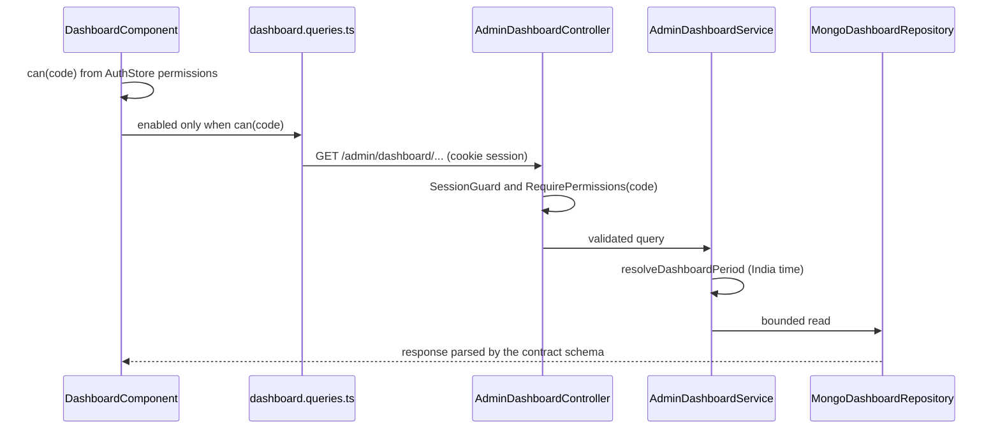

# Admin home page

The admin home page (`/dashboard`) is the first screen an operator sees after sign-in. It shows sales, orders, customers, stock and reviews, and each widget is authorized on its own. This page is for developers changing a widget or its data, and for administrators deciding which roles see which figures.

## How it works

Each widget has one permission code. The page shows a widget only when the signed-in operator holds its code, and the matching API route refuses the request without it. Hiding the widget is a convenience; the API check is the control.



1. `DashboardComponent` reads the operator's permissions from `AuthStore` and passes `can(code)` as the `enabled` flag of each TanStack query. A widget the operator cannot see sends no request.
2. The template wraps each widget in `*hasPermission`. When the operator holds none of the widget codes, the page shows one message instead of an empty grid.
3. Each route declares `@RequirePermissions` with the widget's code. A request without it receives 403, whether it comes from the page or from anywhere else.
4. The service turns the period into exact instants with `resolveDashboardPeriod` from `packages/core-domain/src/dashboard`, then calls the `DashboardRepository` port.
5. Every read is bounded by a period, a fixed row limit, or both. No route reads a whole collection.

## Reference

### Widgets

| Widget               | Permission               | Source                                          | Shows                                                                 |
| -------------------- | ------------------------ | ----------------------------------------------- | --------------------------------------------------------------------- |
| Total Revenue        | `dashboard.revenue`      | `GET /admin/dashboard/revenue`                  | Amount paid in the chosen period                                      |
| Monthly Revenue      | `dashboard.revenue`      | `GET /admin/dashboard/revenue/monthly`          | Amount paid in each of the last 12 months                             |
| Total Orders         | `dashboard.orders`       | `GET /admin/dashboard/orders`                   | Purchased orders in the chosen period                                 |
| Recent Orders        | `dashboard.orders`       | `GET /admin/dashboard/orders/recent`            | The 5 newest orders in any status                                     |
| Total Customers      | `dashboard.customers`    | `GET /admin/dashboard/customers`                | Customer accounts, leaving out deleted ones                           |
| Top Selling Products | `dashboard.top_products` | `GET /admin/dashboard/top-products`             | The 4 products with the most units sold in the chosen period          |
| Product Stock Report | `dashboard.stock`        | `GET /admin/dashboard/stock`                    | The 8 live variants with the lowest stock, optionally in one category |
| Latest reviews       | `dashboard.reviews`      | `GET /admin/dashboard/reviews`                  | The 4 newest reviews in any moderation state                          |
| Total Stores         | `setting.index`          | Settings › Stores (`injectStoreLocationsQuery`) | Active store locations                                                |
| Latest blogs         | `blog.index`             | `GET /admin/blog/posts`                         | The 2 newest blog posts                                               |

The six `dashboard.*` codes live in the closed permission registry in `packages/contracts/src/permission.ts` and appear on the role screen under **Dashboard**. No navigation entry uses them, so the registry marks them server-only. The `administrator` system role receives them from `seed:system-roles`, which does not run when the API starts.

The category filter on Product Stock Report reads categories, so it shows only with `category.index`. Review rows link to the review screen only with `review.index`.

### Revenue and orders

- Revenue is the amount paid: the sum of `totalINR` of purchased orders, including shipping and after discounts.
- A purchased order has a status in `PURCHASED_ORDER_STATUSES`: `paid`, `processing`, `shipped` or `delivered`. Revenue, order counts and top sellers leave out pending, cancelled and refunded orders.
- Recent Orders lists orders in any status, newest first, so the operator also sees pending and cancelled orders.
- Monthly Revenue groups orders by calendar month in India time (`Asia/Kolkata`), so an order placed late at night lands in the right month. A month without sales shows zero.

### Periods

The Total Revenue and Total Orders tiles each carry their own period picker (`app-period-picker` in `shared/ui/period-picker`). Both default to the last 12 months. The query string is `?period=<value>`, plus `from` and `to` for a custom period.

| `period`          | Range read                                                       |
| ----------------- | ---------------------------------------------------------------- |
| `last_12_months`  | This calendar month and the eleven before it, up to now          |
| `last_30_days`    | Today and the 29 days before it, up to now                       |
| `last_month`      | The previous calendar month                                      |
| `last_quarter`    | The previous calendar quarter                                    |
| `current_quarter` | This calendar quarter, up to now                                 |
| `custom`          | `from` to `to`, both calendar days, inclusive                    |
| `today`           | Today, up to now (Top Selling Products filter)                   |
| `last_week`       | The previous Monday-to-Sunday week (Top Selling Products filter) |
| `this_year`       | This calendar year, up to now (Top Selling Products filter)      |

- Every day starts at midnight in India, not at UTC midnight. India has no daylight saving, so one fixed offset is exact.
- `last_12_months` covers the same months as the Monthly Revenue chart, so the tile and the chart add up to the same figure.
- A custom period spans at most `DASHBOARD_CUSTOM_RANGE_MAX_MONTHS` (24) months, and `from` must not be after `to`. The contract refuses anything else with 400.
- The picker repeats the limit as `CUSTOM_RANGE_MAX_MONTHS`, because the admin imports only types from `@saha-textile/contracts`. A spec holds the two values equal.

### Stock states

`dashboardStockState` gives each variant one state, using the same rule as the storefront's Low stock badge:

1. A quantity of zero or less is **Out of stock**.
2. Otherwise the threshold is the variant's `lowStockThreshold`, else the product's, else `SHOP_LOW_STOCK_THRESHOLD` (2).
3. A quantity at or below the threshold is **Low stock**. Above it is **In stock**.

Only live variants of live products with tracked stock appear, sorted by quantity, lowest first.

### Row limits and indexes

`DASHBOARD_LIST_LIMITS` sets the row count of each list: recent orders 5, top products 4, stock 8, reviews 4. The API never returns more.

| Collection        | Index                                                            | Serves                             |
| ----------------- | ---------------------------------------------------------------- | ---------------------------------- |
| `orders`          | `{ createdAt: -1 }`                                              | Recent Orders                      |
| `orders`          | `{ status: 1, createdAt: -1 }`                                   | Revenue, order counts, top sellers |
| `productVariants` | `{ status: 1, 'stock.tracked': 1, 'stock.quantity': 1, _id: 1 }` | Product Stock Report               |
| `reviews`         | `{ createdAt: -1 }`                                              | Latest reviews                     |

## Procedures

### Give a role access to some widgets

1. Open **Roles** and edit the role.
2. Under **Dashboard**, tick the codes for the widgets the role should see.
3. Save. Holders see the change on their next request, because a role change invalidates their permission version.

### Give the administrator role new widget codes

New codes reach the `administrator` role only when you run the seed:

```bash
pnpm --filter @saha-textile/adapters-db-mongo seed:system-roles
```

Until you run it, the administrator's new widgets stay hidden and their routes return 403.

### Add a widget

1. Add a code to the registry in `packages/contracts/src/permission.ts`, with a server-only reason when no navigation entry uses it.
2. Add the response schema to `packages/contracts/src/dashboard.ts` and a method to the `DashboardRepository` port.
3. Implement the method in `MongoDashboardRepository` with a period or a row limit, and add an index for its sort.
4. Add the route to `AdminDashboardController` with `@RequirePermissions`, then run `pnpm check:route-authorization` and `pnpm check:route-contracts`.
5. Add the code to `WIDGET_PERMISSIONS` in `features/dashboard/dashboard.ts`, gate the widget with `*hasPermission`, and pass `can(code)` as the query's `enabled` flag.
6. Feed tables from signals. A table config object changed in place does not redraw when no other widget triggers change detection.
7. Test the page with a role that holds only the new code.

## Limitations

- The response shapes in `packages/contracts/src/dashboard.ts` serve the home page only. They will change when the order, stock and report screens define these figures, so nothing else should depend on them.
- The Monthly Revenue chart draws a commission line from JSON demo data beside the real revenue line. It is not real money.
- The **View** action on Recent Orders opens the order screen, which reads JSON demo data.

## Related pages

- [Admin overview](./overview)
- [Admin state and data](./state-and-data)
- [Security and identity](../backend/security-and-identity)
- [Route inventory](../api/route-inventory)
