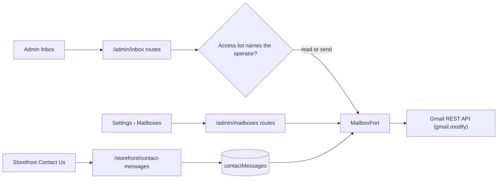

# Inbox and Mailboxes

Staff read and answer the shop's Google Workspace mailboxes inside the admin. Gmail is the only mail engine and the only copy of every message: the API reads each mailbox live and stores no message content. Staff never sign in to Google themselves.

This page is for developers changing the Inbox, the Mailboxes settings page, the Gmail adapter or the Contact Us form.

## Before you begin

- Read [Core domain and ports](../backend/core-domain-and-ports) for `MailboxPort` and the mailbox repositories.
- The Gmail adapter needs a Google OAuth client and its redirect address. Without them the API binds `UnavailableMailboxAdapter`, the Inbox lists no mailboxes and Contact Us messages wait in the database.
- Two permissions control the area: `mailbox.manage` for Settings › Mailboxes and `mailbox.use` for the Inbox.
- Real-mailbox testing needs a Workspace mailbox on `MAILBOX_DOMAIN`. Local work and the browser tests answer Gmail calls themselves.

## How it works



### Connecting a mailbox

A super admin connects a mailbox once through Google's own sign-in. Every Settings › Mailboxes route needs `mailbox.manage` and the system Administrator role (`SUPER_ADMIN_ROLE_KEY`); the permission alone is not enough.

- **Scopes.** The sign-in asks for `gmail.modify` (read, send, label, Bin), `gmail.settings.basic` (filters, vacation reply, signature) and full mail access (`https://mail.google.com/`), which Gmail requires for permanent delete. The scopes Google granted are stored per mailbox. A mailbox connected with fewer scopes keeps working; `needsReconnectFor` lists the features it cannot use until a super admin connects it again, and those routes answer 409 `mailbox_reconnect_for_feature`.
- **Sign-in state.** The OAuth `state` is signed with a key derived from `MAILBOX_TOKEN_KEY`, expires after 10 minutes, and its nonce is stored hashed in `oauthStates` so it works once. The callback trusts the state, not the session cookie, because the access cookie can expire while someone reads Google's consent screen. It then checks that the admin who started it is still an active super admin.
- **Allowed addresses.** Only addresses on `MAILBOX_DOMAIN` are accepted.
- **Tokens.** The refresh token is encrypted before it is stored. See [Mailbox tokens](../backend/security-and-identity#mailbox-tokens).
- **Aliases.** The mailbox's Gmail send-as addresses, with their display names and signatures, are read at connection. **Refresh aliases** reads them again; it is separate from the Inbox's Refresh. An alias that Gmail refuses during a send is dropped from the stored list.
- **Disconnecting.** **Disconnect** stops the mailbox at once, then asks Google to withdraw the grant. When Google confirms, the token is forgotten (`revocation: done`). When it does not, the encrypted token is kept only so **Try again** (`withdraw-again`) can ask once more (`revocation: failed`); the mailbox cannot be used either way.
- **Withdrawn grants.** When Google withdraws a grant, the mailbox is marked as needing reconnection and its calls answer 409.

### Access

Each mailbox has its own access list. A person's rights in one mailbox come from `mailboxRights()` in `packages/core-domain/src/mailbox`, and every Inbox call checks the right it needs. No row means no access.

| Right            | Allows                                                              |
| ---------------- | ------------------------------------------------------------------- |
| `read`           | Open the mailbox, read, download attachments, mark read or unread   |
| `send`           | Write, reply and forward                                            |
| `organise`       | Archive, move to Inbox, spam, star, important, add or remove labels |
| `bin`            | Move to the Bin and restore                                         |
| `delete_forever` | Delete from the Bin for good, and Empty Bin                         |
| `labels`         | Create, rename and delete labels                                    |
| `settings`       | Basic Gmail settings and the mailbox's shared saved replies         |

- **Needed rights.** Each right brings the ones it cannot work without (`withNeededRights`): everything needs `read`, and `delete_forever` needs `bin`.
- **Older rows.** Data migration `0007-mailbox-rights` turns Read into `read` and Read-and-send into `read`, `send`, `organise` and `bin`. It grants nobody `delete_forever`, `labels` or `settings`. `canSend` is still written for older builds.
- **Unknown mailboxes.** A mailbox the operator has no right in answers 404, so its existence is not revealed. A missing right answers 403.
- **Super admin.** The super admin manages mailboxes but reads one only when its access list names them.
- **Editing the list.** The Access popup lists the people the server names, then adds people found by `GET /admin/mailboxes/people`, which searches every page of the admin directory. Save sends the list with the version it was read at; a newer version answers 409 and nothing is written. Save stays off until the current list has loaded.
- **Access changes.** Every access change is written to the audit trail with counts, and kept as long as security records.

### Reading

- **Layout.** The Inbox shows folders, the conversation list and the reading pane side by side on a wide screen, and one column at a time on a phone.
- **Folders.** Inbox, Starred, Important, Sent, All mail, Spam and Bin map to Gmail labels in `FOLDER_LABELS`.
- **Labels and categories.** The sidebar lists the mailbox's own labels, nested by "/" in their names, and the category tabs the mailbox uses, each with its unread count. Labels hidden in Gmail stay hidden. A conversation can carry several labels; they are shown as chips, not as folders it lives in. Nothing about labels is stored here.
- **Search.** Search runs over All mail with Gmail's own query syntax.

The page address names the place the operator is in:

| Address                                              | Shows                                            |
| ---------------------------------------------------- | ------------------------------------------------ |
| `/inbox`                                             | The last mailbox and folder used in this browser |
| `/inbox/<mailbox>/<folder>`                          | One folder of one mailbox                        |
| `/inbox/<mailbox>/<labelId>`                         | One label (`Label_…`) or category (`CATEGORY_…`) |
| `/inbox/<mailbox>/<folder>/<threadId>`               | One open conversation                            |
| `/inbox/<mailbox>/drafts`                            | The mailbox's Gmail drafts                       |
| `…?draft=reply` (also `reply_all`, `forward`, `new`) | The compose box                                  |
| `…?draft=open&d=<draftId>`                           | A Gmail draft, reopened in the compose box       |
| `…?q=<words>`                                        | Search results                                   |

`<mailbox>` is the part of the address before `@`. One matcher route (`inboxMatcher` in `inbox.routes.ts`) serves every form, so moving between them keeps the page. **Back** steps out one level at a time. A shared link opens the same conversation for a colleague, still checked against that colleague's own access. An address that names a mailbox the operator cannot open moves them to one they can open and says why.

The counts, labels, list and open conversation are read again every minute (`INBOX_REFRESH_MS`). **Refresh** asks for all of them at once and shows when Gmail last answered; a second click while one runs does nothing.

- **New conversations.** At the top of the first page of a folder, with no search, nothing ticked and nothing open, they slide into place with a short tint (none with reduced motion). Anywhere else they wait behind "N new · Show".
- **New replies in the open conversation.** They wait behind "N new replies · Show" and stay unread in Gmail until shown. Folded messages, quotes, pictures and message frames already on screen are kept.
- **Read state.** Opening a conversation marks exactly the unread messages shown (`POST …/messages/read`), never the conversation as a whole. A failed mark is tried again the next time they show; **Mark unread** is respected.
- **Unread counts.** When Gmail does not answer for a mailbox, its count is unknown (`unread: null`) and shows as "—", never 0.

### Selection, labels and the Bin

- **Selection.** Each row has a checkbox; Select all ticks the current page and shows a mixed state for part of it. "Select all about N" acts on every conversation that matches, read on the server when the action runs (up to 5,000). With rows ticked, the toolbar offers the actions the folder and the person's rights allow. Changing mailbox, folder, label, search or page clears the selection, and a refresh never ticks new arrivals.
- **Bulk results.** `POST …/bulk` reports each conversation as done or failed with a reason. Failed ones stay ticked with a **Retry** for just those.
- **Labels.** People with `labels` create, rename and delete labels. Deleting a label keeps every conversation's mail and other labels. A link to a label Gmail has since deleted lands on the Inbox with a note.
- **Delete.** Outside the Bin, Delete moves to the Bin. Inside the Bin it asks before deleting for good. **Empty Bin** has its own question with Gmail's counts. The API reads each conversation's labels from Gmail when the action runs and deletes only messages in the Bin; a conversation partly in the Bin keeps its other messages and is reported as partly kept.

### Showing a message

Mail HTML passes two barriers before anyone sees it.

1. `cleanEmailHtml()` in the Gmail adapter removes scripts, forms, frames, event handlers and style sheets. Links open in a new tab with no referrer. Pictures on other servers are not fetched until someone chooses to show them, because a remote picture can report that the mail was opened. Inline `cid:` pictures (up to 10 per conversation) become `data:` addresses. Links whose words show one address and open another are marked with the real address.
2. The admin renders each message in a sandboxed frame with no scripts.

`cleanEmailHtml()` also splits off quoted history (Gmail, Outlook, Yahoo, Thunderbird and Apple Mail quote styles) into `quoteHtml`, which the reading pane folds behind a **Show quoted text** control.

- **Plain-text form.** A message sent as HTML only gets a plain-text form from `htmlToText()`, used for folded lines, forwards and the plain-text quote in a reply.
- **Folded messages.** Older read messages in a conversation fold to one line.
- **Very large mail.** A message with over 1 MB of formatted mail (`LARGE_MESSAGE_HTML_CHARS`) opens as plain text first, with **Show formatted version**.
- **Attachments.** Attachments always download. Files that can run programs ask before downloading.

### Sending

- **From address.** A reply goes out from the alias the customer wrote to, so the conversation stays on one address. It goes to the message's Reply-To when there is one. Contact Us messages carry the customer's address there.
- **Signature and threading.** The API adds the chosen address's Gmail signature and the conversation's full `References` chain.
- **Quote.** When the operator keeps the quote, the API builds it from the answered message as Gmail holds it, never from text sent by the browser.
- **Forwards.** A forward can carry the original attachments, which the API copies from Gmail on the server.
- **Limits.** Uploaded attachments may total 10 MB (`MAX_SEND_ATTACHMENT_BYTES`), with at most 10 files. A forward with copied attachments may total 25 MB (`MAX_FORWARD_BYTES`).
- **Signing out.** `forgetMailboxData` removes every Inbox and Mailboxes query and the tab's unsent drafts whenever the admin session ends, so the next person on the same browser sees none of it.
- **Collision check.** Before sending a reply, the admin reads the conversation again. If someone answered after the reply was started, sending stops and names who answered. The operator can read what arrived and keep their reply, or choose **Send anyway**. The check runs in the admin because the API's error filter returns only standard error bodies.
- **Unsent text.** The tab also keeps a copy of each draft in `sessionStorage`, per mailbox, conversation and mode, so a reload or a lost connection keeps the text. Closing the tab with unsent text asks first.

### Drafts and Undo Send

- **Saved to Gmail.** The compose box saves to a Gmail draft three seconds after typing stops (`AUTOSAVE_MS`). A reply opened and left untouched makes no draft. The line beside **Send** says **Saved to Gmail** with the time only after the API has answered, and says when a save failed or the browser is offline.
- **What a draft holds.** A draft holds the typed text, the addresses and the uploaded files. The signature, the quote and a forward's original files are added when it is sent. Two headers, `X-Saha-Textile-Quote` and `X-Saha-Textile-Forward`, record the quote and forward choices so a draft reopens as it was left; a sent message carries neither.
- **Files.** A file is uploaded with the first save after it is picked. Later saves ask the API to keep the files already in the draft (`keepAttachments`), and the API copies them from Gmail into the new version.
- **Two writers.** Each save names the draft version it last saw. When someone saved the draft since, the API answers `412 draft_changed` and the compose box offers **Use theirs** or **Keep mine**.
- **Drafts folder.** People with the Send right see the mailbox's Gmail drafts, including ones written in Gmail itself, and reopen them in the compose box. A reply being written is left out of its conversation, so it never counts as someone else's reply.
- **Discard.** **Discard** deletes the Gmail draft, after asking when there is text to lose. When Gmail refuses, the text stays.
- **Undo Send.** **Send** saves the finished message, with its signature and quote, as a Gmail draft and answers at once. The message goes ten seconds later (`UNDO_SEND_SECONDS`); a toast offers **Undo** until then. **Undo** leaves the message in Drafts and reopens it. Closing the tab does not stop the send.
- **The outbox.** Each waiting message is a row in `mailboxOutbox` (ids and counts only, removed after seven days). `UndoSendDispatcher` in the API sends what is due every two seconds, so a restart loses nothing. Each row is claimed in one atomic step, so several API instances never send it twice, and the writer's Send right is checked again at that moment.
- **Lost answers.** A message gets its own `Message-ID`. When Gmail's answer to a send is lost, the API looks for that id in Sent, then for the draft, before anything is tried again: found in Sent means sent, a draft still there means try again (three tries in all), neither for a minute means gone. A message is never sent twice on a guess. The admin reports the outcome once: sent, not sent (still in Drafts), gone, or unconfirmed.
- **Purchase orders.** Purchase orders are emailed at once through `InboxService.send()`, without the wait.

### Saved replies

Saved replies are short answers written once, such as delivery times or return steps. **Saved replies** in the compose box puts one at the cursor, ready to change before sending; nothing is sent by choosing one.

- **Shared** replies belong to one mailbox. Everyone with the Send right there can use them; only people with that mailbox's Settings right can add, change or delete them.
- **Personal** replies belong to one admin user, who can use them in any mailbox they may send from. Nobody else sees them.
- The Send right in the mailbox named is needed for every call. Another person's reply, or another mailbox's shared reply, answers 404.
- Each mailbox and each person can keep up to 100 (`MAX_SAVED_REPLIES`). They are plain text, in the `savedReplies` collection. Every change writes a `mailbox.saved_reply_changed` audit record with the reply's id and scope, never its text.

Every send writes a `mailbox.message_sent` audit record with Gmail's message and thread ids. Gmail records only that the mailbox sent a message; the Inbox reads these records to show which operator sent each reply from the admin.

### Gmail calls

`GmailMailbox` in `packages/adapters-mail-gmail` keeps Gmail traffic inside the mailbox quota.

| Concern                 | Behaviour                                                                                         |
| ----------------------- | ------------------------------------------------------------------------------------------------- |
| Page size               | 20 conversations, so one page stays inside one second's quota                                     |
| Parallel calls          | At most 8 Gmail calls in flight across all mailboxes; more queue                                  |
| Rate-limit retries      | A call Gmail refuses as too fast is retried after 500 ms and again after 1,500 ms                 |
| List cache              | A folder page is reused while the mailbox's `historyId` is unchanged (200 pages kept)             |
| Conversation-line cache | A list line is reused while that conversation's `historyId` is unchanged (5,000 lines kept)       |
| Errors                  | A withdrawn grant answers 409, Gmail's rate limit 429, any other Gmail failure 502 with no detail |
| Last checked            | Written at most every 5 minutes per mailbox, however many people have it open                     |
| Label list              | Reused while the mailbox's `historyId` is unchanged; counts read once per label otherwise         |
| Batch changes           | `messages.batchModify` and `messages.batchDelete`, at most 1,000 ids per call                     |

The API checks for new mail by reading on request. It uses no push notifications and no Google Cloud billing.

### Contact Us

The storefront's Contact Us form posts to `/storefront/contact-messages`. `ContactMessagesService` stores the message first, so none is lost while Gmail is unreachable or no mailbox is chosen. It then places the message in the mailbox chosen in Settings › Mailboxes with Gmail import. The message arrives in that Inbox unread, from the customer, with Reply-To set to the customer, and states the language to reply in.

- **Spam checks.** The form has built-in checks only: a hidden field, a minimum of three seconds on the form, stored rate limits, at most three links (`MAX_CONTACT_LINKS`) and a 24-hour repeat check. A bot or a repeat gets the same answer as a real message.
- **Retries.** Waiting messages are retried every 5 minutes for 72 hours, then stay `failed`.
- **Not MSG91.** Contact Us messages never use `NotificationPort`. MSG91 email carries only one-time codes and the newsletter.

## Reference

| Concern                              | Repository source                                                                       |
| ------------------------------------ | --------------------------------------------------------------------------------------- |
| Request and response shapes, limits  | `packages/contracts/src/mailbox.ts`                                                     |
| Rights, folder labels, reply subject | `packages/core-domain/src/mailbox/mailbox-rules.ts`                                     |
| Gmail adapter                        | `packages/adapters-mail-gmail/src/gmail-mailbox.ts`                                     |
| HTML cleaning and quote split        | `packages/adapters-mail-gmail/src/clean-html.ts`                                        |
| Inbox and send rules                 | `apps/api/src/mailboxes/inbox.service.ts`                                               |
| Sign-in state, audit, error mapping  | `apps/api/src/mailboxes/mailbox-support.ts`                                             |
| Contact Us delivery                  | `apps/api/src/mailboxes/contact-messages.service.ts`                                    |
| Inbox screen                         | `apps/admin/src/app/features/inbox/inbox.ts`                                            |
| Reply addressing and drafts          | `apps/admin/src/app/features/inbox/inbox-drafts.ts`                                     |
| Undo Send outbox                     | `apps/api/src/mailboxes/undo-send.dispatcher.ts`                                        |
| Saved replies                        | `apps/api/src/mailboxes/saved-replies.service.ts`                                       |
| Mailboxes settings                   | `apps/admin/src/app/features/setting/mailboxes/mailboxes.ts`                            |
| Routes                               | [Admin mailbox and inbox routes](../api/route-inventory#admin-mailbox-and-inbox-routes) |

## Procedure: test a change

1. Run the unit tests for the parts you changed:

    ```bash
    pnpm --filter @saha-textile/adapters-mail-gmail test
    pnpm --filter @saha-textile/admin test
    pnpm --filter @saha-textile/api test
    ```

2. Run the browser journey. `e2e/inbox.admin.spec.ts` answers the admin's `/admin/inbox` calls itself and runs in the `admin` Playwright project. It covers the list, the page address and Back, folded messages, a reply's address and quote, and the collision stop. `pnpm e2e:stack` runs it with the rest of the admin journeys against a throwaway database. Set `E2E_ADMIN_URL` to point it at an admin on another address.
3. Docker mode (`pnpm stack:up`) receives Google's mailbox callback on `https://localhost:4000/admin/mailboxes/oauth/callback`, the dev client's registered address: the stack edge answers only that path on port 4000. See `docker/stack/README.md`.
4. After changing the admin's global SCSS, run `pnpm --filter @saha-textile/admin styles`. A running dev server does not rebuild `app.gen.css` by itself.

## Limitations

- The browser journey and unit tests do not reach Gmail. Sign-in, sending, import, labels and permanent delete need a real Workspace mailbox to verify.
- Files already saved in a draft are removed together, by discarding the draft, or one at a time in Gmail.
- A reply reopened from Drafts sends without the collision check, because the compose box cannot know which messages its writer had read.
- Finding a send whose answer was lost relies on Gmail keeping the message's own `Message-ID`, which is unconfirmed until it is tried on a real mailbox. Without it such a send ends as unconfirmed, never as a second copy.
- A sent message cannot be recalled after the ten seconds.
- Saved replies are plain text; formatting in them is not kept.
- Gmail settings (filters, vacation reply, signature) are managed in Gmail.
- Whether Gmail's own filters run on mail placed by import (Contact Us) is unconfirmed until it is tried on a real mailbox.

## Related pages

- [Security and identity](../backend/security-and-identity)
- [Composition and adapters](../backend/composition-and-adapters)
- [Notifications](../business-flows/returns-refunds-and-notifications)
- [Languages](../maintenance/languages)
