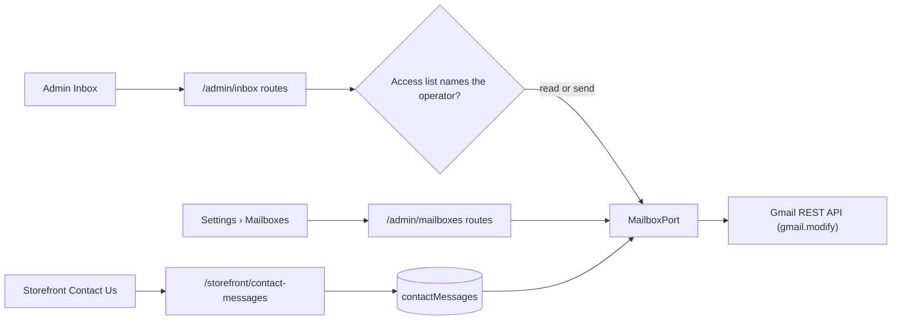

# Inbox and Mailboxes

Staff read and answer the shop's Google Workspace mailboxes inside the admin. Gmail is the only mail engine and the only copy of every message: the API reads each mailbox live and stores no message content. Staff never sign in to Google themselves.

This page is for developers changing the Inbox, the Mailboxes settings page, the Gmail adapter or the Contact Us form.

## Before you begin

- Read [Core domain and ports](../backend/core-domain-and-ports) for `MailboxPort` and the mailbox repositories.
- The Gmail adapter needs a Google OAuth client and its redirect address. Without them the API binds `UnavailableMailboxAdapter`, the Inbox lists no mailboxes and Contact Us messages wait in the database.
- Two permissions control the area: `mailbox.manage` for Settings › Mailboxes and `mailbox.use` for the Inbox.
- Real-mailbox testing needs a Workspace mailbox on `MAILBOX_DOMAIN`. Local work and the browser tests answer Gmail calls themselves.

## How it works



### Connecting a mailbox

A holder of `mailbox.manage` connects a mailbox once through Google's own sign-in, using the `gmail.modify` scope. That scope reads, sends, labels and trashes. It never deletes permanently and never changes Gmail settings.

- **Sign-in state.** The OAuth `state` is signed with a key derived from `MAILBOX_TOKEN_KEY` and expires after 10 minutes. The callback trusts the state, not the session cookie, because the access cookie can expire while someone reads Google's consent screen.
- **Allowed addresses.** Only addresses on `MAILBOX_DOMAIN` are accepted.
- **Tokens.** The refresh token is encrypted before it is stored. See [Mailbox tokens](../backend/security-and-identity#mailbox-tokens).
- **Aliases.** The mailbox's Gmail send-as addresses, with their display names and signatures, are read at connection. **Refresh** reads them again. An alias that Gmail refuses during a send is dropped from the stored list.
- **Disconnecting.** **Disconnect** withdraws the grant at Google and forgets the token.
- **Withdrawn grants.** When Google withdraws a grant, the mailbox is marked as needing reconnection and its calls answer 409.

### Access

Each mailbox has its own access list. An operator's right in one mailbox is `none`, `read` or `send`, and `mailboxRight()` in `packages/core-domain/src/mailbox` is checked on every Inbox call.

| Right  | Allows                                                                              |
| ------ | ----------------------------------------------------------------------------------- |
| `read` | Open the mailbox, read conversations, download attachments, mark read or unread     |
| `send` | Everything `read` allows, plus write, reply, forward, archive, move, trash and spam |

- **Unknown mailboxes.** A mailbox the operator has no right in answers 404, so its existence is not revealed.
- **Super admin.** The super admin manages mailboxes but reads one only when its access list names them.
- **Access changes.** Every access change is written to the audit trail and kept as long as security records.

### Reading

- **Layout.** The Inbox shows folders, the conversation list and the reading pane side by side on a wide screen, and one column at a time on a phone.
- **Folders.** Inbox, Sent, All mail, Spam and Trash map to Gmail labels in `FOLDER_LABELS`.
- **Search.** Search runs over All mail with Gmail's own query syntax.

The page address names the place the operator is in:

| Address                                              | Shows                                            |
| ---------------------------------------------------- | ------------------------------------------------ |
| `/inbox`                                             | The last mailbox and folder used in this browser |
| `/inbox/<mailbox>/<folder>`                          | One folder of one mailbox                        |
| `/inbox/<mailbox>/<folder>/<threadId>`               | One open conversation                            |
| `…?draft=reply` (also `reply_all`, `forward`, `new`) | The compose box                                  |
| `…?q=<words>`                                        | Search results                                   |

`<mailbox>` is the part of the address before `@`. One matcher route (`inboxMatcher` in `inbox.routes.ts`) serves every form, so moving between them keeps the page. **Back** steps out one level at a time. A shared link opens the same conversation for a colleague, still checked against that colleague's own access. An address that names a mailbox the operator cannot open moves them to one they can open and says why.

The list refreshes every minute (`INBOX_REFRESH_MS`). New conversations do not reshuffle the list under the pointer: they wait behind a "new conversations · Show" line. Changes to rows already shown apply in place.

### Showing a message

Mail HTML passes two barriers before anyone sees it.

1. `cleanEmailHtml()` in the Gmail adapter removes scripts, forms, frames, event handlers and style sheets. Links open in a new tab with no referrer. Pictures on other servers are not fetched until someone chooses to show them, because a remote picture can report that the mail was opened. Inline `cid:` pictures (up to 10 per conversation) become `data:` addresses. Links whose words show one address and open another are marked with the real address.
2. The admin renders each message in a sandboxed frame with no scripts.

`cleanEmailHtml()` also splits off quoted history (Gmail, Outlook, Yahoo, Thunderbird and Apple Mail quote styles) into `quoteHtml`, which the reading pane folds behind a **Show quoted text** control.

- **Plain-text form.** A message sent as HTML only gets a plain-text form from `htmlToText()`, used for folded lines, forwards and the plain-text quote in a reply.
- **Folded messages.** Older read messages in a conversation fold to one line.
- **Attachments.** Attachments always download. Files that can run programs ask before downloading.

### Sending

- **From address.** A reply goes out from the alias the customer wrote to, so the conversation stays on one address. It goes to the message's Reply-To when there is one. Contact Us messages carry the customer's address there.
- **Signature and threading.** The API adds the chosen address's Gmail signature and the conversation's full `References` chain.
- **Quote.** When the operator keeps the quote, the API builds it from the answered message as Gmail holds it, never from text sent by the browser.
- **Forwards.** A forward can carry the original attachments, which the API copies from Gmail on the server.
- **Limits.** Uploaded attachments may total 10 MB (`MAX_SEND_ATTACHMENT_BYTES`), with at most 10 files. A forward with copied attachments may total 25 MB (`MAX_FORWARD_BYTES`).
- **Collision check.** Before sending a reply, the admin reads the conversation again. If someone answered after the reply was started, sending stops and names who answered. The operator can read what arrived and keep their reply, or choose **Send anyway**. The check runs in the admin because the API's error filter returns only standard error bodies.
- **Unsent text.** Drafts are kept in `sessionStorage` per mailbox, conversation and mode. Closing the tab with unsent text asks first, and **Discard** asks when there is text to lose.

Every send writes a `mailbox.message_sent` audit record with Gmail's message and thread ids. Gmail records only that the mailbox sent a message; the Inbox reads these records to show which operator sent each reply from the admin.

### Gmail calls

`GmailMailbox` in `packages/adapters-mail-gmail` keeps Gmail traffic inside the mailbox quota.

| Concern                 | Behaviour                                                                                         |
| ----------------------- | ------------------------------------------------------------------------------------------------- |
| Page size               | 20 conversations, so one page stays inside one second's quota                                     |
| Parallel calls          | At most 8 Gmail calls in flight across all mailboxes; more queue                                  |
| Rate-limit retries      | A call Gmail refuses as too fast is retried after 500 ms and again after 1,500 ms                 |
| List cache              | A folder page is reused while the mailbox's `historyId` is unchanged (200 pages kept)             |
| Conversation-line cache | A list line is reused while that conversation's `historyId` is unchanged (5,000 lines kept)       |
| Errors                  | A withdrawn grant answers 409, Gmail's rate limit 429, any other Gmail failure 502 with no detail |
| Last checked            | Written at most every 5 minutes per mailbox, however many people have it open                     |

The API checks for new mail by reading on request. It uses no push notifications and no Google Cloud billing.

### Contact Us

The storefront's Contact Us form posts to `/storefront/contact-messages`. `ContactMessagesService` stores the message first, so none is lost while Gmail is unreachable or no mailbox is chosen. It then places the message in the mailbox chosen in Settings › Mailboxes with Gmail import. The message arrives in that Inbox unread, from the customer, with Reply-To set to the customer, and states the language to reply in.

- **Spam checks.** The form has built-in checks only: a hidden field, a minimum of three seconds on the form, stored rate limits, at most three links (`MAX_CONTACT_LINKS`) and a 24-hour repeat check. A bot or a repeat gets the same answer as a real message.
- **Retries.** Waiting messages are retried every 5 minutes for 72 hours, then stay `failed`.
- **Not MSG91.** Contact Us messages never use `NotificationPort`. MSG91 email carries only one-time codes and the newsletter.

## Reference

| Concern                              | Repository source                                                                       |
| ------------------------------------ | --------------------------------------------------------------------------------------- |
| Request and response shapes, limits  | `packages/contracts/src/mailbox.ts`                                                     |
| Rights, folder labels, reply subject | `packages/core-domain/src/mailbox/mailbox-rules.ts`                                     |
| Gmail adapter                        | `packages/adapters-mail-gmail/src/gmail-mailbox.ts`                                     |
| HTML cleaning and quote split        | `packages/adapters-mail-gmail/src/clean-html.ts`                                        |
| Inbox and send rules                 | `apps/api/src/mailboxes/inbox.service.ts`                                               |
| Sign-in state, audit, error mapping  | `apps/api/src/mailboxes/mailbox-support.ts`                                             |
| Contact Us delivery                  | `apps/api/src/mailboxes/contact-messages.service.ts`                                    |
| Inbox screen                         | `apps/admin/src/app/features/inbox/inbox.ts`                                            |
| Reply addressing and drafts          | `apps/admin/src/app/features/inbox/inbox-drafts.ts`                                     |
| Mailboxes settings                   | `apps/admin/src/app/features/setting/mailboxes/mailboxes.ts`                            |
| Routes                               | [Admin mailbox and inbox routes](../api/route-inventory#admin-mailbox-and-inbox-routes) |

## Procedure: test a change

1. Run the unit tests for the parts you changed:

    ```bash
    pnpm --filter @saha-textile/adapters-mail-gmail test
    pnpm --filter @saha-textile/admin test
    pnpm --filter @saha-textile/api test
    ```

2. Run the browser journey. `e2e/inbox.admin.spec.ts` answers the admin's `/admin/inbox` calls itself and runs in the `admin` Playwright project. It covers the list, the page address and Back, folded messages, a reply's address and quote, and the collision stop. `pnpm e2e:stack` runs it with the rest of the admin journeys against a throwaway database. Set `E2E_ADMIN_URL` to point it at an admin on another address.
3. After changing the admin's global SCSS, run `pnpm --filter @saha-textile/admin styles`. A running dev server does not rebuild `app.gen.css` by itself.

## Limitations

- The browser journey and unit tests do not reach Gmail. Sign-in, sending and import need a real Workspace mailbox to verify.
- Very large messages are cleaned and sent whole; there is no plain-text-first view for them.
- A sent message cannot be recalled, there are no saved replies, and actions apply to one conversation at a time.
- Only the five folders are shown. Other Gmail labels stay in Gmail.

## Related pages

- [Security and identity](../backend/security-and-identity)
- [Composition and adapters](../backend/composition-and-adapters)
- [Notifications](../business-flows/returns-refunds-and-notifications)
- [Languages](../maintenance/languages)
