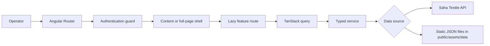

# Admin orientation

The admin application is the private workspace for operators. It covers catalogue, orders, customers, promotions, content, configuration and reporting. It is an Angular 22 single-page application with lazy-loaded feature routes.

## Recommended reading sequence

1. [Application atlas](./application-atlas): filter features by status.
2. [Routing and shell](./routing-and-shell): follow a URL through guards, layouts and feature routes.
3. [State and data](./state-and-data): understand queries, stores, interceptors and data sources.
4. [Forms, tables, and CRUD](./forms-tables-and-crud): use the established interaction patterns.
5. [Contributor recipes](./contributor-recipes): add a feature step by step.

## Mental model

## Capabilities

| Capability       | How it works                                                                          |
| ---------------- | ------------------------------------------------------------------------------------- |
| Route graph      | Authentication, two shells, a fallback and about 30 lazy feature families             |
| Admin shell      | Header, sidebar, footer, loader and page wrapper                                      |
| Authentication   | Cookie sessions, password and PIN sign-in, recovery, invites and the idle lock        |
| Account Security | PIN, password and session management at `/account`                                    |
| Authority        | Roles, operators and role assignments against the permission registry                 |
| Customers        | List, create, edit, soft delete, recycle bin, restore and customer ledger             |
| Catalogue        | Product form, old-address redirects, add-on templates, FAQ, and questions and answers |
| Media            | Media library, home banners, review moderation and the YouTube field                  |
| Notifications    | Channel switches, usage and templates                                                 |
| Tables and forms | Shared search, pagination, selection, actions and permission-aware UI                 |

Other feature routes render from JSON data. See [Data sources](./state-and-data#data-sources).

## Feature families

The content shell lazy-loads: dashboard, account, role, admin user, customer, customer ledger, attribute, measurement, add-on template, tag, redirect, blog, page, tax, store, category, shipping, media, coupon, product, currency, points, settings, order status, orders, theme options, home banners, reviews, FAQ, notifications, refunds, and questions and answers.

Most families have create and edit routes. Orders add details, create-order and checkout routes. Blog adds category and tag routes.

## Directory ownership

| Directory                     | Owns                                                | Should not own               |
| ----------------------------- | --------------------------------------------------- | ---------------------------- |
| `routes/`, `*.routes.ts`      | URL composition and lazy boundaries                 | Domain rules                 |
| `layout/`                     | Admin chrome and page shells                        | Feature CRUD logic           |
| `features/`                   | Operator workflows and presentation                 | Hard-coded transport         |
| `core/admin-*`, `core/media/` | Typed gateways to the API                           | Presentation                 |
| `data-access/queries/`        | Remote cache keys and read lifecycles               | Form-local state             |
| `data-access/services/`       | Typed transport methods                             | Authorization policy         |
| `core/state/`                 | Session, menu, settings, loader and cart state      | Copies of remote collections |
| `shared/ui/`                  | Tables, fields, upload controls, modals, pagination | Feature orchestration        |
| `shared/directives/`          | Reusable presentation behaviour                     | Access control               |

:::danger UI permissions are not authorization
Hiding an action improves usability but does not secure it. The API authenticates the actor and authorizes the resource and action on every request.
:::

## Before making an admin change

- Identify the feature route and its shell.
- Trace every displayed record to its query and service.
- Confirm whether the action is a real write or has no backend.
- Reuse shared table, form and upload components.
- Design writes around shared contracts, error recovery and auditability.

## Limitations

- Dashboard, orders, categories, attributes, tags, coupons, pages, blog, settings and other families read JSON data.
- Many list actions and form submissions in those families have no backend.
- The create-order flow uses a client cart and does not place an order.
