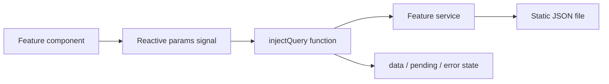
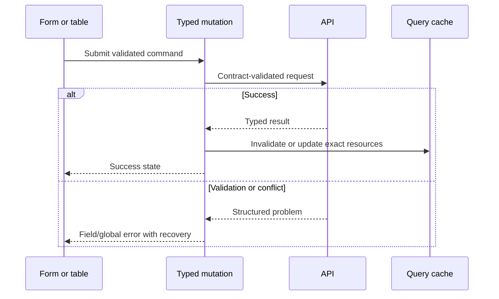

# Admin state and data

The admin application combines server-state queries, application stores, a client cart and local reactive forms.

## Ownership map

| Concern                          | Owner                              | Examples                                                             |
| -------------------------------- | ---------------------------------- | -------------------------------------------------------------------- |
| Remote list and detail lifecycle | TanStack Angular Query             | Products, categories, orders, roles, users, customers, notifications |
| Transport                        | Typed gateways and `HttpClient`    | Gateways under `core/`, services under `data-access/services`        |
| Session and shell state          | NgRx SignalStore                   | Auth, menu, loader, settings                                         |
| Create-order cart                | Classic NgRx                       | Cart reducer and effects                                             |
| Form interaction                 | Angular reactive forms and signals | Product, coupon, user, role, customer and account forms              |
| Cross-cutting HTTP behaviour     | Interceptors                       | Cookie credentials, CSRF, loader, error handling                     |

## Data sources

| Source | Features                                                                                                                                                                                                                                          |
| ------ | ------------------------------------------------------------------------------------------------------------------------------------------------------------------------------------------------------------------------------------------------- |
| API    | Auth, roles, operators, customers, notification settings, media library, banners, reviews, YouTube, product form, redirects, add-on templates, FAQ, questions                                                                                     |
| JSON   | Attributes, blog, cart, categories, countries, coupons, currencies, customer ledger, dashboard, navigation badges, notification inbox, order status, orders, pages, points, refunds, settings, shipping, states, stores, tags, tax, theme options |

## Read path

Query keys usually include the full parameter object. Keep parameters stable and serializable, and do not create different shapes for the same resource.

## Write path

In JSON-backed features, many list components mark status toggles, delete, bulk delete, approve, export, replicate, refund and settings actions as having no backend. Some forms load a record and then navigate without writing. These comments stop a local interaction being mistaken for a backend capability.

API-backed features write through their gateways. Media uploads go directly to Spaces through `MediaUploadService`. `injectAdminCustomersQuery` takes a `live` or `deleted` view and keys its cache on it.

## Migrating a reader to the API

1. Confirm the request and response schema in `packages/contracts`.
2. Replace the JSON URL inside the service, not the component.
3. Keep or deliberately migrate the query key.
4. Map pagination and filter behaviour explicitly.
5. Handle API validation and authorization failures.
6. Add query tests and feature-level states.
7. Remove the JSON file and update the atlas.

## Implementing a write

Do not optimistically remove or approve records unless rollback is defined. High-impact catalogue, refund, permission and configuration changes favour correctness and clear feedback.

## Runtime configuration

The admin application loads `public/config.json` at startup, through `provideAppInitializer` in `core/config/runtime-config.ts`, and fills the mutable `environment` object with `apiUrl` and other non-secret values. The committed file holds localhost defaults. Deployments mount their own.

## Session and HTTP behaviour

- The auth interceptor sends `withCredentials: true`, and sends the CSRF token as `x-csrf-token` on unsafe methods. The token comes from `GET /auth/admin/csrf` and is held in memory by `core/auth/csrf-tokens.ts`.
- The idle lock's keep-alive refresh uses the same cross-tab lock as the interceptor's 401 rotation (`core/auth/session-refresh-lock.ts`), so two tabs never rotate one token at once.
- `@saha-textile/http-transport` provides single-flight refresh, cross-tab locks, CSRF recovery, request ids and error mapping.

## Security rules

- A menu, directive, hidden button or guard is not authorization.
- Never ship secrets or privileged configuration in the admin bundle.
- Validate API payloads with shared zod contracts.
- Treat 401 and 403 differently: unauthenticated and unauthorized are different states.
- Do not store tokens in browser storage. Sessions use API-set cookies.
