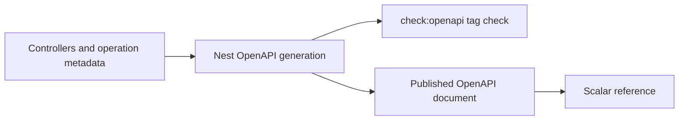

# OpenAPI and Scalar reference

OpenAPI is the machine-readable description of the API. Scalar renders that document as a readable reference with a Test Request client.

## How the document is produced

NestJS builds one OpenAPI document in `apps/api/src/openapi.ts`. The API serves it at `/openapi.json`. The portal build generates the same document without a database connection, using `pnpm --filter @saha-textile/api generate:openapi`, and publishes it.

| Route               | Content                        |
| ------------------- | ------------------------------ |
| `/api/reference/`   | Scalar reference               |
| `/api/openapi.json` | The published OpenAPI document |

Do not maintain a second OpenAPI file by hand.

## Tags

Each operation carries one tag from the fixed list in `apps/api/src/openapi-tags.ts`: `health`, `catalog`, `currency`, `promotions`, `cart`, `orders`, `auth`, `storefront-account`, `privacy`, `media` and `reviews`. `pnpm --filter @saha-textile/api check:openapi` rejects any other tag.

## Using Test Request

The document declares one server, `https://localhost:4000`. It must be HTTPS on `localhost` because session cookies use the `__Host-` prefix, which requires `Secure` and is bound to one host.

All normal controls apply to Test Request: CORS, authentication, CSRF, audience, ownership and rate limits. It has no privileged token and no proxy.

To send a state-changing request from a session:

1. Sign in, or complete signup, OTP verification or refresh.
2. Call `GET /auth/csrf`, or `GET /auth/admin/csrf` for an admin session, and copy `csrfToken` from the reply.
3. Send the token in the `x-csrf-token` header, with the session cookies.

A missing or mismatched token returns `403` with `reason: csrf_rejected`. Fetch the token again and retry once. A `403` without that reason is a permissions refusal; do not retry it.

`GET /auth/csrf` works with or without a session. For a live session it keeps a valid token, and it replaces the token only if the cookie is missing or does not match. Anonymous callers get a token that is not bound to a session. The token does not create a session or grant any access.

## Interactive-request rules

The API client follows the same rules as a real frontend:

- It targets approved development or staging servers only.
- It stores no production secrets.
- It has no authentication bypass and no privileged default token.
- Saved examples contain no secrets or real personal data.

Portal access does not replace API authorization.

## Operation documentation standard

Each operation should document:

- Purpose and audience.
- Authentication and CSRF requirements.
- Roles, permissions, ownership or provider-signature rules.
- Path, query, header and body schemas.
- Response schemas by status.
- Validation and business error codes.
- Rate-limit behaviour.
- Idempotency and version requirements.
- Pagination, filter and sort behaviour.
- Collections or external systems affected.
- Audit, outbox, notification and provider side effects.
- Examples without secrets or real personal data.

## Limitations

The generated document lists every controller route with its summary and tag, but it is incomplete in these ways:

- Operations do not declare the `sessionCookie` security scheme, so Scalar cannot show which routes need a session, audience, permission or CSRF token.
- Request bodies and response schemas are not generated from the zod contracts.
- `ApiErrorResponse` is not published as a response schema.
- Error codes, rate limits, idempotency and side effects are not described per operation.
- The document is not generated or checked in CI.

Scalar therefore carries the **Scaffolded** status. It can move to **Implemented** when:

1. CI generates the document without production secrets.
2. Core route families have explicit request and response schemas.
3. Authentication, CSRF, audience, permission, error and idempotency rules are represented.
4. Tests assert required paths, tags and security schemes.
5. Approved development and staging server URLs are defined.
6. Production interaction is disabled or protected.

## Related pages

- [Route inventory](./route-inventory)
- [Scalar](/tools/scalar)
- [Security and identity](../backend/security-and-identity)
