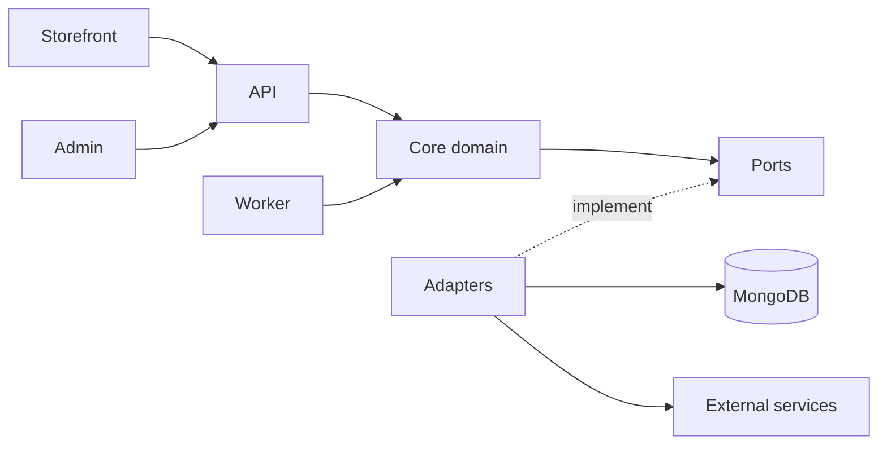

import { ArchitectureReactor } from '@site/src/components/ArchitectureReactor';

# System overview

Saha Textile is an e-commerce platform for a Kolkata saree and textile retailer. It consists of a storefront, an admin application, an API with a background worker, and a private developer portal, all in one pnpm and Turborepo monorepo.

The platform follows a hexagonal architecture. Domain rules live in `packages/core-domain`. Infrastructure lives in adapters. Each deployable application connects ports to adapters at startup.

The interactive diagram below shows the same architecture. Hover, tap or use the arrow keys to inspect a boundary.

<ArchitectureReactor />

## Dependency rule

Imports point inward. Core domain code does not import NestJS, Angular, MongoDB, payment SDKs, storage SDKs or other adapters. Core may reference shapes from `packages/contracts` through `import type`, which is erased at compile time. Value imports are forbidden.

## Swap test

Replacing an edge concern requires a new adapter and a dependency-injection binding. It must not require edits to core use cases or UI packages.

## Runtime configuration and secrets boundary

Configuration is injected at runtime and is not compiled into builds.

- The **API and worker** read secrets from their environment.
- The **Angular applications** read a public `config.json` at startup. It holds non-secret values such as API and site URLs, locales and public client IDs.
- The **local developer portal** reads one username and password from its gitignored `.env.local`. Only the portal server reads them, and child builds receive an environment without them.

## Related pages

- [Monorepo map](./monorepo-map)
- [Backend platform atlas](/backend/overview)
- [Deployment overview](/deployment/overview)
