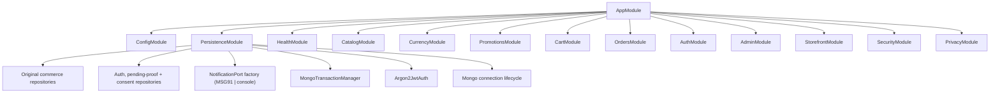
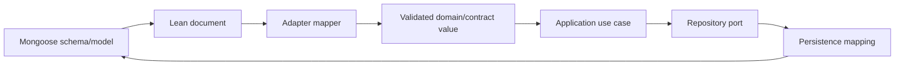

# Composition root and adapters

Composition is the only place where abstract capabilities become concrete implementations. The API does this in `AppModule` and the global `PersistenceModule`. The worker does the same in `apps/api/src/worker/media-worker.ts`.

## Module graph

`AppModule.forRoot(config)` takes validated configuration and passes it to every module, so a test can compose the application with values that are not in the environment. `apps/api/src/bootstrap.ts` builds the application without opening a port. `main.ts` adds only the listener.

`PersistenceModule` binds repositories and external adapters. `MediaModule` and `CatalogModule` consume them.

## Dependency-injection bindings

Tokens are declared in `apps/api/src/infra/tokens.ts`.

| Token family                        | Implementation                                                                                                                                                                            |
| ----------------------------------- | ----------------------------------------------------------------------------------------------------------------------------------------------------------------------------------------- |
| Catalogue and commerce repositories | Mongo repositories for products, variants, categories, placements, attributes, redirects, routes, stock alerts, FAQ, questions, relations, bundles, currencies, promotions, carts, orders |
| Account repositories                | `MongoCustomerRepository`, `MongoAdminUserRepository`                                                                                                                                     |
| Auth repositories                   | Sessions, credentials, OTP, OAuth state, provider identities, pending signup and contact change, reset, verification, invite and rate-limit repositories                                  |
| Authorization repositories          | `MongoRoleRepository`, `MongoAdminUserRoleAssignmentRepository`                                                                                                                           |
| Governance repositories             | `MongoAuditLogRepository`, `MongoConsentRepository`, notification settings, templates and outbox                                                                                          |
| Media repositories                  | Media assets, media roles, content blocks, site settings, reviews                                                                                                                         |
| `TRANSACTION_MANAGER`               | `MongoTransactionManager`                                                                                                                                                                 |
| `AUTH_PORT`                         | `Argon2JwtAuth`                                                                                                                                                                           |
| `SEARCH_PORT`                       | `MeilisearchSearch`                                                                                                                                                                       |
| `NOTIFICATION_PORT`                 | `Msg91NotificationAdapter` when `NOTIFICATION_PROVIDER=msg91` and `MSG91_AUTH_KEY` is set, otherwise `ConsoleNotificationAdapter`                                                         |
| `STORAGE_PORT`                      | `SpacesStorageAdapter` when Spaces credentials are set, otherwise `UnconfiguredStorageAdapter`                                                                                            |
| `MEDIA_JOB_QUEUE`                   | `BullMqMediaJobQueue` on Redis                                                                                                                                                            |
| `CDN_PURGE`                         | `CloudflareCdnPurge` when zone and token are set, otherwise `LogOnlyCdnPurgeAdapter`                                                                                                      |
| `YOUTUBE_PORT`                      | `YouTubeDataApi` when `YOUTUBE_API_KEY` is set, otherwise `UnavailableYouTubeAdapter`                                                                                                     |

`OAuthService` builds `GoogleIdTokenVerifier` and `FacebookTokenVerifier` from `@saha-textile/adapters-auth`. The worker adds `SharpImageCodec` from `@saha-textile/adapters-image-sharp`.

An unconfigured adapter fails at the point of use with a clear message. It never pretends the operation succeeded.

## Mongo adapter responsibilities

The adapter owns:

- Connection configuration and the Mongoose lifecycle.
- Models with declared physical collection names, and their indexes.
- Conversion from Mongoose documents to contract-shaped values.
- A transaction manager that exposes only an opaque context and uses `AsyncLocalStorage`, so nested transactions join the outer one.
- Translation of unique-index races into `DuplicateIdentifierError`.
- Single-statement customer address writes.
- One write path for provider identities, `AuthIdentityRepository`.
- Migrations, seed tools and index reconciliation.

It keeps provider details such as `_id`, Mongoose query syntax, sessions, BSON dates and schema options out of core.

## Model-to-domain mapping

Read mappers handle ids and dates explicitly. Nested `Mixed` values are cast without runtime validation. Secret fields such as password and PIN hashes stay inside the adapter.

## Provider adapter pattern

For payment, shipping, notifications, exchange rates, storage, search and media processing:

1. Keep provider configuration on the server.
2. Expose a core capability port.
3. Translate domain input into the provider request.
4. Verify the provider's response, signature or status.
5. Map provider failures to stable application error categories.
6. Redact provider payloads from responses and logs.
7. Store the correlation data that reconciliation needs.
8. Bind the adapter in composition.

## Development, sandbox, and live adapters

| Kind                 | Use                                     | Not to be mistaken for                |
| -------------------- | --------------------------------------- | ------------------------------------- |
| Test implementation  | Deterministic checks of a port contract | Provider compatibility                |
| Unconfigured adapter | Explicitly unavailable local behaviour  | A working integration                 |
| Sandbox adapter      | The provider's real sandbox protocol    | Live credentials or capture           |
| Live adapter         | The production integration              | Permission for unsafe console actions |

A live adapter requires current provider documentation, credentials, webhook verification, reconciliation, failure testing and an approved rollout.

## Configuration boundary

`apps/api/src/config/app-config.ts` validates runtime values with zod when the process starts. A half-set credential group, such as Spaces or Cloudflare, stops startup with a message naming the missing variables.

Cookie names default to `st_access`, `st_refresh`, `st_csrf`, `st_guest` and `st_signup`. Admin sessions use `st_admin_access`, `st_admin_refresh` and `st_admin_csrf`. All variables are listed in the [environment catalogue](/engineering-live-context/environment-variables).

### Deployment hardening

`apps/api/src/config/deployment-hardening.ts` runs when the API or worker starts. A strict deployment is `DEPLOY_ENV=staging` or `production`, or `NODE_ENV=production` with `DEPLOY_ENV` unset. In a strict deployment the process lists every unsafe setting and exits with code 1 if any of these apply:

- A JWT or CSRF secret is missing, a placeholder, shorter than 64 characters, repetitive, or shared with another secret.
- `COOKIE_SECURE` is off, or CORS is unset, uses a wildcard, uses HTTP or names a local origin.
- `TRUST_PROXY` or `CLIENT_IP_HEADER` is unset.
- The notification provider is not `msg91`, its key is missing, or `OTP_LOCAL_FIXED_CODE` is set.
- Facebook credentials are half set.
- MongoDB has no credentials, Redis has no password, or Spaces and its HTTPS CDN URL are not configured.

The local stack sets `DEPLOY_ENV=local` to opt out.

## Connection lifecycle and readiness

A failed MongoDB connection at startup is logged and does not stop the process. `/health/live` keeps answering and `/health/ready` returns `503` until the connection is available.

## Adding an adapter safely

1. Read the owning port and use case.
2. Check the provider's current official protocol and version.
3. Add configuration with zod, and keep it out of the browser.
4. Implement mapping and error translation inside the adapter package.
5. Add unit tests with a controlled transport.
6. Add sandbox or integration tests behind explicit environment gates.
7. Add the composition binding.
8. Add readiness checks only for dependencies that traffic requires.
9. Update the docs and OpenAPI side effects.
10. Confirm that no SDK type reached core.

## Adapter review questions

- Can the provider be replaced without changing controllers, domain code or Angular?
- Are timeouts, retries and backoff explicit?
- Is a retry safe, or protected by idempotency?
- Are credentials, raw payloads and personal data redacted?
- Is the provider's id stored where reconciliation needs it?
- Does failure leave an auditable state instead of guessing success?
- Can a derived system be rebuilt from authoritative records?

## Limitations

- `PersistenceModule` also binds non-persistence adapters, such as `AuthPort` and storage.
- Nested `Mixed` fields are not validated at runtime when read.
