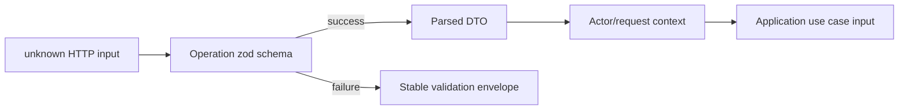

# Contracts, validation, and serialization

`packages/contracts` holds zod schemas shared by the API and both Angular applications. A schema validates unknown data at runtime and provides its TypeScript type.

One schema does not represent every layer.

## Four different shapes

| Shape                | Purpose                    |     May contain secrets? | Location             |
| -------------------- | -------------------------- | -----------------------: | -------------------- |
| Request contract     | What one operation accepts |                       No | `packages/contracts` |
| Domain entity        | Business-meaningful value  | No infrastructure fields | Contracts and core   |
| Persistence document | How an adapter stores data | Sometimes, internal only | Mongoose interfaces  |
| Response contract    | What one actor may receive |                    Never | `packages/contracts` |

A signup-finalisation request must not accept `role`, verified identifiers, provider subjects, credential hashes or internal flags merely because those fields exist in storage. The final values come from server-held proof.

## Contract families

| Files                                                                                  | Principal schemas                                                 | Key rule                                                     |
| -------------------------------------------------------------------------------------- | ----------------------------------------------------------------- | ------------------------------------------------------------ |
| `common.ts`                                                                            | Locales, localized text, ids, money, pagination, errors           | The locale set is configuration; failures share one envelope |
| `catalog.ts`, `category.ts`, `category-placement.ts`                                   | Category lifecycle, placements, facets, SEO                       | One canonical placement per category                         |
| `catalog-read.ts`, `catalog-write.ts`                                                  | Storefront cards, listings and product pages; admin product forms | Read models carry resolved prices and images                 |
| `attribute.ts`, `product.ts`, `product-options.ts`, `product-variant.ts`               | Attributes, lifecycle, option groups, variants                    | Only `live` is public; an option's role sets its behaviour   |
| `product-bundle.ts`, `product-relation.ts`, `product-insight-set.ts`, `stock-alert.ts` | Bundles, relations, weekly insights, stock alerts                 | Bundles do not nest                                          |
| `seo-redirect.ts`, `seo-route.ts`                                                      | Redirect rows and head data                                       | One hop from any old address                                 |
| `media.ts`, `content-block.ts`, `site-settings.ts`                                     | Assets, size roles, banners, typed settings                       | Clients receive resolved image URLs                          |
| `inventory.ts`, `content.ts`                                                           | Ledger and FIFO layers; FAQ, questions, reviews                   | Review photos stay private until approved                    |
| `cart.ts`, `order.ts`, `currency.ts`, `shipping.ts`, `promotion.ts`                    | Commerce aggregates, snapshots, quotes                            | Canonical product price is INR                               |
| `customer.ts`, `admin-user.ts`, `admin-role.ts`, `admin-customer.ts`                   | Customer and operator profiles, CRM requests                      | Credential material is absent                                |
| `session.ts`, `auth.ts`, `signup.ts`, `oauth.ts`, `admin-auth.ts`                      | Sessions and sign-in flows                                        | No reusable token in any body                                |
| `storefront-account.ts`                                                                | Own profile, address, session and contact requests                | Customer identity comes from the session                     |
| `auth-internal.ts`                                                                     | OTP, OAuth, reset, invite and rate-limit storage                  | Codes and tokens are represented by hashes                   |
| `consent.ts`, `audit.ts`, `notification.ts`                                            | Consent, audit, notification settings and outbox                  | Records are append-only                                      |
| `permission.ts`, `role.ts`                                                             | Permission registry, roles, assignments                           | Grants normalize against the registry                        |

`AttributeValueType`, `ProductRelationTargetType`, `AuthRateLimitScope` and `AuthRateLimitAction` are named exports, so Mongoose schemas derive their allowed values from them instead of copying lists.

## Boundary validation

`ZodValidationPipe` treats input as `unknown`, calls `safeParse`, and returns a sanitized `400` issue list. `pnpm check:route-contracts` rejects unnamed controller-local request shapes.

## Naming convention

Use module and operation names, not one overloaded entity name.

```text
CatalogProductResponse
CatalogProductListQuery
AdminCreateProductRequest
AdminUpdateProductRequest
AdminProductResponse
CartResponse
AddCartLineRequest
CheckoutQuoteRequest
CheckoutQuoteResponse
PlaceOrderRequest
OrderSummaryResponse
OrderDetailResponse
AdminOrderDetailResponse
```

## Request parsing rule



- Apply defaults only when the API owns the default.
- Coerce only deliberate transport forms, such as numeric query strings.
- Reject or strip unknown privileged fields by an explicit, tested rule.
- A TypeScript type assertion performs no runtime validation.
- Validate provider and webhook payloads even after signature verification.

## Response serialization rule

Response contracts are an allowlist. They must make it impossible to leak:

- Password, PIN or OTP hashes.
- Refresh-token or session hashes.
- Provider credentials or raw provider payloads.
- Internal fraud or risk flags.
- Cost layers and supplier terms.
- Admin-only notes.
- Hidden product states.
- Audit metadata not meant for the actor.

Storefront, admin and internal job responses may use different contracts for the same aggregate.

## Persistence mapping

Mappers translate `_id` and `Date` values into contract-friendly ids and ISO strings. The preferred sequence is:

```text
Mongoose lean document
→ explicit adapter mapper
→ domain/contract runtime parse
→ application result
→ actor-specific response parse
```

Parsing twice is acceptable at trust boundaries when it prevents drift or leakage.

## Evolution rules

### Backward-compatible changes

- Add an optional response field.
- Add an optional request field with a server-owned default.
- Add an enum value only when every consumer handles unknown values safely.
- Add an endpoint without changing existing behaviour.

### Potentially breaking changes

- Rename or remove a field.
- Change nullability, unit, currency or timestamp meaning.
- Make an optional request field required.
- Change pagination, sorting, error, idempotency or authorization behaviour.
- Reuse an enum value for a different meaning.

For a breaking change, version the HTTP contract or run a coordinated migration. Do not reinterpret stored data silently.

## Contract test matrix

For every important schema, test:

1. Minimum valid input.
2. Full valid input.
3. Defaults.
4. Each boundary value.
5. Malformed primitives.
6. Missing required fields.
7. Invalid enum, identifier, date or currency.
8. Privileged or secret-field injection.
9. Safe serialization.
10. A fixture from the previous released contract.

## Limitations

- Some path and query values are parsed manually.
- Many responses are returned without being parsed through a response schema.
- Mongoose `Mixed` arrays are cast without runtime validation.
- A contract does not mean a route uses it. Inventory, bundle and several other families have no HTTP workflow.
