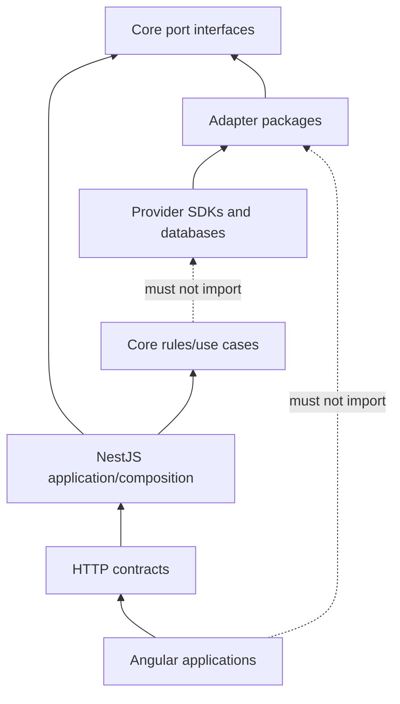

# Core domain, pricing, and ports

`packages/core-domain` holds business rules and port interfaces. It knows nothing of NestJS, Fastify, Mongoose, MongoDB, Meilisearch, Spaces or any payment or shipping provider.

## Dependency direction



Imports point inward. Runtime calls flow outward only through a port that composition supplies.

## Domain modules

| Folder     | Contains                                                                                                                                              |
| ---------- | ----------------------------------------------------------------------------------------------------------------------------------------------------- |
| `auth/`    | Password, PIN and signup policy, rate-limit policy, effective permissions, client-address scope                                                       |
| `catalog/` | Card price, badges, listing filters and facets, product visibility, relations, legacy address resolution, measurements, stock alerts, weekly insights |
| `media/`   | Ingest policy, derivative plan, asset processing, image resolution, garbage collection, review photos, YouTube feed, storage keys, size roles         |
| `pricing/` | Money, discounts and PayPal gross-up                                                                                                                  |
| `ports/`   | Repository and provider interfaces                                                                                                                    |

## Pricing functions

| Function            | Responsibility                           | Guardrails                                    |
| ------------------- | ---------------------------------------- | --------------------------------------------- |
| `roundMoney`        | Round to a set number of decimals        | Rejects non-finite input                      |
| `convertFromINR`    | Multiply INR by a stored rate            | Rejects negative INR and non-positive rates   |
| `discountAmountINR` | Compute a percentage or fixed discount   | Caps percentage at 100 and fixed at the price |
| `applyDiscountINR`  | Subtract the resolved discount           | Never below zero                              |
| `paypalGrossUp`     | Preserve a net amount after fees         | Percentage must be in `[0,1)`                 |
| `cardPrice`         | Single price or range for a product card | Catalogue amounts are tax-inclusive rupees    |

These functions do not form a checkout engine. Tax, promotion stacking, shipping and exchange-rate staleness are outside them.

## Port inventory

### Repositories

| Port                                                                                              | Capability                                      |
| ------------------------------------------------------------------------------------------------- | ----------------------------------------------- |
| `ProductRepository`, `CategoryRepository`                                                         | Products and categories                         |
| `ProductVariantRepository`, `ProductBundleRepository`, `ProductRelationRepository`                | Variants, bundles and relations                 |
| `CategoryPlacementRepository`, `CategoryFacetConfigRepository`, `AttributeDefinitionRepository`   | Taxonomy, facets and attributes                 |
| `SeoRedirectRepository`, `SeoRouteRepository`, `AddonTemplateRepository`                          | Old addresses, head data and add-on templates   |
| `StockAlertRepository`, `ProductInsightSetRepository`                                             | Stock alerts and weekly insights                |
| `FaqRepository`, `ProductQuestionRepository`, `ReviewRepository`                                  | FAQ, questions and reviews                      |
| `InventoryRepository`, `InventoryCostLayerRepository`                                             | Stock ledger and FIFO cost layers               |
| `CartRepository`, `OrderRepository`, `CurrencyRepository`, `PromotionRepository`                  | Commerce records                                |
| `CustomerRepository`, `AdminUserRepository`                                                       | Public account records                          |
| `CustomerAuthRepository`, `AdminUserAuthRepository`                                               | Credentials and account security state          |
| `AuthSessionRepository`, `OtpChallengeRepository`, `OAuthStateRepository`                         | Sessions and challenges                         |
| `PasswordResetTokenRepository`, `EmailVerificationTokenRepository`, `AdminInviteRepository`       | Single-use tokens                               |
| `AuthRateLimitRepository`, `AuthIdentityRepository`                                               | Rate-limit counters and provider identity links |
| `PendingSignupRepository`, `PendingContactChangeRepository`                                       | Short-lived proof state                         |
| `RoleRepository`, `AdminUserRoleAssignmentRepository`                                             | Roles and assignments                           |
| `AuditLogRepository`, `ConsentRepository`                                                         | Audit trail and consent history                 |
| `NotificationSettingsRepository`, `NotificationTemplateRepository`, `MessageOutboxRepository`     | Notification settings, templates and outbox     |
| `MediaAssetRepository`, `MediaRoleRepository`, `ContentBlockRepository`, `SiteSettingsRepository` | Media, banners and settings                     |

Every repository has a Mongo implementation in `packages/adapters-db-mongo`. Inventory, cost-layer and facet repositories have no HTTP workflow.

### Capability ports

| Port                     | Capability                          | Adapter                                                  |
| ------------------------ | ----------------------------------- | -------------------------------------------------------- |
| `AuthPort`               | Password hashing and JWT operations | `Argon2JwtAuth`                                          |
| `OAuthVerifierPort`      | Provider token verification         | Google and Facebook verifiers                            |
| `TransactionManagerPort` | Opaque atomic unit of work          | `MongoTransactionManager`                                |
| `SearchPort`             | Index, remove and search products   | `MeilisearchSearch`                                      |
| `NotificationPort`       | Deliver or suppress a message       | `Msg91NotificationAdapter`, `ConsoleNotificationAdapter` |
| `StoragePort`            | Object storage and signed URLs      | `SpacesStorageAdapter`                                   |
| `ImageCodecPort`         | Decode and encode images            | `SharpImageCodec`                                        |
| `MediaJobQueuePort`      | Queue background media work         | `BullMqMediaJobQueue`                                    |
| `CdnPurgePort`           | Purge CDN URLs                      | `CloudflareCdnPurge`, `LogOnlyCdnPurgeAdapter`           |
| `YouTubePort`            | Read channel uploads, check a video | `YouTubeDataApi`                                         |
| `PaymentGatewayPort`     | Create and verify a payment         | None                                                     |
| `ShippingPort`           | Obtain shipping quotes              | None                                                     |
| `FxRatePort`             | Fetch INR exchange rates            | None                                                     |
| `VideoTranscodePort`     | Queue HLS transcoding               | None                                                     |

`DuplicateIdentifierError` carries an email or phone unique-index race across the persistence boundary without exposing a Mongo error.

## What belongs in a port

A port names a capability the application needs:

```ts
interface ShippingPort {
	getQuotes(request: ShippingQuoteRequest): Promise<ShippingQuote[]>;
}
```

It must not expose provider tokens, SDK clients, response classes, error payloads or configuration names. An adapter translates those.

## Port design checklist

- Is the interface in domain language?
- Are inputs and outputs stable across plausible providers?
- Does it avoid framework and SDK types?
- Does it express idempotency and correlation where the use case needs them?
- Can errors be translated into retryable categories?
- Can tests supply a deterministic in-memory implementation?
- Does it avoid becoming a general-purpose repository?
- Does transaction context cross only where atomic work requires it?

## Repository versus provider port

- A **repository port** loads and stores facts controlled by this platform.
- A **provider port** calls an external capability such as payment, shipping, messaging, search or storage.

Do not hide a provider call inside a Mongo repository. Do not make provider payloads part of a domain entity.

## Swappability test

To replace MongoDB with PostgreSQL:

1. Create a PostgreSQL adapter implementing the same ports.
2. Map SQL rows to domain values.
3. Change the composition bindings.
4. Run the same port contract tests.

If controllers, Angular clients, checkout rules or core pricing must change, the boundary has leaked.

## Contracts boundary

`packages/contracts` is the single source of shared shapes. Core may use those shapes with `import type` only. The compiled core must contain no contracts or zod import. Value imports from contracts, and all framework, adapter, database and provider imports, are forbidden.

ESLint enforces this rule. A runtime-purity test also compiles the package and rejects emitted imports outside Node built-ins and the package's own modules.

## Media pipeline

`packages/core-domain/src/media` owns image rules. `MediaService` in the API and the worker call them.

1. **Presign.** The API checks the declared type, size and dimensions, creates a `mediaAssets` record and returns a presigned PUT for a private original.
2. **Upload.** The browser sends the file directly to Spaces.
3. **Finalize.** The API queues a `process` job.
4. **Process.** The worker claims the asset, decodes the file, checks the decoded image again, computes a placeholder, renders each size and writes it under a content-hashed key with a one-year immutable cache header.
5. **Status.** The uploader polls until the state is `ready` or `failed`.

Public images are served by the CDN. A private image, such as a review photo awaiting moderation, is reachable only through a short-lived signed URL and is never cached.

Decoding is the real check: a renamed file fails here, and its object is deleted. Each render honours EXIF orientation, drops metadata, converts to sRGB, flattens transparency onto white and sharpens lightly after resizing. Review photos drop their original after processing.

### Ingest rules

| Rule                    | Value                                                    |
| ----------------------- | -------------------------------------------------------- |
| Accepted types          | JPEG, PNG                                                |
| Maximum file size       | 25 MB                                                    |
| Maximum image size      | 8000 px long edge, 50 megapixels                         |
| Minimum short edge      | 1600 px for product and category images                  |
| Target shape            | 3:4 product and category, 16:9 blog, 1:1 avatar and icon |
| Review photos           | Five per review. A long edge below 500 px warns          |
| Upload URL lifetime     | 15 minutes                                               |
| Signed preview lifetime | 10 minutes                                               |

An image more than 5% off its target shape receives a warning and is letterboxed on white. `GET /media/upload-rules` publishes these limits to clients.

### Size roles

`SEEDED_MEDIA_ROLES` defines the sizes: `thumb`, `card`, `gallery`, `zoom`, image swatches, `share`, `feed_square`, `email_thumb`, `review_thumb`, `review_full`, `banner`, `blog`, `category_icon` and `avatar`. Operators can edit widths and quality from the admin application. Purposes, shape, fit and format are fixed in code.

Each role fits the image one of four ways: `inside` keeps the source shape, `cover` crops to fill the box, `pad` letterboxes on white, and `blur` sets the image over a blurred enlargement of itself.

The worker never upscales: a width the source cannot fill is skipped and reported. Banners skip widths beyond twice their slot's widest display. `share`, `feed_square` and `email_thumb` apply only to an image that serves as a product's main image.

Editing a role's widths or quality increases its version. The 15-minute `reprocess-stale` job then regenerates old files in batches.

### Deletion

A library delete is refused while anything uses the image. Otherwise the asset is soft-deleted. The daily garbage collection soft-deletes unreferenced assets older than 48 hours, restores any that gained an owner, and removes files 30 days after soft deletion. It runs as a dry run until `MEDIA_GC_LIVE` is true, and each run writes an audit record.

## Search boundary

`SearchPort` is bound to `MeilisearchSearch` in `apps/api/src/search/meilisearch-search.ts`. The index holds ids and words, and prices are read back from MongoDB. If the index is down, `GET /catalog/search` answers 503 and never falls back to a MongoDB text query. A failed index update does not fail a product save. Rebuild the index with `pnpm --filter @saha-textile/api search:rebuild`.

## Domain test strategy

Pure domain tests need no Nest application, network, MongoDB, wall clock or provider credentials. Inject clocks, identifiers and policies when determinism matters. Test rules, boundary values, rounding, lifecycle transitions, idempotency decisions and failure categories directly.
