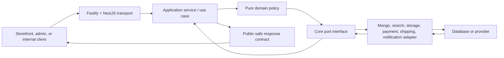

import { BackendRequestAtlas } from '@site/src/components/BackendRequestAtlas';

# Backend platform atlas

The backend is a NestJS application on Fastify, built around a hexagonal core. This section explains how a request moves through the system and which layer owns each concern.

Use the atlas below to explore each capability and its request path.

<BackendRequestAtlas />

## Recommended reading sequence

1. [Request lifecycle and boundary tracing](./request-lifecycle)
2. [Contracts, validation, and serialization](./contracts-and-validation)
3. [Core domain, pricing, and ports](./core-domain-and-ports)
4. [Composition root and adapters](./composition-and-adapters)
5. [Security, sessions, and authorization](./security-and-identity)
6. [Readiness, observability, and verification](./readiness-testing-and-observability)
7. [API route inventory](../api/route-inventory)
8. [OpenAPI and Scalar](../api/openapi-and-scalar)
9. [Mongo adapter map](../database/current-adapter-map)
10. [Transactions and generated catalogue](../database/transactions-and-generation)

## The six boundaries

A change is in the wrong layer if a controller imports a provider SDK, core imports NestJS or Mongoose, an Angular application imports an adapter, or a persistence document leaves through a response.

## Capabilities by layer

| Layer              | Contains                                                                                                                                               |
| ------------------ | ------------------------------------------------------------------------------------------------------------------------------------------------------ |
| Fastify and NestJS | Helmet, proxy and client-IP handling, request ids, redacted logs, safe errors, CORS, rate limiting, compression, cookies, CSRF, health probes, OpenAPI |
| HTTP modules       | Authentication, account self-service, administration, catalogue, media, cart, orders, currency, promotions, privacy                                    |
| Contracts          | Zod schemas for identity, catalogue, media, inventory, content and commerce                                                                            |
| Core domain        | Ports, password, PIN, signup and permission policy, pricing, listing rules, badges, media processing                                                   |
| Mongo adapter      | Models, mappers, indexes, repositories, migrations, seeds and `MongoTransactionManager`                                                                |
| Other adapters     | Google and Facebook verification, MSG91, Spaces, sharp, BullMQ, Cloudflare, YouTube                                                                    |
| Worker             | Image processing, garbage collection, YouTube refresh, stock alerts, weekly insights                                                                   |

## Request analysis framework

For any backend change, answer these questions in order:

1. **Who is the actor?** Anonymous shopper, guest cart owner, customer, staff, admin, job or provider webhook.
2. **What input crosses the boundary?** Validate it as untrusted data.
3. **Which use case owns the action?** A controller coordinates HTTP; it does not own business rules.
4. **Which rule decides success?** Ownership, state transition, price, stock, consent or permission.
5. **Which port is required?** The application asks for a capability, not a vendor SDK.
6. **Which records must agree?** If several durable facts must agree, use a transaction.
7. **What response is safe for this actor?** Persistence shape and response shape are different.
8. **How can failure be retried safely?** Use idempotency, version checks, durable state and audit records.
9. **Which test covers it?** A route's existence says nothing about its security.

## Limitations

- Payment, shipping and exchange-rate ports have no adapter.
- Order creation has no idempotency, stock reservation or payment step.
- Readiness checks MongoDB only.
