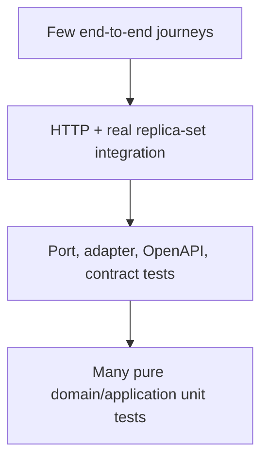

# Readiness, observability, and verification

This page describes the API's health endpoints, logging, metrics and test layers. A process that answers HTTP is live. A service that can perform its work is ready.

## Health endpoints

| Probe           | Question                           | Dependencies | Deployment action                    |
| --------------- | ---------------------------------- | ------------ | ------------------------------------ |
| `/health/live`  | Is the process running?            | None         | Restart only when failing            |
| `/health/ready` | Can this instance receive traffic? | MongoDB      | Remove from traffic, block promotion |
| `/health`       | Alias of `/health/live`            | None         | Prefer `/health/live`                |

A MongoDB outage does not stop the process. `/health/ready` returns `503` while it lasts, so an orchestrator does not restart healthy containers.

Health output never contains credentials, connection strings, network details, provider responses or stack traces.

## Request observability

Every request receives a correlation id, returned in the `x-request-id` header. The API accepts an inbound id only through a trusted proxy and only if it matches a strict pattern. Pino redacts authorization, cookie and CSRF headers, and password, PIN, code and token body fields.

Structured logs should answer:

- Which route or use case ran.
- Which actor type or audience was involved.
- The outcome and stable error category.
- Latency by application and adapter.
- The retry or idempotency result.
- Dependency health and timeout class.
- Safe resource and correlation identifiers.
- Whether an audit or outbox record was written.

Redact tokens, cookies, OTPs, passwords, raw IPs, provider secrets, payment payloads, full address and customer bodies, and sensitive query values.

## Recommended metrics

- Request rate, latency and errors by normalized route and status.
- Authentication success, failure and lockout, without identifiers.
- Rate-limit rejections by bucket.
- MongoDB pool, operation and transaction latency and failures.
- Search latency, errors and no-result rate.
- Notification usage and failures by channel and category.
- Job lag and last-success time.
- Readiness changes.

Avoid high-cardinality labels such as user id, order id, email, token, full URL or search query.

## Test layers



| Layer              | Location                                  | Covers                                                                                          |
| ------------------ | ----------------------------------------- | ----------------------------------------------------------------------------------------------- |
| Unit               | `*.test.ts` and `*.spec.ts` beside source | Pure rules, services, stores, components, contracts                                             |
| Integration        | `packages/adapters-db-mongo/test`         | Repositories, indexes and transactions against a replica set                                    |
| API end-to-end     | `apps/api/e2e`                            | Session rotation, media pipeline, banners, review photos, catalogue                             |
| Browser end-to-end | `e2e`                                     | Playwright on desktop and phone: listings, product pages, sign-in, addresses, stock alerts, SEO |
| Portal             | `scripts/validate-developer-portal.mjs`   | Metadata, sources, links and interactive component data                                         |

Run them with:

```bash
pnpm test                 # all unit tests
RUN_DB_IT=1 pnpm test     # also run MongoDB integration tests
pnpm e2e                  # Playwright, against a running shop
pnpm e2e:session-rotation # session and security scenarios
```

Playwright uses the installed Chrome. Set `E2E_BASE_URL` to test a production build. Integration tests need the replica set: run `pnpm mongo:up` first.

The architecture is covered by further tests. A runtime-purity test compiles `packages/core-domain` and rejects imports outside its own modules and Node built-ins. Deployment hardening is tested by starting the real API and worker entry points.

### What each layer can show

Unit tests show rules and refusals. Provider popups, user-gesture limits, reload behaviour and multi-page social journeys need a real browser, and sometimes real provider accounts.

## Transaction test pattern

For every atomic workflow:

1. Start the Docker MongoDB replica set with `pnpm mongo:up`.
2. Seed isolated test data.
3. Inject a failure after each participating write.
4. Assert that every collection rolled back.
5. Run the success path and assert all records.
6. Repeat the request and assert the idempotent outcome.
7. Exercise concurrent requests.

## Test matrix by area

| Area          | Tests to have                                                                  |
| ------------- | ------------------------------------------------------------------------------ |
| Startup       | Config, proxy and client IP, CORS, headers, rate limits, safe errors, shutdown |
| Auth          | Cookies, CSRF, rotation and reuse, audience, password, PIN, OTP, revocation    |
| Catalogue     | Public visibility, admin writes, redirects                                     |
| Search        | Normalization, publication and removal, rebuild, outage behaviour              |
| Cart          | Guest ownership, merge, stock and status corrections                           |
| Checkout      | Quote version, idempotency, transaction, snapshots, stock and payment rollback |
| Providers     | Signature, timeout, retry, correlation, reconciliation, secret redaction       |
| Data          | Validators, indexes, migrations, backup and restore, TTL                       |
| Documentation | OpenAPI checks, operation completeness, portal validation                      |

## Manual runtime checks

1. Start the required local services.
2. Read `/openapi.json` to find routes.
3. Check liveness and readiness separately.
4. Exercise anonymous, customer A, customer B, staff and admin identities.
5. Test negative cases before the happy path.
6. Capture request ids and sanitized results.
7. Stop one dependency at a time and observe the behaviour.
8. Restore the dependency and confirm recovery.

## Definition of done

A backend capability is complete when:

- Architecture and ownership are correct.
- Security controls are enforced on the server.
- Contracts and response safety are explicit.
- Durable writes are atomic where required.
- Retry, idempotency and failure recovery are defined.
- Tests cover positive and negative cases.
- Health and telemetry can distinguish failure.
- OpenAPI and portal pages match the behaviour.

## Limitations

- CI runs lint and type checks. It does not run tests, integration suites or Playwright.
- Readiness does not check Redis, Meilisearch or Spaces.
- The API exports structured logs only. It has no metrics endpoint.
