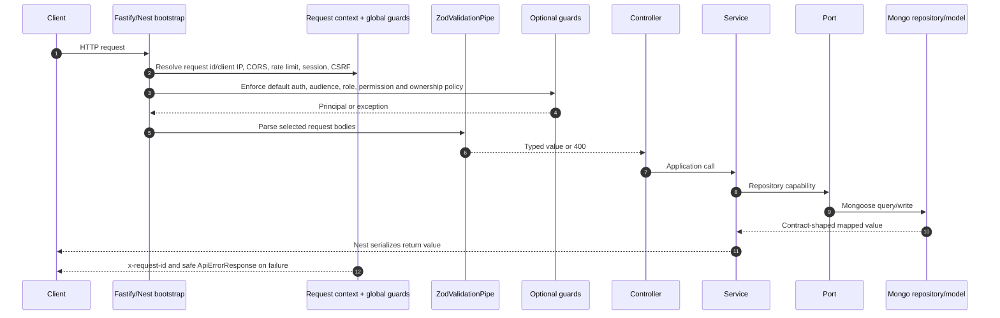
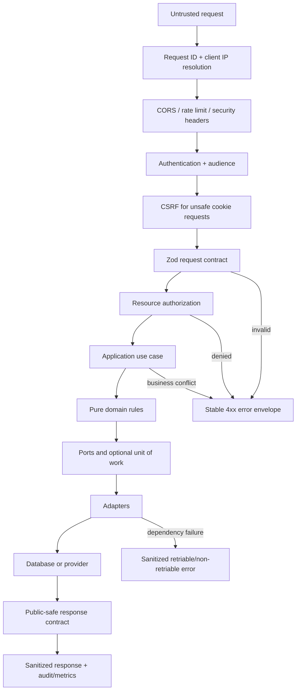

import { FlightSimulator } from '@site/src/components/FlightSimulator';

# Request lifecycle and boundary tracing

A request passes through several checkpoints before and after the controller. This page describes that path and gives a template for tracing an endpoint.

<FlightSimulator />

## Request path

Four global guards run in this order, as registered in `apps/api/src/app.module.ts`:

1. `CookieAudienceGuard` records which session's cookies the route reads: storefront `st_*` or admin `st_admin_*`, from `@Audience`. It never refuses a request.
2. `RefreshReuseGuard` runs on routes marked `@RotatesSession()`. It detects a replayed refresh token and revokes the family, before CSRF can reject the request.
3. `CsrfGuard` checks unsafe methods that carry a session cookie.
4. `SessionGuard` authenticates by default. Routes opt out with `@Public()`.

After the guards:

- `ZodValidationPipe` parses the body and query where a contract is declared.
- The controller calls a service, and the service calls ports.
- Ownership checks return 404 on mismatch for orders, carts and sessions.
- `HttpExceptionFilter` turns every failure into `ApiErrorResponse`.

Session refusals carry a stable optional reason: `session_missing`, `session_expired`, `session_revoked`, `permissions_changed` or `account_inactive`. CSRF refusals carry `csrf_rejected`. Domain refusals travel in `issues[]` with a stable `code`.

Multi-record writes use transactions:

- Signup finalisation commits the customer, password credential and provider identity together.
- Contact confirmation commits proof consumption, the identifier change and the audit record together.
- Order creation commits the order and cart removal together.
- A customer soft delete commits the status change, provider release and audit record together.

## Ideal request path

The diagram shows the full order of checks for a new endpoint.

## Trace template

Use this worksheet to debug or document an endpoint.

| Question           | Record                                                          |
| ------------------ | --------------------------------------------------------------- |
| Method and route   | Example: `POST /orders`                                         |
| Actor and audience | Customer session, admin session, provider webhook, internal job |
| Authentication     | Required, optional or forbidden                                 |
| Authorization      | Ownership, role, permission, consent, provider signature        |
| CSRF               | Required for cookie-authenticated unsafe methods                |
| Rate-limit bucket  | Global plus route-specific key and threshold                    |
| Request contract   | Shared zod schema and version                                   |
| Use case           | One application service method                                  |
| Domain rules       | Stock, price, transition, identity, consent, idempotency        |
| Ports              | Repository and provider capabilities used                       |
| Transaction        | Records that must commit or roll back together                  |
| Response contract  | Actor-safe response; forbidden internal fields                  |
| Errors             | Validation, authorization, conflict, dependency, unexpected     |
| Side effects       | Audit, notification, search index, analytics, provider call     |
| Tests              | Unit, integration, authorization, transaction, OpenAPI, runtime |

## Example: order creation

`POST /orders` runs as follows:

1. `SessionGuard` validates the httpOnly access cookie and sets the principal.
2. `CsrfGuard` requires the session-bound token in both the cookie and the `x-csrf-token` header.
3. `CreateOrderRequest` validates `cartId`, optional currency, gateway and coupon. It accepts no user id.
4. `OrdersService` confirms that the cart belongs to the principal, or is a guest cart backed by the caller's `st_guest` cookie.
5. The service loads each product and calculates INR totals, conversion and coupon discount.
6. `TransactionManagerPort.withTransaction` saves the order and deletes the cart together.

### Limitations

This operation creates a `pending` order only. It has no quote, idempotency key, stock reservation, tax or shipping calculation, or payment attempt. The storefront checkout does not call it.

## Error taxonomy

| Class             | Example                    | Client behaviour               | Log behaviour                        |
| ----------------- | -------------------------- | ------------------------------ | ------------------------------------ |
| Validation        | Malformed quantity         | Correct the highlighted input  | Request id and safe issue paths      |
| Authentication    | Missing or expired session | Start or resume sign-in        | No token contents                    |
| Authorization     | Another user's order       | Generic not-found or forbidden | Actor id, resource type, decision    |
| Business conflict | Stock changed              | Refresh the affected line      | Rule code and current version        |
| Idempotent replay | Order already placed       | Show the original outcome      | Original operation id                |
| Dependency        | Search unavailable         | Degrade or retry by policy     | Adapter, latency, safe provider code |
| Unexpected        | Programming error          | Stable generic 500             | Redacted stack and correlation id    |

Never send stack traces, database documents, provider payloads, secrets, tokens, OTPs, raw IPs or full address and customer data to the client.

## Read versus write checklist

### Read

- Scope the query by visibility and owner in the query itself.
- Enforce pagination limits and deterministic sorting.
- Select only response-safe fields.
- Treat cache keys and `Vary` dimensions as part of correctness.
- Keep non-public records out of public search and cache layers.

### Write

- Authenticate, authorize the resource and validate CSRF before the write.
- Validate the entity version when concurrent edits matter.
- Recalculate business values on the server.
- Use idempotency for retryable high-value actions.
- Open a transaction when several durable facts must agree.
- Let repositories join the ambient adapter session when their ports expose no transaction context. Pass the opaque context only through ports that declare it.
- Write audit and outbox records inside the same consistency boundary where required.
- Return a response contract, not a persistence document.

## Webhook variation

A provider callback is not a trusted internal call. Replace browser session checks with:

1. Raw-body or signature verification.
2. A replay and idempotency check.
3. A known payment or shipment correlation.
4. A legal state transition.
5. A transactional write.
6. A durable acknowledgement.
7. Safe asynchronous follow-up.

A provider's "success" field alone never authorizes an order or payment transition.
