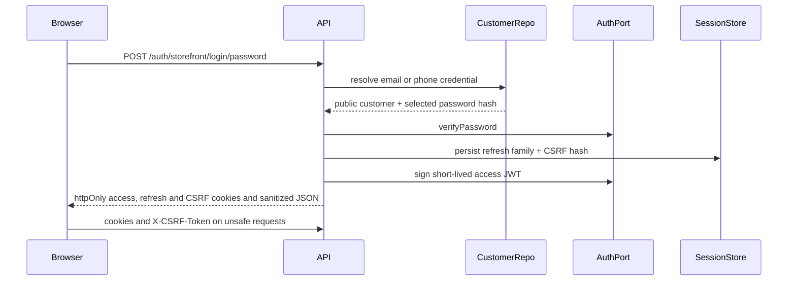
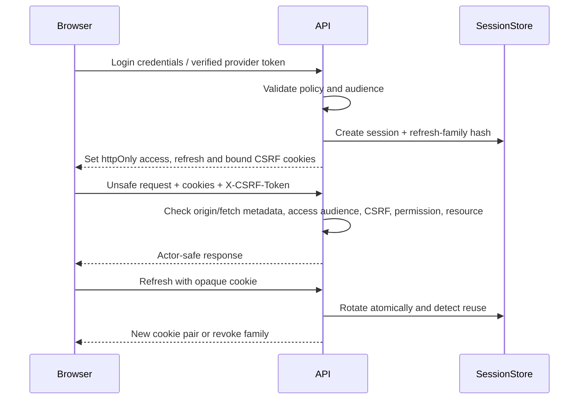

# Security, sessions, and authorization

This page describes how the API authenticates callers, protects sessions and authorizes actions. It covers storefront customers, admin operators and guest carts.

## Authentication versus authorization

- **Authentication:** Who is the caller?
- **Authorization:** May this caller perform this action on this resource now?

A valid token proves identity and session membership. Object-level ownership of carts, orders and sessions is checked separately, and a mismatch returns not-found.

## Browser sign-in



Both Angular applications use cookie-only auth gateways and hold no credential. `packages/http-transport` coordinates the CSRF token, one refresh attempt and cross-tab refresh locking.

## Browser session architecture



### Cookies

| Cookie               | Readable by script? | Purpose                                                  |
| -------------------- | ------------------: | -------------------------------------------------------- |
| Access               |                  No | Short-lived JWT for authenticated requests               |
| Refresh              |                  No | Opaque rotation credential; its hash is stored           |
| CSRF                 |                  No | API half of the double-submit pair, bound to the session |
| Guest (`st_guest`)   |                  No | Opaque proof of ownership of one guest cart              |
| Signup (`st_signup`) |                  No | Ties an in-progress signup to one browser                |
| Locale (`st_locale`) |                 Yes | The visitor's language choice                            |

Storefront sessions use `st_access`, `st_refresh` and `st_csrf`. Admin sessions use `st_admin_access`, `st_admin_refresh` and `st_admin_csrf`, so the two never overwrite each other. `CookieAudienceGuard` selects the right names from the route's `@Audience`.

All session cookies are `httpOnly`, `SameSite=Lax`, `Path=/` and `Secure`. With `Secure` on and `COOKIE_DOMAIN` empty, names carry the `__Host-` prefix, which binds each cookie to the API host. Every environment uses this configuration. Auth responses return sanitized account and session data, never reusable credentials.

### Session lifetimes

| Session                    | Idle lifetime | Absolute lifetime |
| -------------------------- | ------------: | ----------------: |
| Storefront, "remember me"  |       30 days |           90 days |
| Storefront, not remembered |         1 day |           90 days |
| Admin                      |        1 hour |          12 hours |

Access tokens last 15 minutes by default. Without "remember me", cookies have no expiry and end with the browser session. Admin screens lock after 15 minutes of inactivity; see [Admin idle lock](#admin-idle-lock).

The device list (`GET /auth/{audience}/sessions`) shows a label, country and timestamps. It leaves out every token hash and the device hashes.

### Refresh rotation

Refresh tokens are 256-bit opaque values stored as hashes. Each refresh issues a new token and CSRF value, and stores the previous hash. Presenting a previous token proves a leak, so `RefreshReuseGuard` revokes the whole token family, ahead of the CSRF check. Two concurrent refreshes are safe: one wins, and the loser counts as reuse.

`SessionGuard` loads the session by the JWT's `sid` on each request. It rejects a session that is missing, revoked, expired or mismatched, and it compares `tokenVersion` and `permissionsVersion` with the account's current values.

`GET /auth/storefront/me` is an identity probe. A guest with no session cookies receives 200 with `{ user: null }`. An expired access cookie with a live refresh cookie returns 401 `session_expired`, so the browser rotates the session.

## CSRF rule

For cookie-authenticated `POST`, `PUT`, `PATCH` and `DELETE` requests, `CsrfGuard`:

1. Allows safe methods, and unsafe requests with no session cookie.
2. Requires the CSRF cookie and a matching `x-csrf-token` header.
3. Compares them in constant time and checks the session's stored hash.
4. Rejects with 403 and `reason: csrf_rejected`, without saying which half failed.

The storefront and admin cannot read cookies on the API host. They fetch the token from `GET /auth/csrf` or `GET /auth/admin/csrf` and keep it in memory (`CsrfTokenHolder` in `packages/http-transport`). The gateways fetch it again after sign-in and rotation. On `csrf_rejected`, the interceptors fetch once and replay once. A 403 without that reason is never retried. A cross-site page cannot read the token, because CORS lets only listed origins read the reply.

For a live session, `GET /auth/csrf` keeps a valid bound token. It rotates the stored hash only when the cookie is missing or does not match, because a cross-site navigation must not be able to invalidate a session's token.

Never use `GET` for a state-changing operation.

## Audience and privilege separation

| Actor            | Audience        | Allowed surface                                       |
| ---------------- | --------------- | ----------------------------------------------------- |
| Guest cart owner | None            | Its own cart and public catalogue actions             |
| Customer         | `storefront`    | Own account, cart, orders and permitted public writes |
| Staff or admin   | `admin`         | Admin routes permitted by role and permission         |
| Provider webhook | Signature-based | One verified callback capability                      |
| Internal job     | Internal        | A narrow scheduled capability                         |

Customers and operators are separate populations in separate collections, `customers` and `adminUsers`. An admin session never becomes customer authority, and a storefront session never authorizes an admin route.

## Object-level authorization

Order reads compare `order.userId` with the principal and return not-found on a mismatch. An admin holding `order.index` may read any order. Cart routes are public for guest add-to-cart, but enforce the session owner or the hashed `st_guest` proof. Account routes take the customer id from the session and accept none from the caller.

Prefer ownership-scoped repository methods:

```text
getCustomerOrder({ actorUserId, orderId })
→ repository.findOwnedOrder(actorUserId, orderId)
→ not found/forbidden policy
→ CustomerOrderDetailResponse
```

Apply the same pattern to carts, addresses, returns, refunds, wishlists and media drafts.

## Role versus permission

Operators hold one coarse role, `staff` or `admin`, plus permissions. Permission codes form a closed registry in `packages/contracts/src/permission.ts`, so `@RequirePermissions` fails to compile on a mistyped code. Codes that no navigation entry gates are published with `serverOnly: true`. `seed:system-roles` writes the one system role, `administrator`, which holds every code.

- A role groups permissions.
- A permission authorizes an action, such as `order.update`.
- A resource rule checks the specific record and transition.
- Hiding UI is a convenience, not a control.
- Every privileged write produces an audit record.

Effective permissions are the union of the account's embedded grants and its active role assignments. `resolveEffectivePermissions` ignores revoked assignments and caps each role at the holder's tier. The guard resolves them only for routes that declare a permission. If assignments cannot be read, the account keeps only its embedded grants.

### Admin authority controls

- `GET /admin/permissions` publishes the registry. Clients cannot create free-form permissions.
- System roles cannot be edited or deleted.
- `GET /admin/users/:userId/authority` returns roles and resolved permissions.
- An actor cannot grant a role above their own tier, or permissions they do not hold.
- Revoking or disabling the last administrator is refused, and so is disabling yourself.
- Disabling an account increases its token version and revokes every session.
- Role changes write audit records and invalidate the permission version of each holder.
- `bootstrap:first-admin` creates the first administrator from the command line. It refuses to run once administrative authority exists.

## Customer identity

### Signup

Signup creates no customer until both email and phone are verified. The server holds the identifiers and proof in `pendingSignups`, keyed by the `st_signup` cookie. The record slides for 15 minutes, up to 30 minutes in total. A browser can read the record back after a reload and discard it when leaving registration.

Each field allows five code sends, with increasing waits of 0 seconds, 30 seconds, 2 minutes, 10 minutes and 1 hour. The budget follows the field, not the value, so changing a number does not earn a new send.

Finalisation checks ownership before spending the proof, then commits the customer, password credential and provider identity in one transaction. A unique-index race returns `signup_identifier_taken`. A failed guest-cart merge does not undo a successful sign-in.

The finalise request carries no email, phone or provider id. The server uses the values it verified, so a request cannot name someone else's address. A pending record reserves nothing: two people can hold the same address, and the unique index decides at finalisation. Editing a field clears its verified flag in the same write.

### Provider tokens

An identity is the provider plus its stable subject, never the email. Each round trip uses single-use state, stored as a hash.

- **Google.** The API verifies the ID token's signature, issuer, audience, expiry, nonce and subject.
- **Facebook.** The API checks the token through Graph `debug_token`, using an app token built on the server. Its email is only a prefill, so the path always needs an email code. A Facebook id is scoped to one Meta app, so ids from a development app do not carry over to a production app.

An unconfigured provider refuses with `oauth_provider_unavailable`. A token that fails any check is refused, and the reason goes to logs only.

### Disclosure rules

Whether an identifier has an account is disclosed only after control of it is proven:

- After a signup code for email or phone. The person can then sign in directly through `signup/sign-in-existing`, which allows active accounts only and attaches nothing from the signup.
- At the provider callback for an address Google proved. The person is offered a one-time code instead, because `email_verified` alone is never accepted as sign-in proof.

Meta proves nothing about its address, so a Facebook signup finds out through the email code. Accounts are never linked on a matching address. The owner signs in and connects the provider behind step-up.

### Sign-in and account changes

- Customers sign in with a password or one-time code, using email or phone, or with Google or Facebook.
- Login, registration, one-time-code and forgot-password screens are for guests only.
- Connecting or disconnecting a provider, setting a password and changing contact details need a step-up proof: the password if one exists, otherwise a one-time code.
- The last way into an account cannot be removed. The refusal code is `last_credential`.
- A contact change keeps the old value until the new one is proven. Starting a change to a taken value looks the same as any other start, and no code is delivered. Confirmation spends the proof, changes the identifier and writes the audit record in one transaction. A race returns `contact_in_use`.
- `signup`, `step-up` and contact-change refusals use stable codes, shown by the screen that asked rather than as a toast.

## Admin identity

- Operators sign in with a password or a six-digit PIN, using email or username. There is no self-registration and no social sign-in.
- An operator account comes from an invite, valid for seven days, or from the first-administrator command.
- Account Security at `/account` manages the PIN, password and sessions.
- Five failed PIN attempts lock PIN use for 15 minutes. Password sign-in stays available.
- A password reset suspends the PIN until the new password has been used once.
- A password change ends every session, including the current one.

### Admin idle lock

After 15 minutes of inactivity the admin shell opens a lock screen. `POST /auth/admin/resume` accepts the PIN or password and extends the same session, so the open route and form state survive. The lock proves presence. The one-hour idle lifetime still ends the session on the server.

## Password, PIN, and OTP policies

### Password

- Minimum 12 characters, for storefront and admin.
- A denylist of common base words, checked after removing case, punctuation and trailing digits. Brand and locality words are included.
- Short groups typed repeatedly are refused.
- Maximum 256 characters.
- Argon2id hash.
- Generic login failure.
- Rate limits count failures, per identifier and per address.
- A change revokes sessions and increases the token version.

### Admin PIN

- Six digits, set only after a password exists.
- Repeating groups, consecutive runs (including across 9 to 0) and a denylist of common values are refused. Date-shaped PINs are allowed.
- Stored as a strong hash.
- Set and change require the current password.

### OTP

- Six-digit value from a secure random source, stored as an HMAC.
- Ten-minute expiry, five attempts, one active challenge per identifier and purpose.
- Verification is atomic, constant-time and single-use.
- Responses do not reveal whether an account exists.
- Codes are never logged or returned.

In local development `OTP_LOCAL_FIXED_CODE` can fix the code. It is refused in production and with any provider other than `console`.

## Rate limits

`packages/core-domain/src/auth/rate-limit-policy.ts` defines limits per action. Login and OTP verification count failures, so honest customers behind a shared carrier address do not use up a budget. Actions that spend a real resource, such as sending a code, count every attempt. Identifier-scoped refusals keep the generic error, so an attacker cannot time them. Address-scoped refusals return 429 with `Retry-After`.

## Secrets at startup

A strict deployment refuses to start with unsafe secrets or settings. See [Deployment hardening](./composition-and-adapters#deployment-hardening).

`CSRF_SECRET` also keys the HMAC for refresh tokens, guest cart tokens and one-time codes. Rotating it signs everyone out and strands guest carts.

## Security test matrix

| Boundary          | Minimum test                                                            |
| ----------------- | ----------------------------------------------------------------------- |
| Sign-in           | Cookies set, no tokens in JSON, password policy, enumeration resistance |
| CSRF              | Unsafe cookie routes reject missing, wrong and cross-session tokens     |
| Refresh           | Atomic rotation, replay revokes the family, concurrent refresh handled  |
| Audience          | Storefront cannot call admin; admin cannot bypass customer ownership    |
| Ownership         | Cross-user ids fail for every owned resource                            |
| Permissions       | Stale, downgraded and disabled admins fail quickly                      |
| Secrets           | Production fails without secure config; logs and responses are redacted |
| OTP and PIN       | Attempts, expiry, race and reuse                                        |
| Provider callback | Signature, replay, amount and order correlation, legal transition       |

## Audit records

Security audit records identify the request, session, actor, action, target, decision, time and safe context. They never contain passwords, PINs, OTP values, tokens, provider secrets, raw IPs or full personal data. Each record has a retention tier: `financial_security` keeps it for seven years, and `catalog_admin` for five. Authority and credential events use the seven-year tier. The trail is read-only over HTTP, through `GET /admin/audit-logs`, which caps a page at 200 rows and omits the IP and user-agent hashes. Offboarding an operator sets `disabled`, so the record keeps its subject and the email stays claimed.

## Limitations

- Pending-intent continuation is partial: a guest's stock-alert request replays after sign-in, while wishlist and checkout intent do not.
- `POST /orders` has no idempotency key.
- Hosted access to the developer portal is not designed yet.
