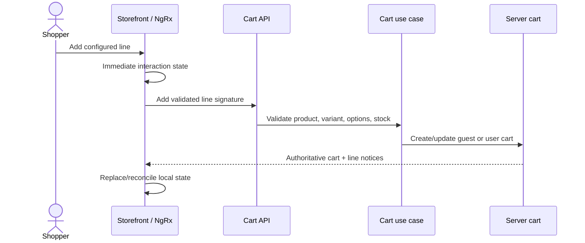
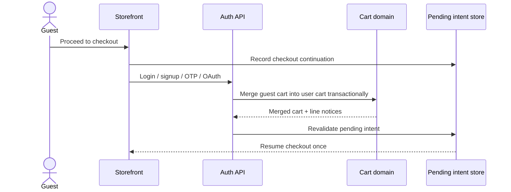

# Cart, pending intent, and offline reconciliation

This page describes how carts work for guests and signed-in customers, and how an action interrupted by sign-in resumes. It also covers the planned offline behaviour.

The storefront's cart is classic NgRx state with browser persistence. The API exposes a separate server cart with guest and user ownership. In the target design the server cart is authoritative, and browser state provides immediate UI and an offline queue.

## Time and ownership model

| Record                 | Owner                    | Lifetime                                 | Purpose                         |
| ---------------------- | ------------------------ | ---------------------------------------- | ------------------------------- |
| Guest cart             | Opaque `st_guest` cookie | 30 days                                  | Guest shopping continuity       |
| User cart              | Signed-in customer       | Business-defined                         | Cross-device cart               |
| Pending intent         | Guest session            | Maximum 30 minutes                       | Resume one account-bound action |
| Offline mutation queue | Browser                  | Until synced, cleared or storage is lost | Temporary offline interaction   |

The latest pending intent wins. It is not an unbounded queue.

## Add-to-cart journey

Add-to-cart never requires sign-in. Checkout does.

## Proceed-to-checkout journey

The order is fixed: authenticate, merge the cart, revalidate the intent, replay once, clear the intent.

After signup or sign-in, the API attempts to adopt the guest cart. A failed merge is logged and does not invalidate the sign-in.

## Merge policy

Duplicate lines merge when product, variant, add-ons and configuration match. Quantities are summed. In the target design, quantities merge only up to available stock, and invalid lines are not dropped silently:

- Retired product: terminal line error.
- Missing or invalid variant: line error.
- Insufficient stock: adjusted or unavailable quantity.
- Stale add-on or measurement choice: explain the required change.
- Changed price or promotion: show the new values before checkout.

## Account-bound intent matrix

| Action              | Guest behaviour               | Replay rule                                            |
| ------------------- | ----------------------------- | ------------------------------------------------------ |
| Wishlist            | Save one intent, authenticate | Revalidate the product, add it, return to origin       |
| Save for later      | Authenticate from the cart    | Revalidate the line, then move it                      |
| Notify me           | Authenticate                  | Replays the alert request for the selected variant     |
| Review              | Authenticate                  | Recheck verified-purchase eligibility                  |
| Proceed to checkout | Authenticate                  | Merge the cart first, then resume checkout             |
| Product question    | No sign-in needed             | Accept name and email; keep identity private in public |
| Reorder             | Already signed in             | Revalidate every item; allow partial success           |
| Public track order  | Not offered                   | Not applicable                                         |

## Offline reconciliation

Offline catalogue and cart support is planned. The reconnect flow is:

1. Determine whether the session is valid.
2. Sync queued changes to the guest or user cart.
3. Check product and variant lifecycle.
4. If active, check stock.
5. Recalculate pricing and other authoritative facts.
6. Replace local state with server values and show line-level notices.

Never cache auth tokens, payment data, account or order personal data, admin responses or secrets in the offline queue.

## Limitations

- The storefront does not call the cart API.
- Only **Notify me** replays after sign-in. Wishlist, save-for-later and checkout intent do not.
- Server cart lines are not validated against product, price or stock.
- Offline support is not in the build.

## Debugging checkpoints

- Compare the browser line signature with the API cart line.
- Check guest and user ownership, and session state.
- Check whether a pending intent expired or was replaced.
- Inspect line-level notices before investigating checkout.
- Never resolve a mismatch by trusting browser totals or dropping a line silently.
