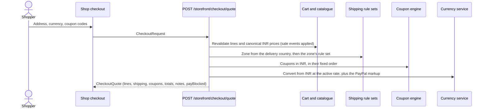

# Checkout, pricing, tax, currency, and shipping

Checkout is the server-owned step between a cart and a payment attempt. The API prices every step; the shop shows the answer and never rebuilds a total from product cards, local cart state or display prices.

## Preconditions

- The shopper is signed in. Guest checkout is off at launch: `/checkout` sends a guest to sign in and back.
- The cart is the shopper's own server cart (`POST /storefront/checkout/quote` reads it from the session).
- The delivery address is complete; billing is the same as delivery unless the shopper unticks it.
- The chosen currency is one the shop offers.

## The page

The page is built from the theme's checkout markup (`checkout-section-2`, `checkout-detail-box`, `delivery-address-box`, `pos-detail-card`, `summary-total`, the coupon box):

1. **Delivery address**: a saved address (the default starts chosen) or a new one with the country rules. The country sets the State list, the phone code and what the postal code is called; in India the PIN code fills the city and State. **Save to my addresses** starts ticked, with **Name this address**.
2. **Billing address**: **Same as delivery address**, or a saved or new one.
3. **Address in India (optional)**: only when both addresses are abroad and the shop sends orders abroad with an Indian invoice address. Every field is optional; only a complete address is used. The shop's words never mention invoices or GST.
4. **Summary**: each line with its MRP note or coupon share, the shipping line with its reason, applied coupons with **Remove**, the total, and **Pay** naming the amount.

## Calculation sequence



The quote runs again whenever the address, currency or coupons change.

## Amount ownership

| Amount                    | Source                                      | Kept on the order                          |
| ------------------------- | ------------------------------------------- | ------------------------------------------ |
| Product and variant price | Canonical INR catalogue row and sale events | INR and paid-currency unit and line totals |
| Coupons                   | Coupon engine in `core-domain`              | Each coupon, its lines and its INR amount  |
| Shipping                  | The zone's shipping rule set                | Charge, reason, rule set and version       |
| Exchange rate             | The active rate source                      | Rate, source and the markup                |
| Tax                       | GST is included in the price                | Tax lines wait on the HSN codes and rates  |

## Currency and gateway

Product prices are always INR. A sale event's price replaces the regular price while the event runs ([Launch and sale events](./events.md)).

- **Rupees** go through the INR gateway at the INR price.
- **Any other currency** goes through PayPal. The whole payment, shipping included, is converted at the active rate and then raised by the PayPal markup (6% for every currency but rupees, changed only by the super admin):

```text
amount = round2(amountINR × rateFromINR × (1 + markupPercent / 100))
```

- Prices follow the active rate source as it updates; a payment keeps the rate that priced it.
- **One list everywhere:** `GET /currency` returns each enabled currency with `shopRateFromINR`, the stored rate with the markup on top (₹ as it is). The top bar's currency picker lists exactly these, and every price on the shop is shown at that rate, so a price seen while browsing is the price the checkout charges. A choice saved in the browser takes today's rate when the list arrives, and one the shop has stopped selling falls back to ₹.
- A shopper billed in India who pays in another currency sees a quiet **Paying from India? Pay in ₹ instead** note (`payFromIndiaInRupees`). It never blocks Pay.
- A shopper billed abroad who picks ₹ while the INR gateway doesn't take cards issued abroad (an order setting) gets the currency picker with the billing country's currency first (`currencyPicker.first`).

## Shipping

The delivery country picks the zone: India is domestic, anywhere else international. The currency never changes the zone. Each zone's rule set prices the cart and explains itself; the shop turns that explanation into the reason line ("1 discounted piece × ₹100 · full-price pieces ship free", "Sent abroad: first piece, then 2 more"). A piece that can't go to the delivery country is named under its line with **Remove**. See [Shipping rules](./shipping-rules.md).

## Coupons

The shopper types a code into the coupon box; up to five codes go with the quote. The coupon engine applies them in a fixed order (% first, then ₹ off, then free delivery), each on what is left and never below ₹0. Sale pieces are left out unless the coupon includes them, and only coupons switched to combine are used together. A refused code says why in plain words (`couponRefusals`).

## When Pay stays off

`payBlocked` names the reason, and Pay's own label says it in place of the amount:

| `payBlocked`               | Pay reads                           | Also on the page                                   |
| -------------------------- | ----------------------------------- | -------------------------------------------------- |
| `cartEmpty`                | Your bag is empty                   |                                                    |
| `lineProblem`              | Check the pieces marked above       | The line's reason in the cart page's words, in red |
| `pieceCannotShip`          | Remove the piece that can't be sent | The line's reason with **Remove**                  |
| `deliveryAbroadNotOffered` | We deliver only within India        |                                                    |
| `noGateway`                | Choose another currency to pay      |                                                    |

A line marked for `lineProblem` is one the cart reports as unavailable, out of stock, or below the shortest cut for fabric; "only a few left" lowers the quantity and doesn't stop Pay.

## Pay and the return

**Pay** (`POST /storefront/checkout/place`, with an idempotency key) saves the order from the same figures the quote showed, holds its pieces for 15 minutes and hands the browser to the gateway. The gateway comes back to `/checkout/payment-return?attempt=…`, which asks the API to confirm the attempt (`POST /storefront/checkout/attempts/:attemptId/confirm`). The server's status enquiry decides; the browser's word is never taken.

| Result                  | What the shopper sees                                                                                                            |
| ----------------------- | -------------------------------------------------------------------------------------------------------------------------------- |
| `paid`                  | The return page: the order is placed, with **See your order**.                                                                   |
| `pending`               | The return page: the bank hasn't answered; the pieces stay held.                                                                 |
| `refunded`              | The return page: a piece sold before the payment arrived, and the payment was refunded in full.                                  |
| `failed` or `cancelled` | Back on the checkout (the return page is replaced in the history), with the popup below or a "didn't go through" line above Pay. |

The return page hands the outcome to the checkout in the browser's history state, never in the URL, and the checkout clears it before opening the popup, so a reload or **Back** never opens it again.

### The currency popups

Both are the shop's confirmation modal (`theme-modal`, `icon-box`, `button-box`) over the checkout:

- **Please choose your currency** (after PayPal returns without a completed payment): ₹ first for shoppers billed in India, each row naming how it pays ("Card, UPI, net banking" or "PayPal"); **Close** and **Continue in ₹**.
- **Switch to your region's currency** (the INR gateway refused a card from abroad): no ₹, the billing country's currency first and marked "From your billing address"; **Try another card** and **Continue in £**.

The popups list ₹, £, US$ and € where the shop offers them; **More currencies** adds the shop's other currencies, named by the browser in the page's language. **Continue** sets the shop's currency, so the checkout quotes again in it.

## Correction matrix

| Failure                   | Response                                              |
| ------------------------- | ----------------------------------------------------- |
| Piece can't go there      | Named under the line with **Remove**; Pay stays off   |
| Coupon can't apply        | Kept off the total, with the reason                   |
| Address invalid           | One message per field, from the country rules         |
| Payment didn't go through | Back to the checkout with the popup or the retry line |

## Limitations

- Tax lines are not shown: GST is included in the price, and the amounts wait on the HSN codes and rates.
- `GET /promotions/active` and `POST /promotions/validate` remain for the older coupon entry; the checkout uses the quote's coupons.

## Debugging checkpoints

1. Confirm the shopper is signed in and the server cart holds the lines.
2. Read the quote response before the page: `payBlocked`, `shipping.reason`, `coupons` and `couponRefusals`.
3. Check canonical INR inputs before converted values.
4. Check the currency's stored rate and the markup.
5. Check the zone's rule set and its version.
6. After a gateway return, read the attempt (`GET /storefront/checkout/attempts/:attemptId`) before the page.
