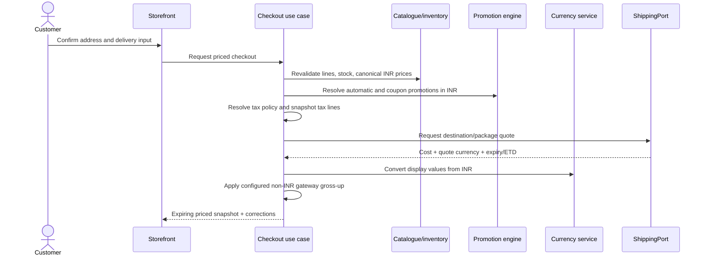
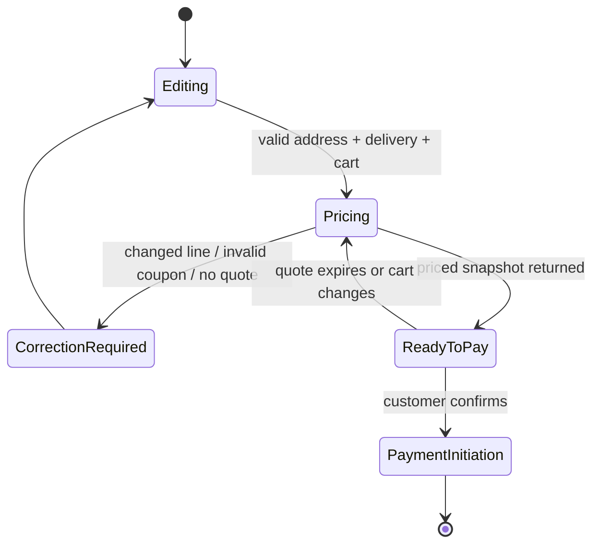

# Checkout, pricing, tax, currency, and shipping

Checkout is the server-owned step between a cart and a payment attempt. It calculates and validates what a customer will pay. This page describes the target design and the rules that apply to it.

## Preconditions

- The customer is signed in. Guest checkout is not available.
- The guest cart merge is complete.
- Every line has a valid product, variant, option, add-on, measurement and bundle signature.
- Shipping and billing addresses satisfy the contract.
- The selected currency is enabled.

## Calculation sequence



The browser renders the snapshot. It does not rebuild the total from product cards, local cart state or display prices.

## Amount ownership

| Amount                    | Source                          | Snapshot requirement                           |
| ------------------------- | ------------------------------- | ---------------------------------------------- |
| Product and variant price | Canonical INR catalogue row     | INR and paid-currency unit and line totals     |
| Add-on and bundle prices  | Validated configuration         | Selected options and resolved amounts          |
| Promotion                 | API promotion engine            | Rule, code and applied INR value               |
| Tax                       | Tax class and rule resolution   | HSN, class, rate, base, amount, inclusive flag |
| Shipping                  | Shipping provider quote         | Value, currency, INR value, provider, method   |
| Exchange rate             | Latest good stored rate         | Rate, source, fetched date                     |
| Gateway gross-up          | Versioned payment configuration | Rule version and charged amount                |

## Canonical price and currency

Product pricing starts in INR:

```ts
effectiveSellingINR = activeSalePriceINR ?? priceINR;
displayNet = roundCurrency(effectiveSellingINR * rateFromINR, currency);
```

INR uses a rate of `1`. If a rate refresh fails, keep the latest good rate and mark it stale. Never overwrite it with an invalid value.

For the non-INR PayPal path, the gross-up formula is:

```text
G = (N + f) / (1 - p)
```

`N` is the intended net amount in the paid currency, `p` is the percentage fee, `f` is the fixed fee and `G` is the charge before currency rounding. Extra exchange-rate or GST-on-fee rules must be explicit versioned configuration.

## Shipping selection

- An India destination uses the domestic shipping adapter.
- Any other destination uses the international adapter.
- A provider response must include value and currency.
- Shipping cost is converted with the stored rate.
- International shipping receives PayPal gross-up only when the active rule enables it.
- A fallback for an unserviceable address must be identifiable in the quote.

## Tax

Tax resolves at checkout from the product or variant tax profile and the applicable rules. The order line freezes the result. The customer-facing tax display is an open accounting decision and must not be guessed in Angular.

## Promotions

`GET /promotions/active` and `POST /promotions/validate` support coupon entry. Final checkout must re-evaluate coupon validity, timing, scope, priority, stacking and cart conditions against INR values.

## Checkout state machine



## Correction matrix

| Failure             | Response                                                       |
| ------------------- | -------------------------------------------------------------- |
| Product retired     | Mark the line unavailable; require removal or replacement      |
| Stock reduced       | Adjust or block the quantity with a line notice                |
| Price changed       | Show old and new values and require confirmation               |
| Coupon invalid      | Keep the cart, remove the discount and explain                 |
| Address invalid     | Map structured errors to address fields                        |
| No shipping service | Offer a configured fallback or manual contact                  |
| Quote expired       | Requote before payment                                         |
| Exchange rate stale | Use the latest acceptable rate, or block past the safety limit |

## Limitations

- The storefront checkout renders forms, addresses, delivery and payment choices with a static totals object. It does not call the API.
- No quote endpoint, tax engine or shipping adapter exists.
- Exchange rates are stored values. No refresh job or `FxRatePort` adapter exists.
- Points and wallet controls in the checkout UI have no backend.

## Debugging checkpoints

1. Confirm that the cart merge finished and the session is valid.
2. Compare the cart version and signature with the priced snapshot.
3. Inspect line corrections before promotion or shipping calculations.
4. Check canonical INR inputs before converted values.
5. Inspect the exchange-rate and gross-up configuration versions.
6. Check the shipping destination, package facts, quote currency and expiry.
7. Never debug a total from the rendered Angular numbers alone.
