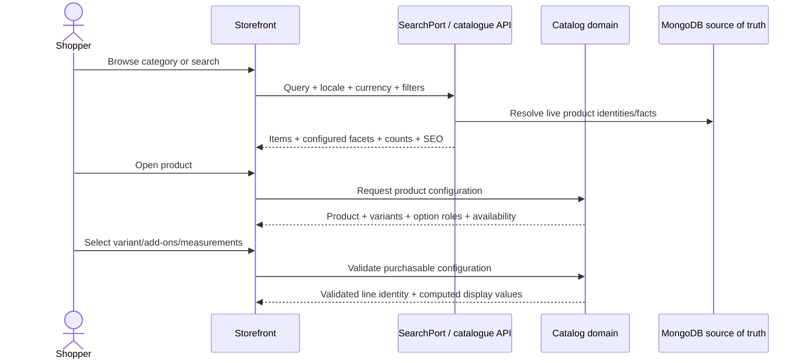
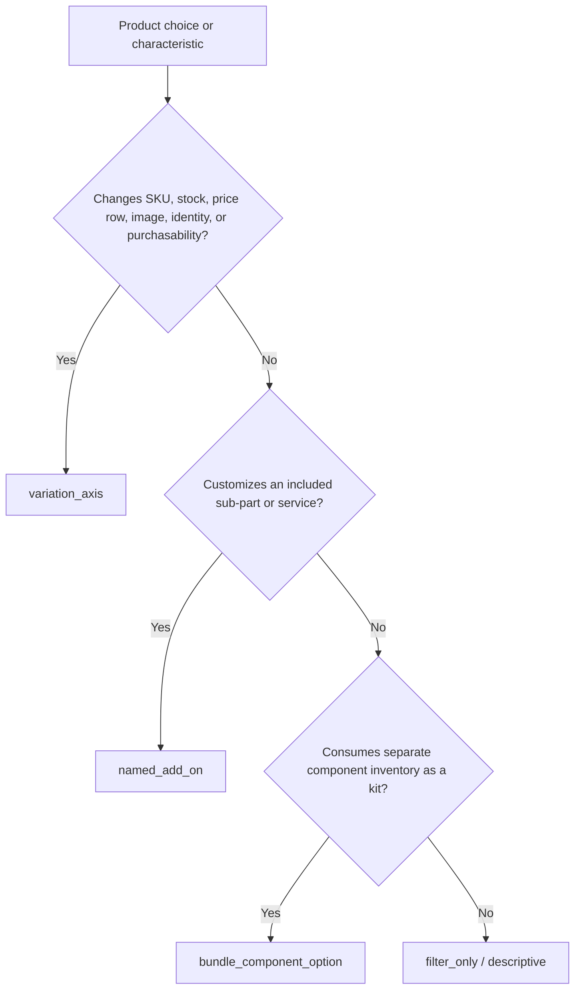

# Discovery and product configuration

This journey starts with a customer need and ends with one valid, purchasable cart line. It covers discovery, product visibility, options, price, media and stock.

## Journey



Category pages, cards, product pages and search read the catalogue API. The cart is a client-side store.

## Semantic option roles

An option's label, such as color, size, design, fabric or waist, does not decide its behaviour. Its semantic role on the product does.



| Role                      | Creates variant matrix? | Own stock and SKU?       | Catalogue facet?                                    |
| ------------------------- | ----------------------- | ------------------------ | --------------------------------------------------- |
| `variation_axis`          | Yes                     | Yes, through the variant | Yes, when a product also states it as a filter fact |
| `named_add_on`            | No                      | Service or add-on rules  | No                                                  |
| `bundle_component_option` | Separate composition    | Component inventory      | No                                                  |
| `filter_only`             | No                      | No                       | Yes                                                 |

## Saree and blouse example

A saree with an included blouse piece stays the base product. `Blouse Design` is a named add-on group:

- Default `No Design`.
- Optional design terms.
- Optional INR price change.
- Design-specific media where relevant.
- Measurement fields for stitched choices only.

A standalone blouse may use design as a variation axis, because the design identifies the SKU and stock row.

## Category listings

`GET /catalog/placements` returns one page of cards for a category path. Filters cover price, rating, category and attributes. Ticks within a facet combine with OR, and facets combine with AND. Facet counts are disjunctive: a facet's counts ignore that facet's own selection. Only the plain first page of a listing is marked indexable. The storefront drops malformed filter values from the address; the API rejects them with 400.

## Product badges

A card shows at most one promotional badge and one stock fact.

| Badge         | Qualifies when                                                                                 |
| ------------- | ---------------------------------------------------------------------------------------------- |
| Sale          | A variant sells below its MRP                                                                  |
| Featured      | An operator marks the product                                                                  |
| Bestseller    | The weekly job ranks it in the top 8 by all-time units                                         |
| Trending      | The weekly job ranks it in the top 8 for the last 30 days, excluding bestsellers               |
| New           | Published in the last 30 days                                                                  |
| Low stock     | Sellable units are at or below the threshold, default 2, for a product that has been restocked |
| Back in stock | Restocked in the last 14 days                                                                  |

An operator can pin or hide a badge, but a pin only chooses among badges that already qualify.

## Variant rules

Variant rows exist only for `variation_axis` groups. Named add-ons belong to the cart line and never appear on a variant.

- A product has one row per option combination, and every row selects the same axes.
- SKUs are unique across the catalogue.
- A product has at most one base variant, the `No Stitching` or `No Blouse` row.
- A variant may set its SKU, MRP, selling price, stock, images, shipping dimensions, barcode and HSN. An empty field inherits the product.
- Title, description and SEO stay on the product.
- A selling price cannot exceed the MRP, and a sale window cannot end before it starts.

A named add-on group must offer a base term, such as `No Design`, and default to it.

## Bundles

A bundle is a product that resolves to separate component lines.

| Bundle type            | Behaviour                                |
| ---------------------- | ---------------------------------------- |
| `fixed_kit`            | Every component ships. None are optional |
| `choose_one_per_group` | The customer picks within each group     |
| `optional_addons`      | The customer may add components          |

The price policy is `sum_components`, `fixed_bundle_price` or `discounted_components`. A fixed price is required for the second and refused for the others. A bundle cannot contain itself, and bundles do not nest.

## Related products

A relation links a product to another product for discovery, and changes neither price nor stock. The types are `related`, `upsell`, `cross_sell`, `bought_together`, `complete_the_look`, `substitute` and `same_collection`.

`related` and `upsell` are always curated by hand. `cross_sell` and `bought_together` can also come from the weekly insight job, which replaces its rows as one set. Public reads return only live relations inside their schedule, in rank order.

## Reviews, questions and FAQ

- **Reviews.** A customer can review a product they received. There is one review per customer, product and order, with up to five photos. A review stays pending until an operator decides. Approve publishes it and its photos. Reject deletes the photos. Public ratings count approved reviews only.
- **Questions.** Anyone can ask, with a name and email. The email stays in the admin view, and "stay anonymous" hides the name in public. A repeat of a pending question returns the first one. Only answered questions are public, and answering sends the `product_question_answered` email.
- **FAQ.** An entry is global, or targets categories, products or both. A page shows the global entries plus those matching it, each once.

## Cart-line signature

Two lines can merge only when their full purchase configuration is equivalent. The merge identity includes:

```text
product id
+ variant id
+ selected variation values
+ selected named add-ons
+ measurement/customization signature
+ bundle component selections where applicable
```

Quantity applies after identity matching and is subject to stock.

Catalogue option, add-on, attribute and taxonomy labels are data, and the storefront renders them as returned. Interface text such as "View all" uses Transloco keys.

## Price and stock ownership

- The storefront shows returned display values and performs immediate interaction checks.
- Canonical price, sale price, promotion eligibility, add-on prices, bundle totals, tax basis and stock belong to the server.
- A card shows one price only when every counted variant shares the same selling price and MRP. Otherwise it shows a range.
- Draft, disabled and discontinued products do not appear in public catalogue reads. The API enforces this for lists and direct reads.

## Failure and edge cases

| Condition               | Expected behaviour                                                  |
| ----------------------- | ------------------------------------------------------------------- |
| Unknown slug            | A real 404 with helpful navigation                                  |
| Discontinued product    | `410`, or a `301` when an operator names a live replacement         |
| Variant does not exist  | Disable the combination and keep prior valid selections             |
| Required add-on missing | Keep the product visible and block add-to-cart with a field message |
| Measurement required    | Render data-defined fields and validate them                        |
| Variant sold out        | Offer **Notify me**                                                 |
| Currency changed        | Refetch server-computed prices                                      |

## Debugging checkpoints

1. Confirm that the route resolved the expected locale and slug.
2. Identify the service and query that supplied the data.
3. Inspect the product status and semantic roles.
4. Reconstruct the variant, add-on and measurement signature.
5. Confirm that the API returned the price and availability.
6. Check that the same configuration survives product detail, cart and checkout.
