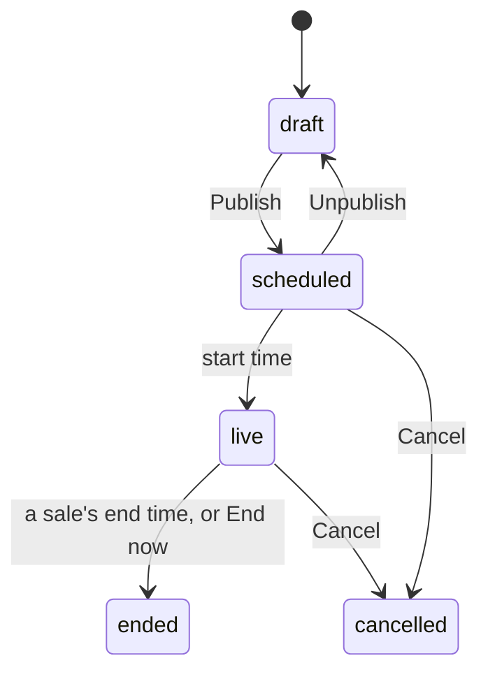

# Launch and sale events

An event is one of two kinds:

- A **launch** puts draft categories and products live at its start time. It has no end.
- A **sale** gives products a sale price from its start time to its end time.

Nothing on the shop changes while an event is a draft. **Publish** arms it: the shop starts counting down and the customer message goes out. From then on the API clock acts at the start and end times without anyone in the admin.

## Lifecycle

| State       | Meaning                                                                                       |
| ----------- | --------------------------------------------------------------------------------------------- |
| `draft`     | Editable, invisible to shoppers. Only a draft can be deleted                                  |
| `scheduled` | Published. The shop shows the countdown; editing must still pass Publish's checks             |
| `live`      | Started. A launch stays `live` for good; a running sale may move its end and change its rules |
| `ended`     | A sale that reached its end, or was ended with **End now**. Read-only, keeps its sale record  |
| `cancelled` | Stopped for good. A running sale's prices go back at once; a launch's items stay on the shop  |

A launch that has started, an ended sale and a cancelled event are read-only. Taking a launched product off the shop is done per product.

## Data

Events live in the `shopEvents` collection. Each document holds:

- `name` (admin only), and the `title` and `message` per language. The message is rich-editor markup, cut down on every save by the blog's `sanitizeArticleHtml` allowlist.
- `startsAt` and `endsAt` in UTC. The admin enters India time; a launch's `endsAt` is always null.
- `linkHref`: a shop path the top bar line, the popup button and the message lead to.
- `showCountdown`, `showPopup`, `nowLiveDays` (how long a launch keeps its "Now live" line, 0 to 60 days).
- `popupAssetIds`: up to five media library pictures (`MAX_POPUP_PICTURES`), in slide order, and `popupImageSide` (`right` or `left`). Pictures are optional.
- `launch`: `categoryIds`, `productIds`, and `heldProductIds` (draft products inside a picked category that stay draft).
- `sale`: category lines and product lines, each with a rule (below).
- The lifecycle stamps (`publishedAt`, `startedAt`, `endedAt`, `cancelledAt`, `messageSentAt`), the `launchReport` and the `saleRecord`.
- `previewTokenHash` and its expiry for the admin's preview link. Only the hash is kept.

Indexes cover `status` with `startsAt` (the clock's reads), `previewTokenHash` (sparse) and `popupAssetIds`. The media owner registry reads `popupAssetIds`, so garbage collection never removes a picture an event uses. A document written with the older single `popupAssetId` field reads as a one-picture list, and the next save moves it to `popupAssetIds` and unsets the old field.

## Sale rules and pricing

A rule is one of three kinds:

| Kind      | `value`               | Result                                                                             |
| --------- | --------------------- | ---------------------------------------------------------------------------------- |
| `percent` | Percent off, 0 to 100 | `floor(normal × (100 − value) / 100)`                                              |
| `amount`  | Whole rupees off      | `normal − value`                                                                   |
| `fixed`   | A sale price          | `value`, or a per-SKU price from `skuPrices` for a product with several price rows |

A category line applies its rule to every product in the category and the categories under it. Inside a category line, an **exception** either holds a product back (`held`, no sale price) or gives it its own rule (`own`).

`resolveSaleRule` in core-domain picks the rule for a product in this order:

1. A product line for that product.
2. An `own` exception in any category that holds it.
3. A `held` exception in any category, which keeps the product out even when another category would discount it.
4. Every matching category rule. When categories disagree, `salePriceINR` keeps the lowest price.

**Sets.** A set (a product of type `bundle`) has no price rows of its own. The sale's **Sets (bundles)** switch (`sale.includeSets`, off by default) decides whether the sale reaches sets at all, whatever category they sit in or even when picked. When it is on, the rule a set resolves to applies to its set price, after the set's own price method and rules: `SalePriceBook.setRules` hands the running rules to the set reader, the core quote (`quoteBundle`, `eventSale`) keeps the lowest result, and the shop page, cards, cart and checkout all price the set that way. The Review tab shows a set as one row at its set price. When it is off, sets keep their own price and do not appear in Review.

`applySaleRule` refuses a rule that cannot apply to a SKU: a normal price of ₹ 0 or less, a result of ₹ 0 or less, a result at or above the normal price, or more rupees off than the price. Saving refuses rules that can never apply (`saleRuleProblem`). The Review tab warns, without refusing, when a SKU would be more than 60% off (`SALE_WARNING_PERCENT`), which catches a typed 90 meant as 9.

### The price overlay

Sale prices never touch a product. `SalePriceBook` holds every published sale's rules per product in memory. Each API process re-reads it every 60 seconds (`SALE_BOOK_REFRESH_MS`) and after every admin change. A failed read keeps the last good book.

An entry applies from the sale's start to its end by the clock, whatever the stored status says, so the price changes on the second even before the clock writes `live`. `SaleAwareVariantRepository` wraps the variant repository: reads with the `public` audience get `salePriceINR` laid over them, while admin reads and every write go straight through. A sale price therefore cannot be saved onto a product, and nothing needs putting back when a sale ends.

The cart and checkout are priced by the server, so a cart re-prices on its next read when a sale starts or ends. Search, price filters and sorting are re-indexed for the touched products at each start and end. The product page reads `saleEndsAt` from the catalogue to show its "Hurry up! Sale ends in" timer for the soonest-ending sale on that product.

## Publish

`shopEventPublishProblems` in core-domain and the API's catalogue checks list everything that stops Publish, one problem per line:

| Code                              | Stops Publish when                                                                                            |
| --------------------------------- | ------------------------------------------------------------------------------------------------------------- |
| `missing_text`                    | A title or message is empty in any active language. An editor holding only an empty paragraph counts as empty |
| `missing_start`, `start_passed`   | No start time, or the start is not in the future                                                              |
| `missing_end`, `end_before_start` | A sale without an end, or an end at or before the start                                                       |
| `no_items`                        | No category or product picked                                                                                 |
| `not_ready`                       | A launch product fails Go Live; the row carries its Go Live gaps                                              |
| `overlap`                         | A product is in another published sale over the same time; the row names that sale                            |
| `bad_rule`, `unknown_item`        | A rule that can never apply, or a category or product deleted since it was picked                             |
| `not_draft`                       | The event is already published                                                                                |

The problems travel as field issues, which the API's error filter passes to the admin form. A successful Publish returns how many customers the message reaches.

## The clock

`EventClock` runs inside every API process, not in the worker. Every minute (`EVENT_SWEEP_MS`) it looks for events whose moment has come. Between sweeps it sets a timer for the next start or end, so the shop changes on time. A server that was down acts within a minute of coming back.

Each step is one conditional write (`scheduled → live`, `live → ended`). When two API copies wake for the same moment, only the one whose write succeeds runs the step.

- **Launch start.** The launch's draft categories go live in their canonical place on the shop menu. Every draft product in them, except the held ones, and every product picked alone is checked against Go Live again. A product edited since Publish so that it fails Go Live stays draft. A product someone put live by hand is left alone. `launchReport` lists what went live, what was skipped and what failed, with gaps.
- **Sale end.** `saleRecord` keeps each SKU's normal price, sale price, units sold, revenue and discount from paid orders in the sale's window, with totals and the product's English title. The working rules are not needed again.

Every clock step and every admin write leaves an audit record.

## Customer message

Publish sends the event's message once, on the first Publish. Unpublishing and publishing again does not send it a second time. `EventMessenger` sends email only, on the MSG91 marketing template `shop_event_announcement`, to active customers whose saved consent includes marketing, each in their own language. `NotificationPort` applies the marketing kill-switch. SMS and WhatsApp wait for approved MSG91 templates. **Send me a test** sends the message in every language to the signed-in admin.

## API

Admin routes are under `/admin/events` and use the `event.index`, `event.create`, `event.edit`, `event.publish`, `event.cancel` and `event.destroy` permissions. The [route inventory](../api/route-inventory.md) lists each one. Notable routes:

- `GET /admin/events/:id/review`: the items, every SKU's final price with the rule it came from, what stops Publish, and the message's reach.
- `GET /admin/events/category-products/:categoryId`: a category's products and SKU prices, for the launch item list and the sale exceptions window.
- `POST /admin/events/:id/preview`: a preview link that works for 30 minutes.

Public reads take `?locale=`:

- `GET /catalog/events`: published events as the shop shows them, with `serverNow`.
- `GET /catalog/events/preview?token=`: one event's popup through a preview link, published or not, shown as if published. An unknown or expired token returns no events.

`publicShopEvent` turns a stored event into the shop's shape for one language at one moment:

| Field         | Sale                       | Launch                                        |
| ------------- | -------------------------- | --------------------------------------------- |
| `phase`       | `upcoming`, then `running` | `upcoming`, then `launched`                   |
| `countdownTo` | The start, then the end    | The start, then null                          |
| `stripUntil`  | The end                    | `nowLiveDays` after the start                 |
| `popupUntil`  | The end                    | 60 days after the start (`LAUNCH_POPUP_DAYS`) |

An ended sale, and a launch whose strip and popup are both over, are left out. `popupImages` holds the pictures that can be shown, in order; a deleted or unprocessed picture is skipped, and the list is empty when the popup is off.

## Admin

The admin menu's **Events** group holds **All events** (`/event`), **New launch** (`/event/create/launch`) and **New sale** (`/event/create/sale`). All events lists events with search, type and state filters, and sorts by name, start or end. Both create pages open the same form; the type is fixed by the first save.

The form's tabs:

- **General:** name, shop title per language through the shared Language switch, start and end in India time, the link picker, the countdown and popup switches, popup pictures and their side, and **Preview** at computer or phone width.
- **Items** (launch): categories, products picked alone and held products, each with its Go Live gaps.
- **Discounts** (sale): category lines with their exceptions window, and product lines.
- **Message:** the customer message per language in the rich editor, and **Send me a test**.
- **Review:** what stops Publish, the message's reach, every SKU's final price with the rule it came from and its refused or warned state, and the **Results**: a launch's report or an ended sale's record.

**Publish**, **Unpublish**, **Cancel** and **End now** show according to the state.

## Shop

`ShopEvents` (in `core/events`) reads `GET /catalog/events` during server rendering, so the first paint already holds the lines. In the browser it reads again and keeps the gap between the server's clock and the browser's. Every countdown ticks from server time, so a wrong phone clock cannot show a wrong time. The fixed moment beside a timer is always India time text, the same for every shopper.

- **Top bar and phone strip.** The top bar shows each event's line and countdown on computers; the minimal header's strip shows it on phones. While the event has a popup, tapping the phone strip opens that popup at once.
- **Product page.** A product in a running sale shows its sale price and the sale-ends timer.
- **Tab title.** While an event has a line, a hidden tab alternates its title with the event's title and time left.

### The event popup

`EventModal` shows one event per visit. `choosePopupEvent` picks it: the running sale that ends soonest, then a sale about to start, then the newest launch. Events whose popup is over or that the visitor answered are skipped.

It opens at the newsletter popup's engagement moments: half the page scrolled, 30 seconds on the site, or the pointer leaving towards the browser bar. It never opens on arrival, or on `/cart`, `/checkout`, `/account` or `/auth` pages. While an event popup can show, the newsletter popup waits for a later visit.

Layout:

- With pictures, the theme's 800px split (`modal-lg`), pictures on the side `popupImageSide` names and above the text on phones.
- With several pictures, an `ngb-carousel` with indicators and no arrows, sliding every 4 seconds and pausing on hover and focus. It stands still during server rendering and for visitors who ask for reduced motion.
- Without pictures, the 400px text half alone (`event-popup-text-only`), centred.

Answers live in the Functional `st_events` cookie, as `id~endTime` pairs. The cookie expires with its last entry.

- **✕** rests that event's popup for 3 days.
- **Don't show this again** stops it until its `popupUntil`.

Without Functional consent nothing is stored, and the session flag `st_events_shown` keeps the popup to once a visit.

A phone strip tap opens the popup whatever was answered before, and closing it stores nothing unless **Don't show this again** was ticked. The admin's preview opens the shop with `?event_preview=<token>`: the popup opens at once and closing it stores no cookie or visit flag.
