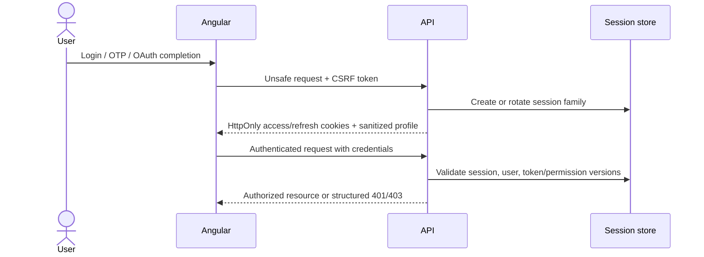
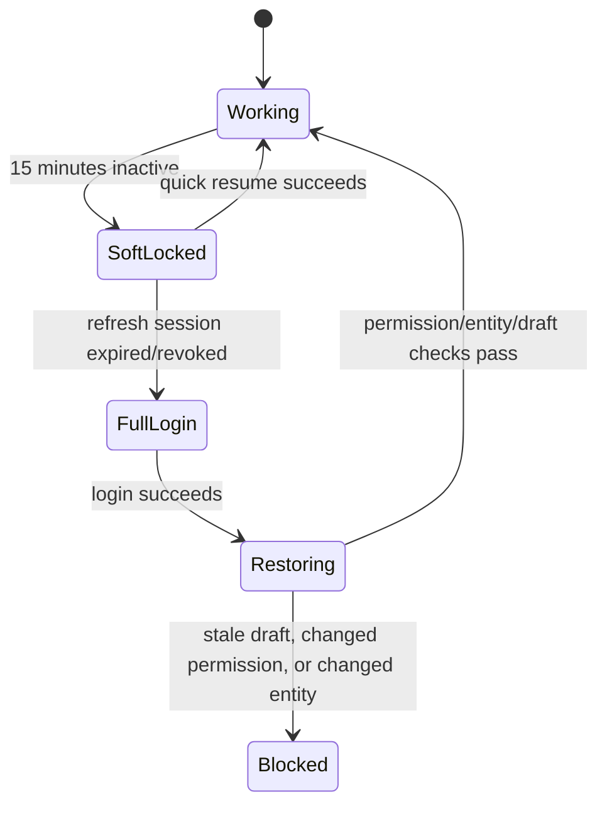

# Identity, account, and admin resume

This page describes how customers and operators sign in, manage their accounts and resume work. For the security rules behind these flows, see [Security, sessions, and authorization](/backend/security-and-identity).

## Storefront methods

Customers can sign in with a password or a one-time code, using email or phone, or with Google or Facebook.

Signup creates no customer until both email and phone are verified. The finalisation step reads those values from server-held pending state.

- `GET /auth/storefront/signup` restores the safe projection after a reload.
- `DELETE /auth/storefront/signup` abandons the signup.
- Each field shows where its code went and waits out the server's backoff before offering another.
- **Change** on a verified field reopens it without spending a send.

Guest browsing is always available, and public pages never return 401 to a guest. Login, registration, one-time-code and forgot-password are guest-only screens: a signed-in customer is redirected to `/account/dashboard`. `/account/*` routes redirect guests through the storefront `AuthGuard`.

After sign-in the API attempts to adopt a proven guest cart. A failed merge does not undo the sign-in.

Password recovery accepts an email or phone, but the phone only finds the account. The reset link always goes to the email on the account, and the answer is the same for a known or unknown identifier.

### Social signup and abandonment

A provider address that is already registered does not start a signup when the provider proved it. A Google sign-in whose email has an account returns `account_exists` with that address, or `account_not_accessible` for a disabled or locked account. The login card then switches to one-time-code mode with the address filled in. The code signs the person in, and they can connect Google from **Sign-in methods**.

When a signup code proves an email or phone that already has an account, the registration alert offers **Sign in to that account**, without a second code, or **Use different details**. Facebook does not prove its address, so a Facebook sign-in begins a signup and finds out at the email code. Accounts are never linked on an address.

An unknown Google or Facebook identity begins a server-held signup and opens `/auth/register`. On every arrival the page reads the pending record. It prefills the name and email, locks a provider-verified email, hides the password and other provider controls, and asks for the remaining phone proof. A reload keeps the record. In-app navigation away discards it, and the record expires on its own otherwise.

Abandoning a Google-origin signup also asks Google Identity Services to revoke this site's grant for that email hint. This does not sign the person out of Google. A later attempt may ask for account selection and consent again. A completed signup keeps the grant.

Facebook initialization waits for `fbAsyncInit`, reads `window.FB` at call time and keeps `FB.login()` synchronous with the user gesture. OAuth state is single-use and is issued again after a refusal. Connect mode passes the provider credential to step-up instead of starting a sign-in.

## Browser session model

Angular stores sanitized user and session status, never access or refresh secrets.

## Authentication outcome rules

- Login failure does not reveal whether an account exists.
- OTP and reset requests respond the same way for known and unknown accounts.
- OTPs are short-lived, rate-limited, single-purpose and single-use.
- OAuth validates state, provider, nonce and verified identity facts.
- Connect mode never becomes a sign-in.
- Disabled, locked or deleted users receive no new session.
- Refresh rotation invalidates the previous token, and reuse revokes the family.
- Password and role changes invalidate affected sessions or permission versions.

## Account data

The account API owns the customer's profile name, addresses, sign-in methods, sessions and pending email or phone changes.

Address add and update use one atomic MongoDB statement, so concurrent edits do not replace the whole array. Contact confirmation consumes the proof, changes the identifier and writes the audit record in one transaction. A unique-index race returns `contact_in_use`.

Personal records are never public offline cache, and object lookups enforce ownership.

## Admin authentication

Operators sign in with a password or PIN, using email or username. The guard enforces audience, role, declared permissions and current permission versions. There is no self-registration or social sign-in.

Accounts come from an invite, or from the first-administrator command. Accepting an invite creates the account but no session, so the new operator signs in afterwards.

Recovery uses a single-use emailed token, never an OTP. The route `/auth/otp` is a step for pasting that token. It verifies nothing and cannot sign anyone in. The PIN is entered on an on-screen keypad with no text field, and digit keys on a physical keyboard work too.

## Admin deep-link and soft-lock flow

After 15 minutes of inactivity the shell opens the idle lock. Resume uses the preferred method, PIN when configured and otherwise password, through `POST /auth/admin/resume`. The API also enforces the admin idle lifetime and PIN lockout.

## Safe admin resume order

1. Keep only allowed workflow state.
2. Reauthenticate with the preferred quick-resume method.
3. Revalidate the active user, session, token version and permission version.
4. Revalidate the target entity and version.
5. Restore a draft through the normal form mapping and validation.
6. Retry a blocked unsafe request only when it is safe and idempotent.

Authorization failures are not queued. A 403 stays blocked until permissions change.

## Dynamic draft requirements

Complex product, order and invoice forms need enough draft metadata to rebuild conditional controls: product type, option roles, generated variant inputs, add-on groups, measurements, the current step and unsaved media references. Restoring a draft must never bypass validation.

## Limitations

- Pending-intent continuation covers **Notify me** only.
- Order history, wishlist, reviews, saved items, notifications, points and wallet are separate capabilities, and most read JSON data.
- Reload and crash recovery for complex admin forms is not built.
