import { CommerceJourneyAtlas } from '@site/src/components/CommerceJourneyAtlas';

# Business and commerce journey atlas

A business journey crosses more boundaries than one screen or endpoint. This section follows customer and operator actions through routes, UI state, contracts, the API, domain rules, persistence, external ports and recovery.

Use the atlas to select a journey and switch between three views:

- **Current code** shows what the repository does.
- **Target design** shows the intended behaviour.
- **Failure recovery** shows how the system stays safe when something fails.

<CommerceJourneyAtlas />

## Read the deep dives

1. [Discovery and product configuration](./discovery-and-product-configuration)
2. [Cart, authentication intent, and offline reconciliation](./cart-and-intent)
3. [Checkout, pricing, tax, currency, and shipping](./checkout)
4. [Payment and order lifecycle](./payment-and-order-lifecycle)
5. [Returns, refunds, and notifications](./returns-refunds-and-notifications)
6. [Identity, account, and admin resume](./identity-account-and-admin-resume)
7. [Failure recovery and debugging](./failure-recovery-and-debugging)

## How a journey is traced

```mermaid
flowchart LR
    Intent["Customer or operator intent"] --> Route["Route / page"]
    Route --> Feature["Feature composition"]
    Feature --> State["Query / store / form"]
    State --> Contract["Shared zod contract"]
    Contract --> API["API operation"]
    API --> UseCase["Domain use case"]
    UseCase --> Port["Port"]
    Port --> Adapter["Adapter"]
    Adapter --> External["MongoDB or provider"]
    External --> Result["User-visible result"]
```

Not every journey reaches every box. Each page states what exists and what is planned.

## Where to look

| Question                           | Primary source                                        |
| ---------------------------------- | ----------------------------------------------------- |
| What does the UI do?               | Tested route, component and state behaviour           |
| What HTTP shape exists?            | `packages/contracts`, controllers, generated OpenAPI  |
| What should the business flow do?  | The decision log and technical knowledge base         |
| What data is durable?              | Adapter models, indexes and transactions              |
| What does an external provider do? | Its adapter and the provider's official documentation |

## Commerce rules

These rules apply across all journeys:

- Canonical product price is INR.
- Angular never calculates authoritative checkout totals.
- The API revalidates product, variant, add-on, bundle, price, promotion, tax, stock and shipping eligibility.
- Guests can use a cart. Guest checkout is not available.
- Authentication merges the guest cart before replaying one pending action.
- Orders snapshot purchased facts, so later catalogue changes cannot rewrite history.
- Payment, shipment, return and refund records have separate lifecycles.
- UI permissions improve usability but do not authorize an operation.
- Sensitive account, order, payment and admin data is never cached for offline use.
