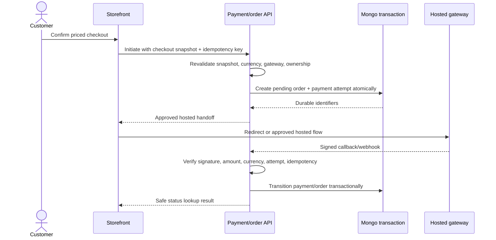
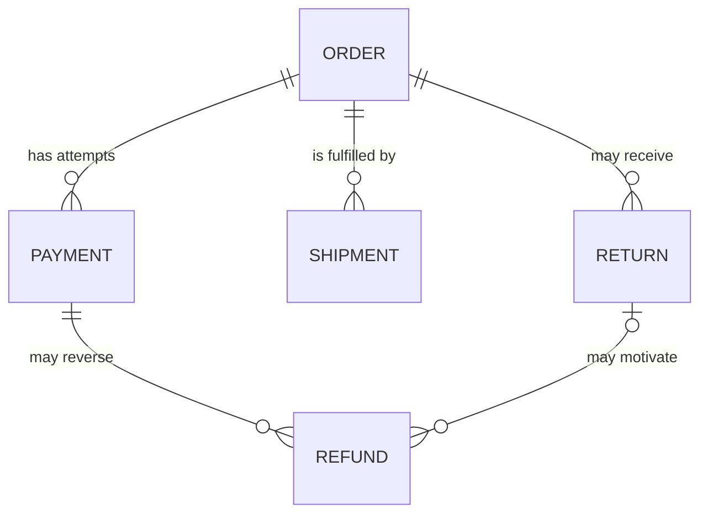

# Payment and order lifecycle

This page describes how orders and payments relate, and the rules a payment integration must follow. Orders exist in the API. Payment is a design with a port and no adapter.

## Gateway selection

| Paid currency                | Gateway role                  | Decided by            |
| ---------------------------- | ----------------------------- | --------------------- |
| INR                          | INR online gateway (CCAvenue) | API checkout use case |
| Any enabled non-INR currency | PayPal                        | API checkout use case |

Angular does not choose a gateway. The server derives it from the validated paid currency and active configuration.

## Initiation and confirmation

Gateway credentials, encryption keys and webhook secrets stay on the server behind `PaymentGatewayPort`.

## Why order and payment are separate

One order can have several payment attempts. A failed attempt must not erase the shopping record, and a gateway callback must not rewrite purchased facts.

## Order snapshot

Every purchased line freezes enough information to stay correct after product edits or archival:

- Product and optional variant identifiers.
- Title, slug, SKU, product type and category context.
- Chosen variation attributes.
- Named add-ons and captured measurements.
- Image reference.
- Unit and line totals in INR and the paid currency.
- Resolved promotion and tax lines.
- Return and refund eligibility facts.
- Product status at purchase.

Order history renders from the snapshot, not from the current product.

## Lifecycle separation

### Order

`pending → paid → processing → shipped → delivered`, with cancellation and refund paths. Transitions must be validated and appended to a timeline.

### Payment attempt

`initiated → authorized/captured` or `failed`, with later partial or full refund states. Callback order and retries must be idempotent.

### Shipment

Quote, label, pickup, transit, delivery, failure and cancellation are shipment events, not order or payment fields.

## Idempotency and callback safety

- Client retries reuse an idempotency key tied to the same priced snapshot.
- Provider callbacks are authenticated and checked against the stored amount, currency, order and attempt.
- Repeated valid callbacks return the existing result.
- A browser return URL is not proof of payment.
- Unknown, mismatched or stale callbacks fail closed and enter an auditable review path.

## Ownership and authorization

Customers can read only their own orders. A mismatch returns not-found. An admin holding `order.index` can read any order. `PATCH /orders/:id/status` needs an admin session, CSRF and `order.update`. A guarded route or a supplied order id is never sufficient authorization.

## Document numbering

The numbering policy for orders, tax invoices and purchase invoices is an open decision. Before you implement it, the decision log must define:

- Financial-year reset or perpetual sequence.
- Company code, separators and zero-padding.
- Gapless requirements and cancellation handling.
- Separate sequences for each document type.

Do not generate production numbers from database counts, random ids, timestamps or a frontend formatter. India financial-year boundaries are calculated in IST, and issued invoices must stay immutable.

## Failure matrix

| Situation                       | Order                               | Payment                        | Customer experience                    |
| ------------------------------- | ----------------------------------- | ------------------------------ | -------------------------------------- |
| Provider handoff fails          | Stays pending or abandoned          | Attempt failed or not started  | Retry safely without a duplicate order |
| Browser closes                  | Pending state remains               | Await callback or status check | Resume from account or order status    |
| Callback delayed                | Not marked paid from browser return | Pending                        | Explain processing and poll safely     |
| Amount mismatch                 | Not fulfilled                       | Flagged or failed              | Safe generic message; operator alert   |
| Duplicate callback              | No duplicate transition             | Existing result returned       | Stable confirmation                    |
| Stock changed before initiation | Not initiated                       | None                           | Return to corrected checkout           |

## Limitations

- `POST /orders` creates a `pending` order and removes the cart in one transaction. It has no idempotency key, stock step or payment step.
- No provider adapter, hosted handoff, callback route or webhook exists.
- `OrdersService` generates an interim order number.
- Status changes have no legal-transition rule, version check or audit record.

## Debugging checkpoints

1. Trace the checkout snapshot id and idempotency key.
2. Check the server-derived gateway and paid currency.
3. Inspect the order and the payment attempt separately.
4. Verify the provider signature, amount and currency.
5. Inspect the status timeline and audit records.
6. Confirm ownership and permission checks.
7. Never rely on the browser success page.

## Provider documents

Provider reference material is under [Payments](/payments):

- [CCAvenue](/payments/ccavenue): the INR gateway role.
- [Razorpay](/payments/razorpay): a possible later INR gateway.
- [PayPal](/payments/paypal): the non-INR role.
