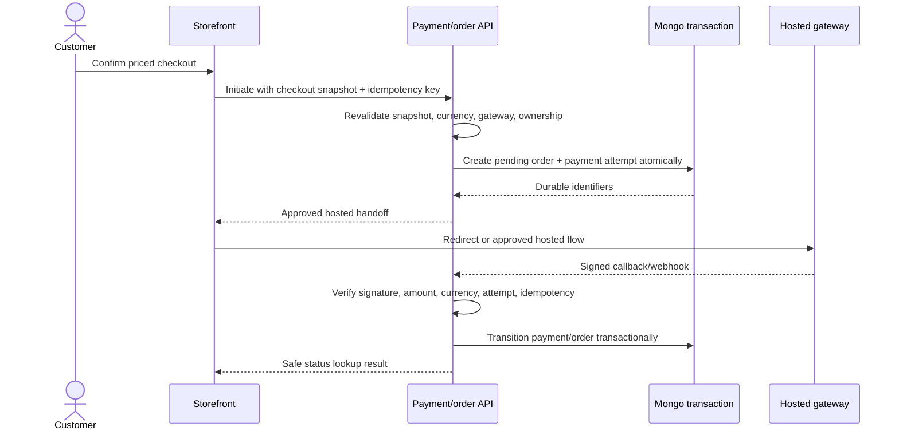
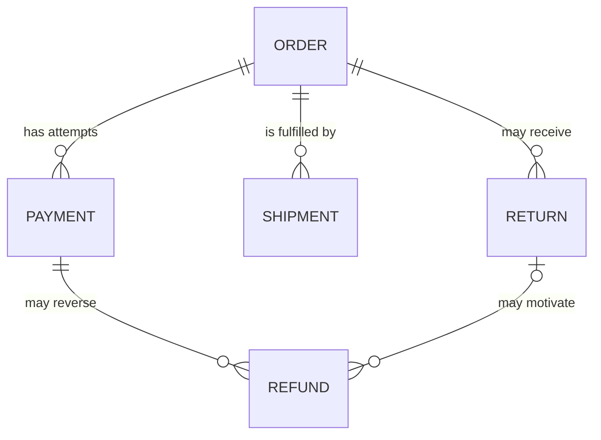

# Payment and order lifecycle

This page describes how orders and payments relate, and the rules a payment integration must follow. Orders exist in the API. The payment port, the rule that judges a gateway's answers, and a CCAvenue adapter exist, and no route uses them yet.

## Gateway selection

| Paid currency                | Gateway role                  | Decided by            |
| ---------------------------- | ----------------------------- | --------------------- |
| INR                          | INR online gateway (CCAvenue) | API checkout use case |
| Any enabled non-INR currency | PayPal                        | API checkout use case |

Angular does not choose a gateway. The server derives it from the validated paid currency and active configuration.

## Initiation and confirmation

Gateway credentials, encryption keys and webhook secrets stay on the server behind `PaymentGatewayPort`.

## Why order and payment are separate

One order can have several payment attempts. A failed attempt must not erase the shopping record, and a gateway callback must not rewrite purchased facts.

## Order snapshot

Every purchased line freezes enough information to stay correct after product edits or archival:

- Product and optional variant identifiers.
- Title, slug, SKU, product type and category context.
- Chosen variation attributes.
- Named add-ons and captured measurements.
- Image reference.
- Unit and line totals in INR and the paid currency.
- Resolved promotion and tax lines.
- Return and refund eligibility facts.
- Product status at purchase.

Order history renders from the snapshot, not from the current product.

## Lifecycle separation

### Order

`pending → paid → processing → shipped → delivered`, with cancellation and refund paths. Transitions must be validated and appended to a timeline.

### Payment attempt

`PaymentState` in `packages/core-domain` has seven values: `pending`, `authorized`, `captured`, `failed`, `cancelled`, `refunded` and `review`. An attempt moves only forward:

| From         | May move to                                                 |
| ------------ | ----------------------------------------------------------- |
| `pending`    | `authorized`, `captured`, `failed`, `cancelled`, `refunded` |
| `authorized` | `captured`, `cancelled`, `refunded`                         |
| `captured`   | `refunded`                                                  |
| `failed`     | `authorized`, `captured`, `cancelled`                       |
| `cancelled`  | `authorized`, `captured`, `refunded`                        |
| `refunded`   | nothing                                                     |
| `review`     | nothing without an operator                                 |

A failed or cancelled attempt can still turn out paid, because money that really moved must be recorded. Nothing moves from paid back to failed. Amounts are whole minor units (paise for INR) in `amountMinor`, and every attempt has its own `attemptId`, sent to the gateway as its order id.

### Shipment

Quote, label, pickup, transit, delivery, failure and cancellation are shipment events, not order or payment fields.

## Idempotency and callback safety

- Client retries reuse an idempotency key tied to the same priced snapshot.
- Provider callbacks are authenticated and checked against the stored amount, currency, order and attempt.
- Repeated valid callbacks return the existing result.
- A browser return URL is not proof of payment.
- `decidePaymentResult` applies these rules for every gateway. Only a direct status enquiry can change an attempt; a callback is checked against it and against the stored attempt.
- Unknown, mismatched or stale callbacks fail closed and enter an auditable review path.

### Judging a gateway's answer

`decidePaymentResult(attempt, status, callback?)` in `packages/core-domain/src/payments` is the one rule for every gateway. `attempt` is the stored attempt, `status` is the direct enquiry (`fetchPaymentStatus`, where `null` means the gateway has no record), and `callback` is the optional browser return (`verifyCallback`). It answers one of four decisions:

| Decision    | Meaning                                                                        |
| ----------- | ------------------------------------------------------------------------------ |
| `apply`     | Record the returned state and gateway reference on the attempt.                |
| `duplicate` | The attempt already holds this state. Change nothing and answer as before.     |
| `pending`   | No verdict yet. Enquire again later.                                           |
| `review`    | Change nothing and hand the attempt to an operator, with one of these reasons. |

| Review reason                  | When                                                                          |
| ------------------------------ | ----------------------------------------------------------------------------- |
| `attempt-mismatch`             | A report names a different attempt.                                           |
| `currency-mismatch`            | A report's currency differs from the stored attempt.                          |
| `amount-mismatch`              | A report's amount differs from the stored attempt.                            |
| `reference-mismatch`           | The stored, status and callback gateway references disagree.                  |
| `paid-callback-without-record` | The callback claims payment, but the gateway has no record.                   |
| `gateway-flagged`              | The gateway itself marks the payment for review, for example as high risk.    |
| `paid-callback-contradicted`   | The callback claims payment, but the status says failed or cancelled.         |
| `state-regression`             | The status would move the attempt backwards, or a paid attempt reads pending. |

The checks run in that order. Only the status answer can change an attempt, so a re-posted callback, or an old failure arriving after a success, meets the same status and resolves to `duplicate`. The function is pure; the caller applies the decision to the attempt and its order in one transaction.

## Ownership and authorization

Customers can read only their own orders. A mismatch returns not-found. An admin holding `order.index` can read any order. `PATCH /orders/:id/status` needs an admin session, CSRF and `order.update`. A guarded route or a supplied order id is never sufficient authorization.

## Document numbering

The numbering policy for orders, tax invoices and purchase invoices is an open decision. Before you implement it, the decision log must define:

- Financial-year reset or perpetual sequence.
- Company code, separators and zero-padding.
- Gapless requirements and cancellation handling.
- Separate sequences for each document type.

Do not generate production numbers from database counts, random ids, timestamps or a frontend formatter. India financial-year boundaries are calculated in IST, and issued invoices must stay immutable.

## Failure matrix

| Situation                       | Order                               | Payment                        | Customer experience                    |
| ------------------------------- | ----------------------------------- | ------------------------------ | -------------------------------------- |
| Provider handoff fails          | Stays pending or abandoned          | Attempt failed or not started  | Retry safely without a duplicate order |
| Browser closes                  | Pending state remains               | Await callback or status check | Resume from account or order status    |
| Callback delayed                | Not marked paid from browser return | Pending                        | Explain processing and poll safely     |
| Return lost while API is down   | Pending state remains               | Settled by status enquiry      | "Confirming your payment" page         |
| Amount mismatch                 | Not fulfilled                       | Flagged or failed              | Safe generic message; operator alert   |
| Duplicate callback              | No duplicate transition             | Existing result returned       | Stable confirmation                    |
| Stock changed before initiation | Not initiated                       | None                           | Return to corrected checkout           |

## Limitations

- `POST /orders` creates a `pending` order and removes the cart in one transaction. It has no idempotency key, stock step or payment step.
- The CCAvenue adapter is bound in the API, and no route calls it. No payment collection, hosted handoff, callback route or webhook exists.
- No job enquires about attempts left `pending`, and no code calls `decidePaymentResult`.
- `OrdersService` generates an interim order number.
- Status changes have no legal-transition rule, version check or audit record.

## Debugging checkpoints

1. Trace the checkout snapshot id and idempotency key.
2. Check the server-derived gateway and paid currency.
3. Inspect the order and the payment attempt separately.
4. Verify the provider signature, amount and currency.
5. Inspect the status timeline and audit records.
6. Confirm ownership and permission checks.
7. Never rely on the browser success page.

## Provider documents

Provider reference material is under [Payments](/payments):

- [CCAvenue](/payments/ccavenue): the INR gateway role.
- [Razorpay](/payments/razorpay): a possible later INR gateway.
- [PayPal](/payments/paypal): the non-INR role.
