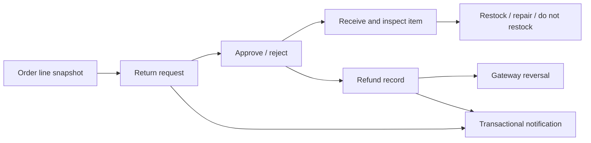

# Returns, refunds, and notifications

This page describes how returns, refunds and customer messages work together. Notifications are built, and order changes send their messages as listed in [Customer messages](/business-flows/admin-ordering-and-zones#customer-messages).

Refunds the shop makes by itself are built: a shop payment that arrives after its pieces sold, or that reaches an order already cancelled, is refunded in full through the gateway with our own refund reference (`R` and the attempt id), so a repeated refund can't pay twice. The attempt keeps the refund's outcome, the payment is marked refunded once the gateway accepts it, and the customer gets `order_refunded_sold_out` or `refund_processed`. Returns, and refunds started by staff, are planned: the storefront and admin refund screens have no backend.

## Separate lifecycles

A refund can exist without a physical return, and a return can be rejected without a refund. Do not collapse both into one order status.

## Return facts

An item-level return records:

- Order and line identity.
- Quantity.
- Reason code and optional condition.
- Customer or actor ownership.
- Request, approval, receipt and close timestamps.
- A restock, repair or do-not-restock decision.

Eligibility comes from immutable order-line facts and current policy, not the current product page.

## Refund facts

A financial reversal records:

- Order and optional return and payment identifiers.
- Amount and currency.
- INR equivalent.
- Reason.
- Pending, processed or failed status.
- Provider refund reference.

A partial refund must never move a whole payment or order into a fully refunded state.

## Notifications

Customer messages go through `NotificationPort`.

| Setting                                | Adapter                      | Behaviour                                                                               |
| -------------------------------------- | ---------------------------- | --------------------------------------------------------------------------------------- |
| `NOTIFICATION_PROVIDER=msg91`, key set | `Msg91NotificationAdapter`   | Sends email, SMS and WhatsApp through MSG91                                             |
| `console`, or `msg91` without a key    | `ConsoleNotificationAdapter` | Logs that a message would be sent, with the destination hashed and the content withheld |

The MSG91 adapter applies channel kill-switches, plan limits and marketing consent, and records each message in the outbox. A repeated idempotency key returns the first result. Email uses the template key as the MSG91 template id, SMS uses the Flow id and WhatsApp uses the approved template name. These values are stored in `notificationTemplates` and edited from the admin notification screens. The MSG91 key stays in the API environment.

| Category      | Examples                                      | Rule                                                        |
| ------------- | --------------------------------------------- | ----------------------------------------------------------- |
| Transactional | OTP, order status, shipment, refund, security | Sent subject to legal and provider rules                    |
| Marketing     | Campaigns, promotions, abandoned cart         | Needs explicit consent, with its own caps and kill-switches |

A launch or sale event's message is a marketing message. Publishing the event sends it by email only, to customers who agreed to marketing. SMS and WhatsApp wait for approved MSG91 templates. Contact Us messages do not use `NotificationPort`: they go to the shop's connected Gmail mailbox.

## Channel settings

Each channel and category pair has one settings row, held in the database and changed only by holders of `setting.edit`. A row can record a plan limit and a warning threshold, which defaults to 80%. With `autoDisableAtLimit` on, reaching the limit stops the pair. Settings hold no provider secrets.

Every attempt writes an outbox row with a hashed destination. A suppressed send is an expected outcome, not an error. Its status is `suppressed_channel_disabled`, `suppressed_use_disabled`, `suppressed_no_consent` or `suppressed_plan_limit`. `suppressed_use_disabled` means Settings › Communications has that message switched off on that channel; the channel kill switch is checked first and still wins. See [Communications](../admin/communications.md).

## Delivery rules

- A business state change does not roll back because a provider is unavailable.
- Outbox records distinguish queued, sent, delivered, failed and suppressed outcomes.
- Provider retries are idempotent.
- Disabled channel and category combinations stop before any provider call.
- No sensitive data appears in a message beyond the approved template.

## Failure matrix

| Failure                            | Required behaviour                                         |
| ---------------------------------- | ---------------------------------------------------------- |
| Return line not owned by customer  | Deny without exposing order details                        |
| Return window or condition invalid | Explain the outcome; create no refund                      |
| Provider refund fails              | Keep the refund failed or pending with retry or review     |
| Duplicate refund command           | Return the existing result                                 |
| Notification provider unavailable  | Retry or use an approved fallback; preserve business state |
| Marketing consent absent           | Suppress the message and record why                        |
| Transactional channel disabled     | Use an enabled channel or escalate                         |

## Operator checklist

- Verify the actor, order, line, quantity and eligibility.
- Inspect the payment currency and refundable amount.
- Keep return and refund statuses separate.
- Require confirmation and permission for manual financial actions.
- Record the provider reference and audit event.
- Notify only after the durable state change succeeds.
- Never expose raw provider payloads or secrets in the UI.

## Limitations

- No return collection or route exists, and staff can't start a refund; the only refunds are the shop's automatic full refunds.
- Optional email fallback providers are configuration values only; no fallback adapter exists.
- The SMS adapter sends the Flow id as both `template_id` and `flow_id`, until a live send confirms which field MSG91 uses.
