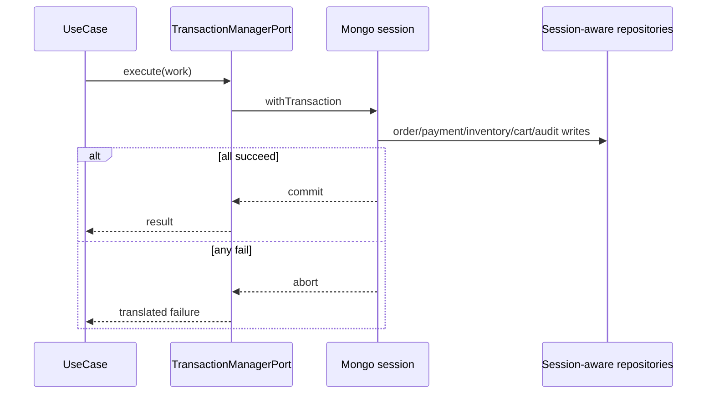
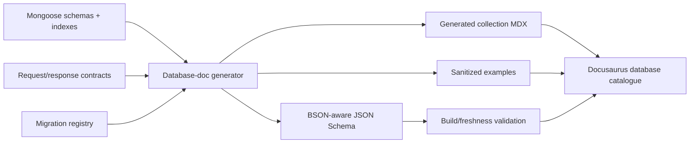

# Transactions and generated catalogue

This page explains how the platform performs atomic writes and how the database catalogue is generated.

## Why a replica set is required

A standalone MongoDB process does not provide multi-document transactions. Local and deployed environments use the same single-node replica set, `rs0`, so transaction code runs the same way everywhere.

A single-node replica set provides transactions, not high availability. Backups and restore drills are still needed.

## How transactions work

`TransactionManagerPort` describes an atomic unit of work without exposing a Mongoose `ClientSession`. `MongoTransactionManager` implements it. Nested calls join the outer session through `AsyncLocalStorage`.



## Transactional workflows

These workflows use transactions:

| Workflow                    | Records that commit together                       |
| --------------------------- | -------------------------------------------------- |
| Signup finalisation         | Customer, password credential, provider identity   |
| Contact-change confirmation | Proof consumption, identifier change, audit record |
| Order creation              | Order save, cart removal                           |
| Customer soft delete        | Status change, provider release, audit record      |
| Customer restore            | Status change, audit record                        |
| Admin invite                | Invite, audit record                               |
| Product save                | Product, variants, redirect for a changed address  |
| Product discontinuation     | Product, redirect                                  |

### Planned workflows

These need transactions when they are built:

- Guest-to-user cart merge.
- Order placement with payment attempt, stock and audit records.
- A verified payment callback.
- Purchase-invoice posting.
- Returns and refunds.

Do not wrap external network calls inside a database transaction. Use durable state, provider idempotency and reconciliation around the local changes.

## Transaction rules

- Keep the callback bounded and deterministic.
- Do not run parallel operations inside a transaction with `Promise.all`.
- Join through the ambient session when a port exposes no transaction context. Pass the opaque context only through ports that declare it. Never leak a Mongoose session into core.
- Reserve idempotency and correlation data before unsafe retries.
- Treat an unknown commit result as a reconciliation problem.
- Test rollback after every participating write.
- Do not delete accounting or order history to keep numbering gapless. Cancel or void it with an audit state.

## Document numbering

Order, tax-invoice and purchase-invoice numbering policy is an open business decision. Before you build it, the decision log must define:

- Financial-year reset or perpetual mode.
- Company code, separators and padding.
- Gapless policy and cancellation handling.
- Separate sequences for each document type.

Business periods use India financial-year boundaries in IST. Stored timestamps are UTC. `OrdersService` generates an interim order number from the date and a random suffix.

## Migration discipline

Every persistent shape or index change should state:

1. The forward schema or index change.
2. The compatibility window for old code and data.
3. Backfill or lazy-upgrade behaviour.
4. Deployment order.
5. A verification query or metric.
6. The rollback or roll-forward plan.
7. Retention and backup impact.
8. The generated catalogue change.

A Mongoose schema edit does not migrate existing documents.

## Generated catalogue

The portal publishes a source-only database reference, the Schema Observatory, at `/database/catalogue/`. The generator imports every exported Mongoose model without opening a connection, and lists fields, defaults, enums, select rules and indexes. Paths with a `Mixed` shape are marked temporary. Credential, PIN, token, code, state, nonce and private-contact fields are named but excluded from synthetic examples.

Regenerate it with:

```bash
pnpm --filter @saha-textile/adapters-db-mongo generate:catalogue
```

### Planned generation pipeline



### Collection page content

A complete generated collection page includes:

- Physical name, owning context and purpose.
- A field table with BSON and TypeScript meaning.
- Required, optional, default, enum and validation details.
- Nested shapes, and references versus embedded data.
- Unique, compound, partial and TTL indexes.
- A sanitized example.
- Read and write paths, and actor ownership.
- Request and response mapping.
- Retention, deletion, archive and privacy behaviour.
- Sensitive fields and transaction participation.
- Migration history and source links.

### Generation safety

- Run against source metadata, never production records.
- Keep examples synthetic or rigorously sanitized.
- Never emit hash values, tokens, credentials, addresses, provider payloads or customer data.
- Keep output deterministic, so review diffs stay meaningful.

Do not maintain a schema, validator, field table and index table by hand. Keep hand-written pages focused on business meaning, lifecycle and operations.

## Backup and restore requirements

Database readiness requires:

- Scheduled backups with success records.
- An encrypted copy and a retention rule.
- Periodic restores into an isolated environment.
- Application-level integrity checks after a restore.
- Measured recovery time and data-loss targets.
- Secret rotation and access audit.

A backup that has never been restored is not a recovery plan.

## Limitations

- Cart merge and stock moves do not use transactions.
- Generated pages do not show DTO mappings, migration history or retention rules.
