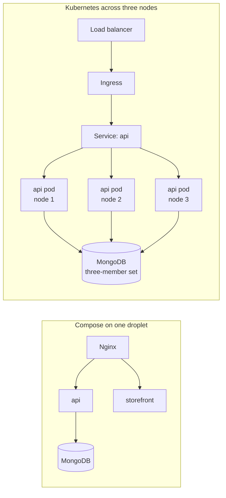

# Compose and Kubernetes

Saha Textile runs on Docker Compose on one droplet per environment. This page explains how that compares with Kubernetes, and why the platform is built so that a later move changes the deploy layer only.

## Two ways to run the same images

Both run OCI container images. The images built for this platform would run on Kubernetes unchanged. The difference is what manages the containers.

|                        | Docker Compose                                  | Kubernetes                                                 |
| ---------------------- | ----------------------------------------------- | ---------------------------------------------------------- |
| Scope                  | One machine                                     | A cluster of machines                                      |
| Model                  | A file describes containers; Docker starts them | A control plane continuously reconciles the declared state |
| Runs on                | Docker Engine                                   | A container runtime such as containerd                     |
| Self-healing           | Restart policy and health checks                | Controllers replace failed pods, on any node               |
| Updates                | Scripted: the side-by-side swap in `bin/lib.sh` | Built in: rolling updates gated by readiness probes        |
| Survives a dead server | No                                              | Yes, with two or more nodes                                |
| Running cost           | Docker only                                     | The control plane and its datastore, plus nodes            |

## How the pieces map

| This platform                               | Kubernetes                             |
| ------------------------------------------- | -------------------------------------- |
| A Compose service and its containers        | Pod                                    |
| The side-by-side swap in `bin/lib.sh`       | Deployment with a rolling update       |
| Nginx finding containers through Docker DNS | Service                                |
| Nginx routing by hostname                   | Ingress                                |
| `/health/live` and `/health/ready`          | Liveness and readiness probes          |
| Files in `secrets/`                         | Secret and ConfigMap                   |
| MongoDB with a named volume                 | StatefulSet with a PersistentVolume    |
| `bin/deploy.sh` over SSH                    | `kubectl apply` or a GitOps controller |

## Kubernetes on a single droplet

Lightweight distributions such as k3s, MicroK8s and k0s run a complete Kubernetes on one server, with no licence fee. k3s includes a load balancer and an ingress controller. Several pods of the API can run on one node, with a Service spreading requests between them.

| Gains on one node                                                             | Does not gain on one node                                   |
| ----------------------------------------------------------------------------- | ----------------------------------------------------------- |
| Several copies of a process, so one crashing or hanging does not stop service | Survival of a dead server: every pod is on the same machine |
| Built-in rolling updates and self-healing                                     | More capacity: copies share the same CPU and memory         |
| A standard, declarative format                                                | Lower cost: the control plane needs memory of its own       |
| A cluster that later nodes can join                                           |                                                             |

k3s documents a 2-core, 2 GB floor for a server node and measured about 1.6 GB on a single node running a simple workload. The whole shop uses about 1 GB at rest, so on an 8 GB droplet the cluster's own machinery would take more memory than the shop.

Compose already provides most of the single-node benefits: the side-by-side swap gives deploys without a gap, and two copies of a service behind Nginx would give process redundancy.

## Kubernetes across several servers

Surviving a dead server needs at least two nodes, a load balancer in front, and a database that survives a node: a three-member MongoDB replica set. On DigitalOcean that means at least two droplets, a regional load balancer at $12 a month, and $40 a month for a highly available managed Kubernetes control plane. That is roughly $150 to $250 a month against about $53 for one droplet, and more to operate.

## Why a move stays cheap

The platform follows the conventions Kubernetes relies on:

- images built once and deployed by digest;
- apps that keep no data inside the container;
- all settings and secrets supplied from outside the image;
- liveness and readiness endpoints;
- a deploy that already requires old and new versions to run side by side.

Moving to Kubernetes would replace `docker/production/` and the deploy scripts with manifests. The applications and images stay as they are.

## Related pages

- [Deploy and recovery](/deployment/deploy-and-recovery)
- [Hosting topology](/deployment/production-topology)
