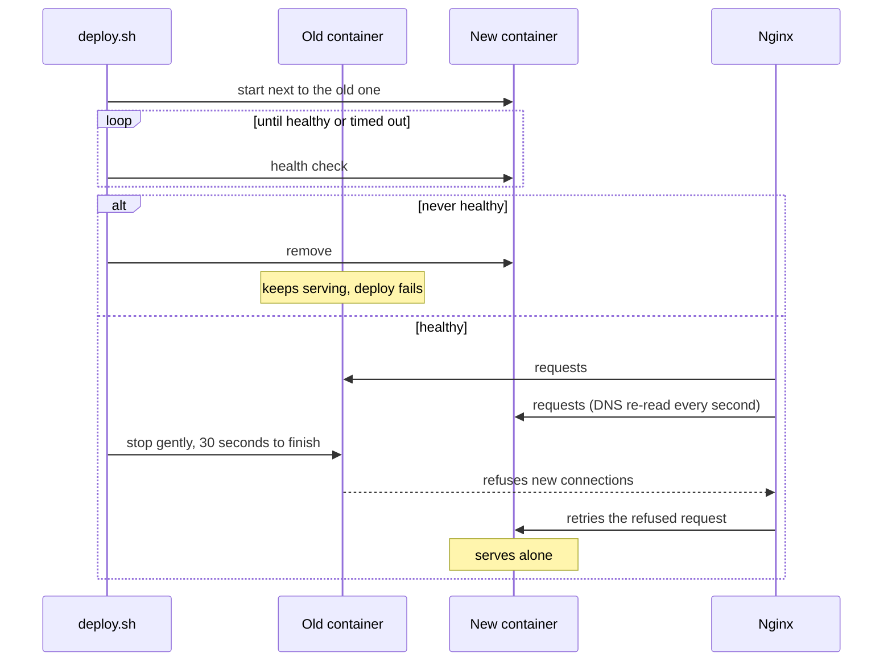
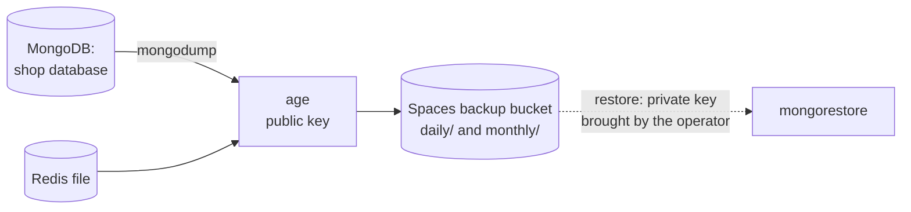

# Deploy and recovery

The scripts in `docker/production/bin/` deploy, roll back, back up and restore one environment. `pnpm production:proof` runs all of them on one machine with throwaway secrets, a local registry, an S3-compatible store and a local certificate authority, and checks the result.

## Release folders

```text
/opt/saha-textile/
├── releases/<id>/
│   ├── compose.yaml
│   ├── nginx/
│   ├── bin/
│   ├── required-secrets.txt
│   ├── release.env        image digests, hostnames, public client IDs
│   ├── secrets/           API, database, search and backup credentials
│   └── public/            rendered config.json files
├── current -> releases/<id>
├── previous -> releases/<id>
├── certs/                 Origin Certificate, Origin CA root, origin pull certificate
├── edge/                  the files the running Nginx reads
└── status/last-backup
```

Each release keeps its own secrets and public config, so a rollback returns to the settings that release ran with. The newest three releases and their images stay on disk.

## Deploy

`bin/deploy.sh <release-folder>` runs these steps. Every step is safe to repeat.

1. Check the release: images pinned by digest, every required name present, certificates in place, and the CCAvenue host allowed by the storefront's CSP.
2. In production, take an encrypted backup.
3. Pull the images.
4. Render the public `config.json` files.
5. Start MongoDB, Redis and Meilisearch, which a deploy never restarts.
6. Start the replica set once, and keep the API's database user in step with its password.
7. Read Meilisearch's Default Admin API Key with the master key, so it is never stored as a separate secret.
8. Run `node dist/first-run-setup.js`: it adds the administrator role, currencies and notification templates when missing, and leaves existing rows alone.
9. Swap the apps side by side.
10. Run `node dist/rebuild-search-index.js`, which builds a second index and swaps it in.
11. Install the back-in-a-moment pages, with the shop's name and logo.
12. Check that every dependency is up and that both `config.json` files parse and name the right API.
13. Mark the release as current.

### Side-by-side swap



The API, storefront and admin swap this way, one after another. The API and storefront run two copies each, so two new copies start beside the two old ones. The worker restarts, because no visitor talks to it and its jobs wait in Redis. Nginx reloads its config in place and restarts only when a hostname or port changes.

Every app container is replaced on every deploy, even with the same image, because Compose does not notice a changed secret file. A rotated secret must reach the running apps.

The proof sends requests continuously during a deploy, a failed deploy and a rollback, and requires zero failures. A swap costs about 260 MB extra memory for about 30 seconds.

**Compatibility rule.** For about half a minute, the old and new versions run together against the same database. Every change must work in that state. The same rule makes rollback safe.

### When a deploy fails

A new container that never becomes healthy is removed and the old one keeps serving. If a later step fails, the previous release is swapped back. The workflow run shows the failure, and the logs stay on the droplet.

An API started with unsafe settings exits with code 1 and a list of the problems, naming variables and never values.

## Back-in-a-moment pages

A reboot or a crash can still stop an app for a moment. Nginx then answers with that app's own page as a 503 with `Retry-After: 15`, in English or French, and the page refreshes itself every 15 seconds.

| Host                          | Shows                                                                                 |
| ----------------------------- | ------------------------------------------------------------------------------------- |
| Storefront                    | The coming-soon box with the logo; language from `/fr/` or `/en/`, else the browser's |
| Admin                         | The admin error section; language from the browser                                    |
| API                           | `{"error":"temporarily_unavailable"}`                                                 |
| API, at `PAYMENT_RETURN_PATH` | "We're confirming your payment", a link to the order list, and no refresh             |

`scripts/build-fallback-pages.mjs` builds the pages during the image build from each app's own stylesheet and translations. The deploy copies them to `edge/fallback/` and fills in the shop's name, logo and site address from `GET /storefront/brand`. The payment page never refreshes, so a browser never posts a payment return twice.

## First administrator

The only manual step. It prints a credential, so it runs over SSH and never in a workflow:

```bash
docker exec -it "$(docker compose --project-name saha-textile ps --quiet api | head -n 1)" \
	node dist/create-first-admin.js --email <address>
```

## Rollback

`bin/rollback.sh` swaps the previous release back in, with the same side-by-side method. It restores code and settings, not data. Its images are on disk, so it needs no registry login.

## Secrets

| File in `secrets/`    | Holds                                                        |
| --------------------- | ------------------------------------------------------------ |
| `api.env`             | API and worker settings, loaded through `DOTENV_CONFIG_PATH` |
| `backup.env`          | Backup bucket, endpoint, key pair and the `age` public key   |
| `mongo-keyfile`       | Replica set key                                              |
| `mongo-root-username` | Database administrator name                                  |
| `mongo-root-password` | Database administrator password                              |
| `mongo-app-password`  | The API's database password                                  |
| `redis-password`      | Redis password                                               |
| `meilisearch.toml`    | Master key and production mode                               |

Files mount read-only into the containers that need them, so values never appear in `docker inspect`. The storefront and admin receive no secrets.

**Rotation:** create the new value, update the GitHub secret, deploy, check, revoke the old value. `CSRF_SECRET` also protects refresh tokens, guest carts and one-time codes, so rotating it signs everyone out; rotate it only after a leak.

**Master copy:** GitHub cannot show a stored secret again, so a copy lives in the operator's password manager. The backup private key also has a second copy, because backups are unreadable without it.

## Backups



- **Nightly**, plus before every production deploy.
- **Encrypted with `age` using a public key.** The server can write backups and never read one back.
- **The shop database only**, not the database users, so a restore on another server keeps that server's passwords. A point-in-time dump is possible only for the whole server, so a write landing during the few seconds of the dump may be caught half-way; the next backup is whole again.
- **Retention:** 30 daily and 12 monthly by lifecycle rule, with versioning on. A Spaces key is either read-only or read, write and delete, so the server's key could delete backups; versioning undoes accidental deletes.
- **Search** is not backed up, because it rebuilds from MongoDB. **Media** already lives in Spaces.
- A total disk loss can lose up to a day of orders.

## Restore

```bash
CONFIRM_REPLACE_DATA=yes bin/restore.sh <backup-stamp> <age-identity-file>
```

It refuses without the confirmation, replaces the shop database, then rebuilds the search index. The private key belongs in the password manager: bring it for the restore and delete it afterwards. A restore drill runs on a throwaway droplet before launch and every quarter.

## Monitoring

| What                    | How                                                                       |
| ----------------------- | ------------------------------------------------------------------------- |
| CPU, memory, disk, load | DigitalOcean metrics agent and alert policies, emailed                    |
| The shop from outside   | One DigitalOcean Uptime check on the storefront                           |
| Backups                 | The last backup time, read by the worker, which emails when it is too old |
| Logs                    | Docker's own logs on the droplet, read over SSH                           |

A super admin screen in the admin app will show the droplet metrics, with a switcher and a comparison view when there is more than one droplet, and the pending patches with a reboot button that needs the operator's PIN.

## Related pages

- [Release pipeline](/deployment/release-pipeline)
- [Hosting topology](/deployment/production-topology)
