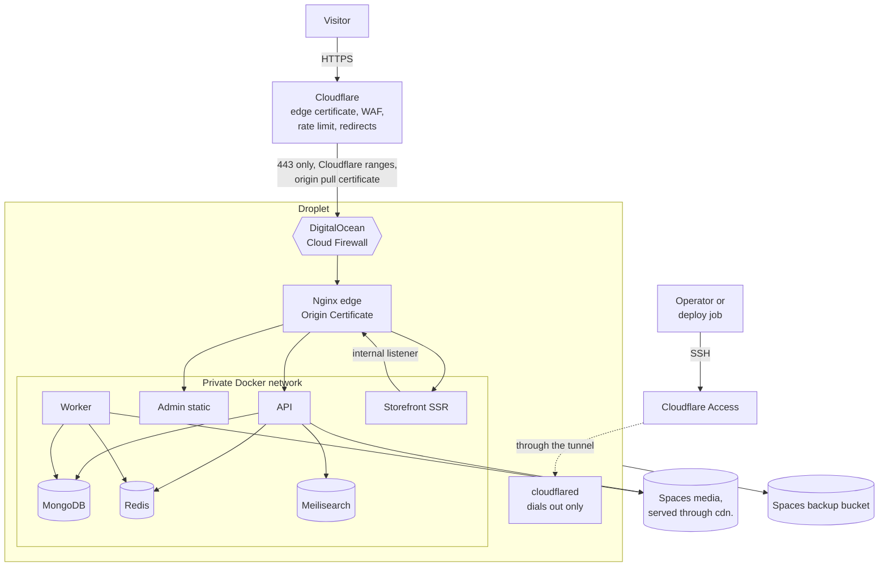

# Hosting topology

Each hosted environment is one DigitalOcean droplet running Docker Compose, behind Cloudflare. Media and backups live in DigitalOcean Spaces.

## Traffic path

Only Nginx publishes a port. SSH has no open port: `cloudflared` dials out to Cloudflare, and people and deploy jobs come in through that connection after Cloudflare Access has checked them.

## Hostnames

| Environment | Storefront                | Admin                           | API                           | Media                         |
| ----------- | ------------------------- | ------------------------------- | ----------------------------- | ----------------------------- |
| Staging     | `staging.sahatextile.com` | `admin-staging.sahatextile.com` | `api-staging.sahatextile.com` | `cdn-staging.sahatextile.com` |
| Production  | `sahatextile.com`         | `admin.sahatextile.com`         | `api.sahatextile.com`         | `cdn.sahatextile.com`         |

Every name is one level below the domain, because Cloudflare's free edge certificate covers `*.sahatextile.com` and not deeper names. `www` redirects to the bare domain. Cookies are host-only on the API host.

## Services

| Service     | Image                          | Memory cap | Measured at rest | Notes                                                             |
| ----------- | ------------------------------ | ---------- | ---------------- | ----------------------------------------------------------------- |
| MongoDB     | `mongo:9.0.4`                  | 3 GiB      | about 325 MB     | Single-node replica set, password login and keyfile               |
| Redis       | `redis:8.8.4-alpine`           | 512 MiB    | about 15 MB      | Password from a file, saved every second, never evicts            |
| Meilisearch | `getmeili/meilisearch:v1.16.0` | 1 GiB      | about 95 MB      | Production mode; the API uses the admin key, never the master key |
| API         | `api`                          | 768 MiB    | about 130 MB     | Two copies. Refuses to start on unsafe settings                   |
| Worker      | `api`                          | 1.5 GiB    | about 115 MB     | Limited to 2 CPUs                                                 |
| Storefront  | `storefront`                   | 768 MiB    | about 120 MB     | Two copies. Calls the API through the internal listener           |
| Admin       | `admin`                        | 64 MiB     | about 13 MB      | Static files and a mounted `config.json`                          |
| Nginx edge  | `nginx:1.30.6-alpine`          | 128 MiB    | about 20 MB      | Reloads its config in place                                       |

Caps and measurements are per copy. Nginx spreads requests over both copies and retries a refused connection on the other, so one copy crashing or hanging stops nothing. The measurements come from `pnpm production:proof` with an empty catalogue. MongoDB and Meilisearch grow with the catalogue: 1,000 products with 1,918 variants take about 13 MB in MongoDB and 38 MB in Meilisearch. Product photos live in Spaces, not on the droplet.

| Droplet    | Size                              | Price                                          |
| ---------- | --------------------------------- | ---------------------------------------------- |
| Production | Basic, 4 vCPU, 8 GiB, 160 GiB SSD | $48 a month                                    |
| Staging    | Basic, 2 vCPU, 4 GiB, 80 GiB SSD  | Billed only while it exists, up to $24 a month |

## Cloudflare

| Control                          | Setting                                                                                                                  |
| -------------------------------- | ------------------------------------------------------------------------------------------------------------------------ |
| Encryption mode                  | Full (strict): Cloudflare checks the Origin Certificate on Nginx                                                         |
| Origin Certificate               | One per environment, 15 years. Cloudflare sends no expiry warning                                                        |
| Authenticated Origin Pulls       | Our own zone certificate. Nginx refuses any connection without it, so another Cloudflare account cannot reach the origin |
| Minimum TLS                      | 1.2, with Always Use HTTPS                                                                                               |
| WAF                              | Free Managed Ruleset and up to 5 custom rules                                                                            |
| Rate limiting                    | One rule, 10-second window, counted per IP, on sign-in and one-time-code paths                                           |
| Bot Fight Mode                   | Off. No rule can skip it, and it can challenge API and webhook traffic                                                   |
| Rocket Loader, email obfuscation | Off. Both rewrite HTML and can break server-rendered pages                                                               |
| Staging                          | Cloudflare Access login on `staging.` and `admin-staging.`; `api-staging.` stays reachable                               |

## Nginx edge

- **Origin lock.** A connection from outside the Docker network must present the Authenticated Origin Pulls certificate. Without one it gets 403, and a wrong certificate fails with 400.
- **Real client address.** Taken from `CF-Connecting-IP` only on connections that passed the origin lock, and passed to the API for rate limits and audit.
- **Internal listener.** The storefront's server reaches the API through the edge from inside the Docker network, without the client certificate, and trusts Cloudflare's Origin CA root.
- **Security headers.** HSTS, `nosniff`, `Referrer-Policy`, `Permissions-Policy` and a Content Security Policy per site. Headers are set at server level, because an `add_header` inside a location would cancel the inherited ones.
- **Readiness stays private.** `/health/ready` answers only inside the Docker network; outside it is 404.
- **Unknown hostnames** get 421.
- **Storefront `config.json`** is served by Nginx, because the storefront's server sends public files at their build-time size.

## Droplet hardening

| Area             | Setting                                                                                                                         |
| ---------------- | ------------------------------------------------------------------------------------------------------------------------------- |
| Operating system | Ubuntu 26.04 LTS, security patches installed automatically                                                                      |
| Reboots          | Chosen by the operator, with an alert when one is pending; after 7 days the server reboots itself at 4 am IST                   |
| Users            | Root login and password SSH off; one admin user with sudo; a `deploy` user whose key can run only the deploy script             |
| Firewall         | DigitalOcean Cloud Firewall as the gate, because Docker's published ports bypass UFW; UFW denies all incoming as a second layer |
| SSH              | Through Cloudflare Tunnel; no port open to the internet                                                                         |
| Emergency access | DigitalOcean Recovery Console, which works without a network and uses the admin user's password                                 |
| fail2ban         | Not installed: no SSH port is open, and behind Cloudflare it would ban Cloudflare's own addresses                               |
| Files            | `/opt/saha-textile` owned by root; secrets readable only by the user inside the container that needs them                       |
| Logs             | Docker's `local` driver, about 100 MB per container, rotated                                                                    |

## Related pages

- [Release pipeline](/deployment/release-pipeline)
- [Deploy and recovery](/deployment/deploy-and-recovery)
