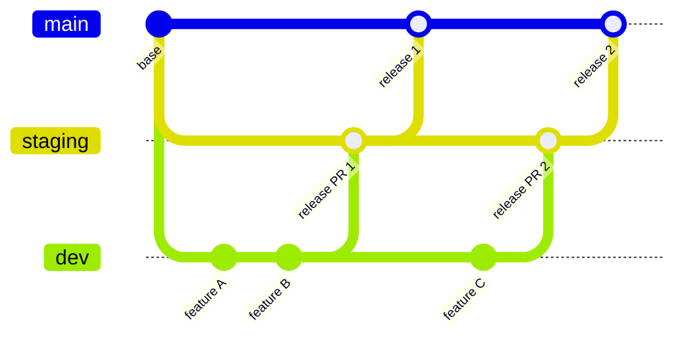
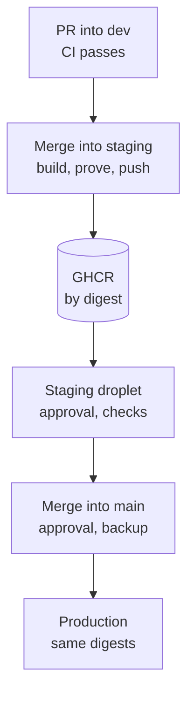

# Release pipeline

A change moves through three long-lived branches, is built into images once, is proven on staging, and reaches production as the same image bytes. Production never rebuilds.

## Branches

| Branch    | Receives                        | Merge method |
| --------- | ------------------------------- | ------------ |
| `dev`     | Feature branches, through PRs   | Any          |
| `staging` | `dev`, through a release PR     | Merge commit |
| `main`    | `staging`, through a release PR | Merge commit |

All three are protected: changes arrive only through pull requests, with signed commits, no force-push and no deletion.

**Squash merges are for short-lived branches only.** A squash copies the changes into one new commit and records no link to where they came from. Between two permanent branches, Git then keeps comparing against old history, and the next promotion conflicts. A normal merge commit records that the target contains the source, so promotions stay clean without back-merges. `git log --first-parent main` still shows one line per release.

## From merge to production

1. **CI** runs on every pull request: lint and repository guards, typecheck, unit tests at 100% coverage, production builds, and browser tests against those builds.
2. **Publishing** runs when code merges into `staging`. `publish-images.yml` calls CI, runs `pnpm production:proof` against freshly built images, then pushes four images to GHCR: `api` (also runs the worker), `storefront`, `admin` and `ops`.
3. **Tags.** Each image is tagged `sha-<commit>` and `tree-<tree hash>`. A merge commit on `main` has a new commit ID but the same Git tree as the tested `staging` commit, so the tree tag finds the tested images.
4. **Staging** waits for approval in the `staging` GitHub Environment, then pulls those images by digest and runs the staging checks.
5. **Production** starts when code merges into `main`. The workflow looks up the digests by tree tag and refuses to continue if none exist. It waits for approval in the `production` GitHub Environment, takes a backup, then deploys the same digests.

A logged emergency option can skip the staging step when the shop is broken. CI and approval still apply.

## Images

| Image        | Runs                                                |
| ------------ | --------------------------------------------------- |
| `api`        | The NestJS API; the same image runs the worker      |
| `storefront` | The Analog and Nitro server                         |
| `admin`      | The static Angular build behind Nginx               |
| `ops`        | Backup and check tools (`age`, `aws`, `curl`, `jq`) |

GHCR packages are private, and a package published from a workflow is linked to the repository, which lets the workflow token read it. A tag can move; a digest cannot, so every deploy names images by digest.

## How the droplet gets images

The droplet holds no Git clone and no GitHub key. The deploy job copies the release files from the tested commit and gives the droplet a read-only registry login that expires when the job ends. The last three releases stay on disk, so a restart, reboot or rollback needs no login.

## Workflow hygiene

- **Logs are readable by any signed-in GitHub user**, because the repository is public. Deploy output reports step names and pass or fail only. It never prints a host address, a credential or container logs.
- **Third-party Actions are pinned to full commit SHAs**, because deploy jobs handle secrets.
- **Secrets live in GitHub Environments**, one set for staging and one for production, with one secret per value so that one key can rotate alone. Both Environments require approval before a deploy starts: `staging` accepts only the `staging` branch and `production` only `main`.

## Related pages

- [Hosting topology](/deployment/production-topology)
- [Deploy and recovery](/deployment/deploy-and-recovery)
- [Compose and Kubernetes](/deployment/compose-and-kubernetes)
