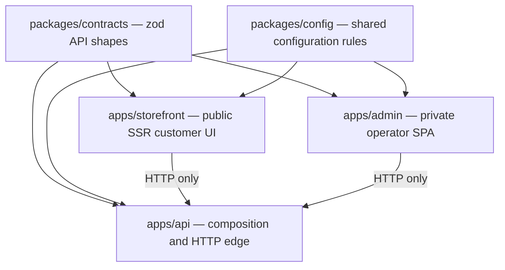

import { FrontendDecisionLab } from '@site/src/components/ApplicationAtlas';

# Frontend engineering system

This page describes what the storefront and admin application share, and how they differ. They use the same architecture but serve different users and runtimes. Share decisions and contracts where they are truly common, and keep customer and operator presentation separate.

## State ownership lab

Choose the shape that best describes the value you are adding.

<FrontendDecisionLab />

## Cross-application boundaries

Angular applications may consume contracts and non-secret shared configuration. They must never import database, payment, shipping, storage, search, authentication, or other server adapters.

## Runtime configuration

Both applications read public, non-secret configuration at startup from `/config.json`. `provideAppInitializer(loadRuntimeConfig)` in `core/config/runtime-config.ts` fetches the file and fills a mutable `runtimeConfig` singleton and the `environment` object that services import.

- The file holds non-secret values only: API and site URLs, locales and public client IDs.
- The committed `config.json` holds localhost defaults. Deployments supply their own.
- During server rendering the loader reads `SAHA_TEXTILE_PUBLIC_CONFIG` from the environment, then falls back to defaults. A failed fetch does not stop startup.

The auth interceptor sends `withCredentials: true` so that cookie sessions flow, and sends the CSRF token as `x-csrf-token` on unsafe methods. The token comes from the API's reply and lives in memory. No bearer token exists, because the API reads the access cookie only.

`@saha-textile/http-transport` is framework-free. It owns the CSRF contract, single-flight refresh, cross-tab locks, URL and request-id helpers and refusal mapping. Each application keeps its own routes and business rules. Repository lint guards reject browser token storage, bearer headers and cross-audience calls.

## Contracts

`packages/contracts/src` holds the zod schemas shared with the API. Use them as the trust boundary wherever an endpoint exists. Application-local interfaces describe JSON and view shapes; do not rename them as contracts.

See [Contracts and validation](/backend/contracts-and-validation) for the full list.

## Reusable UI

Each application has its own `shared/ui` tree. There is no shared UI package, so:

- Reuse within an application is the norm.
- Do not import a package that does not exist, or duplicate a complex widget to prepare for one.

When behaviour becomes stable across both applications, extract the smallest shared primitive, with accessibility and test coverage.

## Layer choice

| If you are adding…        | Start in…                                             | Move outward only when…                          |
| ------------------------- | ----------------------------------------------------- | ------------------------------------------------ |
| URL entry                 | `pages/` for storefront; feature route file for admin | The route composes a real feature                |
| Feature journey           | `features/<feature>`                                  | Another feature needs a stable shared primitive  |
| Remote reader/write       | `data-access/queries` + `services`                    | A shared contract is defined                     |
| Cross-page client state   | `core/state`                                          | Ownership and lifetime justify application scope |
| Reusable visual primitive | Application `shared/ui`                               | Both apps have proven the same abstraction       |
| Pure formatter/helper     | `shared/util` or `shared/pipes`                       | It is independent of feature policy              |
| Boundary schema           | `packages/contracts`                                  | The shape is shared across API and consumer      |

## Runtime differences

| Concern           | Storefront                            | Admin                                     |
| ----------------- | ------------------------------------- | ----------------------------------------- |
| Primary user      | Shopper/crawler                       | Authenticated operator                    |
| Routing           | Analog file-based pages               | Explicit Angular lazy routes              |
| Rendering         | Dynamic SSR + hydration               | Browser SPA                               |
| SEO               | Product/category/content critical     | Normally private/no-index                 |
| Offline target    | Catalogue and cart planned            | Not a primary product requirement         |
| Density           | Customer comprehension and conversion | Efficient operator tables/forms           |
| Security emphasis | Session, cart ownership, checkout     | Fine-grained administrative authorization |

## Dependency rule

Before importing across boundaries, ask:

1. Is the dependency a contract, configuration value, or genuinely reusable UI primitive?
2. Does it point inward toward a stable abstraction?
3. Does it expose secrets, persistence shapes, or adapter behaviour?
4. Would replacing the backend adapter force this frontend import to change?

If the last two answers are yes, the dependency is in the wrong layer.
