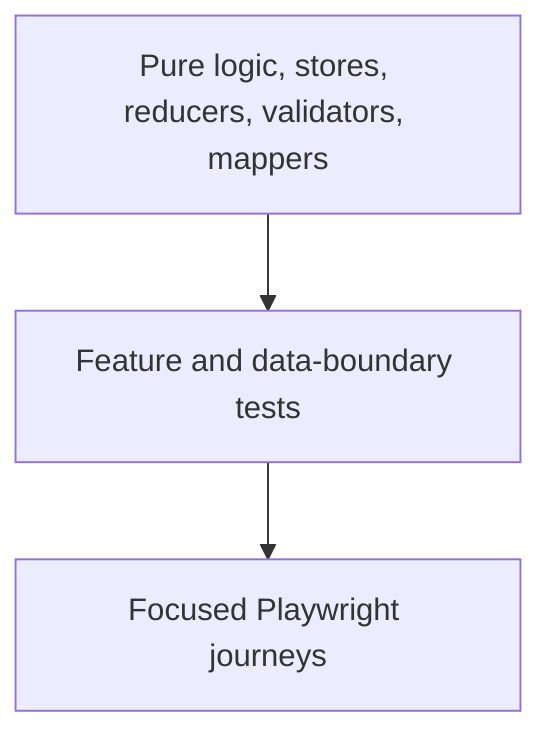

# Frontend quality and definition of done

This page defines the testing approach and completion checks for storefront and admin work.

Both applications have unit tests beside their source. The Playwright suite in `e2e/` covers shopper journeys on desktop and phone. Storybook renders reusable components in isolation. It does not replace feature, integration or browser tests.

## Risk-based test pyramid

### Unit tests

Prioritize reducers/selectors/effects, SignalStore methods, zod parsing, form validators, command mapping, price/currency/variant calculations, and pure transformation helpers.

### Feature integration tests

Cover pending/error/empty/success states, route parameter changes, query enablement and invalidation, form validation mapping, permission-aware presentation, and SSR-safe storefront rendering.

### End-to-end journeys

Use Playwright for a small number of business-critical paths rather than duplicating every component assertion:

- catalogue → product detail → cart;
- cart → checkout handoff;
- login/account boundaries;
- social signup continuation across provider result → registration → reload/abandonment;
- admin list → create or edit, for features with real writes; and
- authorization denial for privileged operations.

## Definition of done

A change is done when it passes these checks, not when it renders once.

### Architecture

- [ ] The change is owned by the correct route, feature, data, state, or shared layer.
- [ ] Server records are not duplicated into client stores without a documented reason.
- [ ] Frontend code imports no server adapter.
- [ ] API shapes use shared zod contracts when the endpoint is real.

### Behaviour

- [ ] Loading, empty, error, success, and retry behaviour are intentional.
- [ ] Duplicate submissions and destructive actions are controlled.
- [ ] Repeated templates use a stable domain id, or a positional key only when the source has no unique identity.
- [ ] JSON-backed and unconnected behaviour is clearly labelled.
- [ ] Price, stock, identity, and authorization assumptions are server-revalidated.

### Rendering and interaction

- [ ] Storefront direct SSR navigation and hydration were checked.
- [ ] Admin deep-link refresh reaches the correct shell.
- [ ] Keyboard, focus, touch target, screen-reader label, and reduced-motion behaviour were checked.
- [ ] Dense tables/forms remain usable at supported widths.

### Verification

- [ ] TypeScript, formatting, lint, and relevant tests pass.
- [ ] High-risk logic has focused automated coverage.
- [ ] Provider popups, user-gesture limits, reload behaviour and multi-page social flows are tested in a real browser.
- [ ] No browser secrets or sensitive logs were introduced.
- [ ] The portal status, sources and verification date are updated.

## Changing a status

A finished-looking screen does not make a capability **Implemented**. Change the status once real data, writes, security and tests meet the definition of done.
