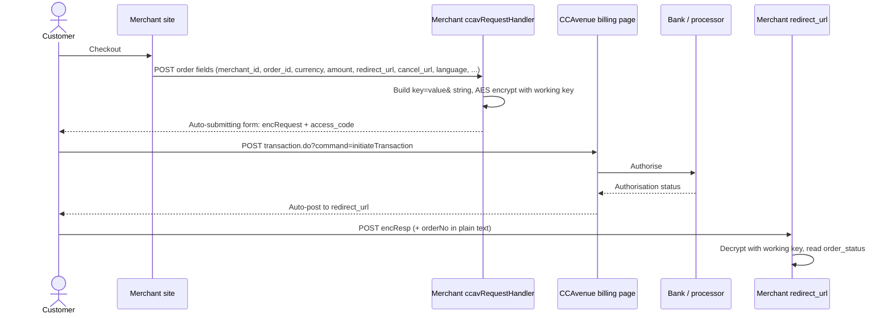

# CCAvenue web integration kit (non-seamless)

Source: `Web_Integration_Non_Seamless.zip`, the "integration kits" link in the HDFC PG Helpdesk mail of 2026-10-27 for merchant **K R MARKETING ONLINE**. The owner received the file on 2026-11-04.

The archive holds one PDF, **CCAvenue Integration Document, Version 3.1** (47 pages, created 2023-04-10), and seven sample kits: ASP.NET, JSP, Node JS, Perl (folder printed "Pearl"), PHP, Python (folder printed "Phyton"), and Ruby on Rails. Sections 1 to 8 below transcribe the PDF. Section 9 records what the kit source code does, because the PDF never states the cipher mode, IV, padding, or key derivation.

Every merchant ID, access code, and working key that appears in the kit or the PDF has been replaced with a placeholder on this page. The real values were not copied into this repository.

Nothing here is wired. No CCAvenue adapter exists, and `PaymentGatewayPort` defines only `createPayment` and `verifyCallback`.

## 1. Introduction

Printed: CCAvenue payment integration kit allows merchants to instantly collect payments from their users using various payment modes like credit cards, debit cards, cash cards, net banking etc. The CCAvenue payment integration supports a seamless payment experience on your platform, while protecting your application from payment frauds and complexity related to various regulations.

## 2. Testing and production environment

Printed: CCAvenue test and production environments are separate. Merchants need an active CCAvenue account to use the test environment and production environment. Merchants will have to log in to their CCAvenue M.A.R.S account and get the API credentials for using these environments.

All transactions initiated by the merchant on our test environment are not processed. Test environment is strictly for testing the request and response functions. After successfully testing the integration, merchant can move to the production environment by changing the URL.

| Environment | URL as printed                                                                       |
| ----------- | ------------------------------------------------------------------------------------ |
| TEST        | `https://test.ccavenue.com/transaction/transaction.do?command=initiateTransaction`   |
| PRODUCTION  | `https://secure.ccavenue.com/transaction/transaction.do?command=initiateTransaction` |

To test the integration, log in to the CCAvenue M.A.R.S account, under **Settings tab → API Keys** page, and copy:

1. Merchant ID
2. Access Code
3. Working Key

## 3. Integration methods

Printed: CCAvenue supports collecting payment information using following methods. All methods are designed to support a seamless user-experience.

1. **CCAvenue billing page (Non-Seamless).** Avoid the hassle of developing and managing your own checkout page. Use the customizable billing page provided by CCAvenue which enables you to collect billing and shipping information of the customer.
2. **Custom checkout form.** Merchants can build a custom checkout form to collect order and payment information and pass the same to CCAvenue server for payment processing. CCAvenue can also store the payment information of the customer to expedite the payment process in future.
3. **CCAvenue "Direct Connect".** This integration enables you to deliver payment services directly through your website without redirecting your users to CCAvenue. This integration is fast and secure. It gives you control to not only build your own custom checkout form, but also control the payment request process with the banks.

The kit received is the non-seamless one, method 1. Methods 2 and 3 have the customer's card number, expiry, and CVV posted by the merchant, which conflicts with the rule in `AGENTS.md` that card data never touches our servers.

## 4. Processing orders using the CCAvenue billing page (non-seamless)

Printed: CCAvenue billing page helps you avoid the hassle of developing and managing your own billing page. CCAvenue billing page is fully customizable enabling you to match the look and feel of your website.

### Process flow

1. Customer selects product/service on your website and proceeds to make payment.
2. Customer is redirected to the CCAvenue billing page where billing, shipping and payment information is entered by the customer.
3. On submission of the transaction information, CCAvenue initiates the authorization process by connecting to the relevant bank/processing organization.
4. On receiving the authorization status from the bank, CCAvenue sends the response back to your website with the transaction status.



### Basic steps

Printed:

- **Set Up.** Download the CCAvenue client library from the MARS panel. Click on "Resources" on the navigation bar of the Dashboard and click "Integration Kit". You will have to use the CCAvenue transaction file (e.g. `ccavRequestHandler.php`) to initiate the payment process.
- **Configure.** Every merchant receives a unique set of keys for transaction processing. These need to be configured in the transaction file used to initiate the payment process. From your MARS account under Settings tab → API Keys page; copy the merchant id, access code and secret encryption. Set these values in the file (e.g. `ccavRequestHandler.php`) downloaded with the integration kit.
- **Payment Processing.** You will have to post the order information to the CCAvenue transaction file (e.g. `ccavRequestHandler.jsp`) to initiate the payment process. CCAvenue transaction file on receiving the order related data will encrypt the data and forward the encrypted request to the CCAvenue billing page.

JSP sample as printed, with the credentials replaced:

```jsp
<html>
<head><title>Sample Transaction File</title></head>
<body>
<%@ page import = "java.io.*, com.ccavenue.transaction.util.AesCryptUtil" %>
<%@include file="libFunctions.jsp"%>
<%
  String merchant_id = "<MERCHANT_ID>"; //Put your merchant id here
  String access_code = "<ACCESS_CODE>"; //Put access code here
  String enc_key = "<WORKING_KEY>"; //Put encryption key here
  Enumeration enumeration=request.getParameterNames ();
  String ccaRequest="", pname="", pvalue="";
   while (enumeration.hasMoreElements ()) {
    pname = ""+enumeration.nextElement ();
    pvalue = request.getParameter (pname);
    ccaRequest = ccaRequest + pname + "=" + pvalue + "&";
  }
    AesCryptUtil aesUtil=new AesCryptUtil (enc_key);
  String encRequest=aesUtil.encrypt (ccaRequest);
%>
<form method="post" name="redirect"
action="https://test.ccavenue.com/transaction/transaction.do? command= initiateTransaction"/>
<input type="hidden" id="encRequest" name="encRequest" value="<%= encRequest %>">
<input type="hidden" name="access_code" id="access_code" value="<%= access_code %>">
<script language='javascript'>document.redirect.submit ();</script>
</form>
</body>
</html>
```

The printed `action` contains spaces (`transaction.do? command= initiateTransaction`). They are kept as printed. The sample also prints a leading space inside the access-code string.

### Request parameters (required)

Printed: Merchant must send the following parameters to the CCAvenue PG for processing an order.

| Name         | Description as printed                                                                                                                                                                                                                                                                                                                                          | Type (length)                                                                                                 |
| ------------ | --------------------------------------------------------------------------------------------------------------------------------------------------------------------------------------------------------------------------------------------------------------------------------------------------------------------------------------------------------------- | ------------------------------------------------------------------------------------------------------------- |
| merchant_id  | Merchant Id is a unique identifier generated by CCAvenue for each activated merchant.                                                                                                                                                                                                                                                                           | Numeric                                                                                                       |
| order_id     | This ID is used by merchants to identify the order. Ensure that you send a unique id with each request. CCAvenue will not check the uniqueness of this order id. As it generates a unique payment reference number for each order which is sent by the merchant.                                                                                                | Alphanumeric (30). Characters allowed: Alphabet (A-Z), (a-z), Numbers, - (hyphen), / (slash), \_ (underscore) |
| currency     | Currency in which you want to process the transaction. INR – Indian Rupee; USD – United States Dollar; SGD – Singapore Dollar; GBP – Pound Sterling; EUR – Euro, official currency of Eurozone                                                                                                                                                                  | Alphabets (3)                                                                                                 |
| amount       | Order amount                                                                                                                                                                                                                                                                                                                                                    | Numeric (12, 2)                                                                                               |
| redirect_url | CCAvenue will post the status of the order along with the parameters to this URL. If you do not send this value, order status will be sent back to the URL configured in dynamic event notifications module in your MARS account. If there is no URL configured in the MARS account, PG will display the status of the order on the CCAvenue confirmation page. | Alphanumeric (100). Characters allowed: Alphabet (A-Z), (a-z), Numbers, / (slash), \_ (underscore)            |
| cancel_url   | CCAvenue will redirect the customer to this URL if the customer cancels the transaction on the billing page.                                                                                                                                                                                                                                                    | Alphanumeric (100). Characters allowed: Alphabet (A-Z), (a-z), Numbers, / (slash), \_ (underscore)            |
| language     | CCAvenue billing page is multi-lingual. Currently we are displaying the page in English (Code - EN).                                                                                                                                                                                                                                                            | Alphabet (5)                                                                                                  |

### Request parameters (optional)

Printed: Merchant can send any of the following parameters in addition to the required parameters.

| Name             | Description as printed                                                                                                                                                                                                                                                         | Type (length) and characters allowed as printed                                                               |
| ---------------- | ------------------------------------------------------------------------------------------------------------------------------------------------------------------------------------------------------------------------------------------------------------------------------ | ------------------------------------------------------------------------------------------------------------- |
| billing_name     | Name of the customer                                                                                                                                                                                                                                                           | Alphabets (60). Alphabet (A-Z), (a-z). Space in between words.                                                |
| billing_address  | Customer's billing address                                                                                                                                                                                                                                                     | Alphanumeric (150). Alphabet, Numbers, # (hash), Comma, circular brackets, / (slash), dot, - (hyphen), space. |
| billing_city     | Customer's billing city                                                                                                                                                                                                                                                        | Alphabets (30). Alphabet, space.                                                                              |
| billing_state    | Customer's billing state                                                                                                                                                                                                                                                       | Alphabets (30). Alphabet, space.                                                                              |
| billing_zip      | Customer's billing zip code                                                                                                                                                                                                                                                    | Alphanumeric (15). Alphabet, Numbers.                                                                         |
| billing_country  | Customer's billing country                                                                                                                                                                                                                                                     | Alphabets (50). Alphabet, space.                                                                              |
| billing_tel      | Customer's phone number                                                                                                                                                                                                                                                        | Numeric (20)                                                                                                  |
| billing_email    | Customer's email address                                                                                                                                                                                                                                                       | Alphanumeric (70). Alphabet, Numbers, @ (at), dot, \_ (underscore).                                           |
| delivery_name    | Recipient's name                                                                                                                                                                                                                                                               | Alphabets (60). Alphabet, space.                                                                              |
| delivery_address | Shipping address                                                                                                                                                                                                                                                               | Alphanumeric (150). Alphabet, Numbers, # (hash), Comma, circular brackets, / (slash), dot, - (hyphen), space. |
| delivery_city    | Shipping city                                                                                                                                                                                                                                                                  | Alphabets (30). Alphabet, space.                                                                              |
| delivery_state   | Shipping state                                                                                                                                                                                                                                                                 | Alphabets (30). Alphabet, space.                                                                              |
| delivery_zip     | Shipping zip code                                                                                                                                                                                                                                                              | Alphanumeric (15). Alphabet, Numbers.                                                                         |
| delivery_country | Shipping country                                                                                                                                                                                                                                                               | Alphabets (50). Alphabet, space.                                                                              |
| delivery_tel     | Shipping phone number                                                                                                                                                                                                                                                          | Numeric (20)                                                                                                  |
| merchant_param1  | This parameter can be used for sending additional information about the transaction. PG will send this parameter in the reconciliation report. NOTE: This parameter value would get displayed on the payment page.                                                             | Alphanumeric (500). Alphabet, Numbers, # (hash), Comma, circular brackets, / (slash), dot, - (hyphen).        |
| merchant_param2  | This parameter can be used for sending additional information about the transaction. PG will send this parameter in the reconciliation report.                                                                                                                                 | Alphanumeric (500). Same characters as merchant_param1.                                                       |
| merchant_param3  | Same description as merchant_param2.                                                                                                                                                                                                                                           | Alphanumeric (500). Same characters as merchant_param1.                                                       |
| merchant_param4  | Same description as merchant_param2.                                                                                                                                                                                                                                           | Alphanumeric (500). Same characters as merchant_param1.                                                       |
| merchant_param5  | Same description as merchant_param2.                                                                                                                                                                                                                                           | Alphanumeric (5000). Same characters as merchant_param1.                                                      |
| promo_code       | This parameter is used for sending the code of the promotion you have created in the CCAvenue MARs by which you may offer specific discounts to customers using specific payment options.                                                                                      | Alphanumeric (20). Alphabet, Numbers.                                                                         |
| tid              | This parameter is used for sending the unique identifier to identify uniqueness of the order. This is an optional parameter. Value for this parameter can be generated using the piece of code given in the integration kit. The uniqueness of TID is valid for 24 hours only. | Numeric (17). Only numbers.                                                                                   |

The `merchant_param1`–`4` lengths here (500) differ from the HDFC VAS guide's 100, recorded on [Hosted checkout](/payments/ccavenue/hosted-checkout). Both are left as printed.

### Request handling

Printed: Please find the below sample of Decrypted encRequest (Query string) which merchant needs to generate after clicking on the final checkout button to get redirected on payment page.

```text
merchant_id=123456&order_id=1234578&currency=INR&amount=1.00&redirect_url=https://www.abc.com/&cancel_url=https://www.abc.com
```

Printed: The above decrypted encRequest needs to be encrypted with AES 128 bit algorithm which is provided in the integration kit. Merchant needs to encrypt the parameters using correct working key. Please find the below final request url which merchant needs to generate to redirect on payment page.

Sample request (UAT/Testing) as printed, access code replaced:

```text
https://test.ccavenue.com/transaction/transaction.do?command=initiateTransaction&encRequest=ccee6b03e00fa4f3657cf56a57bc681341cede3be1c5a077510f239511efa413dfd5ac3dacdbe0ddd2ae6806fc9c04229be8b4535896b0cab939ccd4ec9a9560&access_code=<ACCESS_CODE>
```

Sample request (PROD) as printed, access code replaced:

```text
https://secure.ccavenue.com/transaction/transaction.do?command=initiateTransaction&encRequest=ccee6b03e00fa4f3657cf56a57bc681341cede3be1c5a077510f239511efa413dfd5ac3dacdbe0ddd2ae6806fc9c04229be8b4535896b0cab939ccd4ec9a9560&access_code=<ACCESS_CODE>
```

The kits submit `encRequest` and `access_code` as hidden form fields with `method="post"`, not in the query string.

### Standing instruction parameters

Printed: Merchant must send the following parameters to the CCAvenue PG for setting Standing Instructions for customer.

| Name               | Description as printed                                                                                                                                                                                                                                                                                                                        | Type (length)                                                                |
| ------------------ | --------------------------------------------------------------------------------------------------------------------------------------------------------------------------------------------------------------------------------------------------------------------------------------------------------------------------------------------- | ---------------------------------------------------------------------------- |
| si_type (required) | This parameter is used to identify whether the standing instruction request is for the fixed amount or for variable amount. Expected values: Fixed, Variable                                                                                                                                                                                  | Alphabet (8)                                                                 |
| si_mer_ref_no      | This parameter can be used by the merchant to send a unique identifier. E.G. For insurance – Policy number. It can also be a customer reference number.                                                                                                                                                                                       | Alphanumeric (30). Alphabet, Numbers, - (hyphen), / (slash), \_ (underscore) |
| si_amount          | This will be required only in case of "Fixed" type standing instruction. This SI amount will be charged to the customer on each billing cycle.                                                                                                                                                                                                | Decimal (12,2)                                                               |
| si_setup_amount    | This is a mandatory field and is required as part of the SI creation process. This is a one-time charge                                                                                                                                                                                                                                       | Not printed in section 4. Decimal (12,2) in section 5.                       |
| si_frequency       | This will be required only in case of "Fixed" type standing instruction. Expected values: Week, Month, Year. This is used with si_frequency_no. E.g. If you want to charge the customer every 2 months, you will set the si_frequency parameter as "Month" and si_frequency_no as 2.                                                          | Alphabet (5)                                                                 |
| si_frequency_no    | This will be required only in case of "Fixed" type standing instruction. This parameter will enable you to set the frequency on which you want to charge the customer. Used with si_frequency, as above.                                                                                                                                      | Numeric                                                                      |
| si_billing_cycle   | This will be required only in case of "Fixed" type standing instruction. This parameter will enable you to set the value for total number of times you want to charge a customer. E.g. If you want to charge the customer 10 times every 2 months, you will set the si_frequency as "Month", si_frequency_no as 2 and si_billing_cycle as 10. | Numeric                                                                      |
| si_start_date      | This will be required only in case of "Fixed" type standing instructions. This is the date from which SI billing will start for the customer.                                                                                                                                                                                                 | datetime                                                                     |

The PDF prints the name as `si_ billing_cycle` with a space.

## 5. Processing orders using a custom checkout form

Printed: Merchants can build a custom checkout form to collect order and payment information and pass the same to CCAvenue directly for payment processing.

### Process flow

1. Customer after selecting the product/service and entering the shipping details will proceed to make the payment on your billing page.
2. On your customized billing page customer selects the payment option from the list provided by CCAvenue as a JSON object. Customer enters the payment information and submits the form.
3. On submission of the payment information, CCAvenue initiates the authorization process by connecting to the relevant bank/processing organization.
4. On receiving the authorization status from the bank, CCAvenue sends the response back to your website with the transaction status.

The Set Up, Configure, and Payment Processing steps repeat section 4. Printed: the JSON object will contain the following information.

1. **Payment Option Type** – Will contain payment options allocated to the merchant. Options may include Credit Card, Net Banking, Debit Card, Cash Cards, EMI Payments or Mobile Payments.
2. **Card Type** – Will contain card type allocated to the merchant. Options may include Credit Card, Net Banking, Debit Card, Cash Cards or Mobile Payments.
3. **Card Name** – Will contain name of card. E.g. Visa, MasterCard, American Express or and bank name in case of Net banking.
4. **Payment Mode Status** – Will help in identifying the status of the payment mode. Options may include Active or Down.
5. **Error** – This parameter will enable you to troubleshoot any configuration related issues. It will provide error description.

The page titled "Sample Code" in this section is an image with no extractable text.

### Request parameters (required, custom checkout)

`merchant_id`, `order_id`, `currency`, `amount`, `redirect_url`, and `cancel_url` repeat section 4. `language` is not listed here. The section adds:

| Name           | Description as printed                                                                                                                                       | Type (length)                           |
| -------------- | ------------------------------------------------------------------------------------------------------------------------------------------------------------ | --------------------------------------- |
| payment_option | Payment option selected by the customer. OPTCRDC - Credit Card; OPTDBCRD - Debit Card; OPTNBK - Net Banking; OPTCASHC - Cash Card; OPTMOBP - Mobile Payments | Alphabets (10)                          |
| card_type      | Type of card used by the customer. CRDC - Credit Card; DBCRD - Debit Card; NBK - Net Banking; CASHC - Cash Card; MOBP - Mobile Payments                      | Alphabets (10)                          |
| card_name      | Name of the card used by the customer. This list will be provided by CCAvenue.                                                                               | Alphabets (100). Alphabet (A-Z), (a-z). |
| data_accept    | Resend the parameter value received at the time of fetching the payment options. Expected values – Y or N                                                    | Alphabets (1)                           |
| card_number    | Card number entered by the customer.                                                                                                                         | Numeric                                 |
| expiry_month   | Card expiry month                                                                                                                                            | Numeric                                 |
| expiry_year    | Card expiry year                                                                                                                                             | Numeric                                 |
| cvv_number     | Card CVV number                                                                                                                                              | Numeric                                 |
| issuing_bank   | Card issuing bank name                                                                                                                                       | Alphabets (100). Alphabet (A-Z), (a-z). |
| mobile_no      | Mobile no (Only in case of Mobile payments.)                                                                                                                 | Numeric                                 |

The optional billing, delivery, and `merchant_param1`–`5` fields repeat section 4, except that `delivery_name` is printed as Alphabets (50) here. The standing-instruction table repeats section 4, and prints `si_setup_amount` as Decimal (12,2).

## 6. Vault feature for storing card

Printed: CCAvenue enables the merchants to store card information of their customers for future transactions. This option is available in seamless and non-seamless implementations. CCAvenue PG needs an additional parameter to identify your customer. You can send unique ID of the customer in your system at the time of initiating the transaction. This unique ID can be a customer ID, mobile number or an email ID. CCAvenue PG will store the card information against the customer identifier.

If there are any payment options stored against a customer identifier, CCAvenue PG will retrieve and load the same for customer to make the payment. Customer will also have an option of paying through a new card/payment option.

| Name                | Description as printed                                                                                               | Type as printed                       | Length |
| ------------------- | -------------------------------------------------------------------------------------------------------------------- | ------------------------------------- | ------ |
| customer_identifier | The identifier against which the card information is to be stored or retrieved. Email ID, Customer ID, Mobile number | Alphanumeric, '@' and '.' are allowed | 70     |

## 7. Processing orders using CCAvenue Direct Connect

Printed: This integration will enable you to deliver payment services directly through your website without redirecting your users to CCAvenue. This integration is fast and secure. It gives you control to not only build your own custom checkout form, but also control the payment request process with the banks.

### Process flow

1. Customer after selecting the product/service and entering the shipping details will proceed to make the payment using your billing page.
2. On your customized billing page customer selects the payment option from the list provided by CCAvenue as a JSON object. Customer enters the payment information and submits the form.
3. On submission of the payment information, merchant initiates a server-to-server call to CCAvenue to fetch the request payload for the payment option selected by the user.
4. The request payload received from CCAvenue will be used by you to connect directly to the bank's authentication/3D secure page, bypassing CCAvenue.
5. CCAvenue will receive the authentication status from the bank and in turn post the transaction status back to the merchant's website.

The basic steps and the five-item JSON object list repeat section 5. The page titled "Sample Code" is an image with no extractable text.

Sample code for handling the payload, as printed:

For HTML:

```java
HttpClient vClient = new HttpClient();
String vResponse =
vClient.processUrlConnectionReq("encRequest="+encRequest+"&access_code="+access_code,"https://test.ccavenue.com/transaction/transaction.do?command=initiatePayloadTransaction");
out.print(vResponse);//writes payload on browser to open bank page
```

For JSON:

```java
HttpClient vClient = new HttpClient();
String vResponse =
vClient.processUrlConnectionReq("encRequest="+encRequest+"&access_code="+access_code,"https://test.ccavenue.com/transaction/transaction.do?command=initiatePayloadTransaction");//makes server to server call to CCAvenue and recives payload in JSON fromat
String vHtml = "<!DOCTYPE html PUBLIC '-//W3C//DTD XHTML 1.0 Transitional//EN' 'http://www.w3.org/TR/xhtml1/DTD/xhtml1-transitional.dtd'>"
    +"<html xmlns='http://www.w3.org/1999/xhtml'>"
    + "<head>" + "<meta http-equiv='Content-Type' content='text/html; charset=utf-8' />" + "<title>CCAvenue-Transaction page</title>" + "<link rel='SHORTCUT ICON' type='image/ico' href='"
    + "/images/favicon.ico' />"
    +"<script language='javascript'>window.history.forward(); function noBack() { window.history.forward(); } function SubmitMe(){ document.getElementById('submit').style.visibility='hidden';document.getElementById('submit').click(); }</script>"
    + "</head>"
    + "<body style='margin:0px;' onLoad='noBack();SubmitMe();'>";
  JSONObject obj = new JSONObject(vResponse);
  vHtml=vHtml+"<form name='MalltoEpay' method='"+obj.get("method")+"' action='"+obj.get("bankUrl")+"'>";
  JSONObject requestData = obj.getJSONObject("data");
  Iterator vKeys = requestData.keys();
  while(vKeys.hasNext()){
  String key = (String)vKeys.next();
         vHtml = vHtml+"<input type='text' name='"+key+"' value='"+requestData.get(key)+"'>"; }
  vHtml = vHtml+"<input type='submit' id='submit' value='Continue' style='display:none;'></form>"
  +"</body></html>";
  out.print(vHtml);
```

The JSON payload keys the sample reads are `method`, `bankUrl`, and `data`.

Direct Connect request parameters repeat section 5, and add:

| Name             | Description as printed                                                                                                                                                                                                                                                  | Type (length)                                              |
| ---------------- | ----------------------------------------------------------------------------------------------------------------------------------------------------------------------------------------------------------------------------------------------------------------------- | ---------------------------------------------------------- |
| device_parameter | This optional parameter is used only in case Direct Connect integration for in which merchant sends a device type though which transaction is processed.                                                                                                                | Alphabets (3). Characters allowed: MOB, PC                 |
| sub_account_id   | (Mandatory for sub_account_id integration only.) This parameter can be used for sending sub account id which is configured against your merchant id. Only single sub account is allowed at a time to pass and settlement will get processed in the same sub account id. | Alphanumeric (which is configured against the merchant id) |

## 8. Response parameters

Printed: CCAvenue PG will return following parameters.

| Name                             | Description as printed                                                                                                                                                                                                                                                                                                                                 | Type (length)                                                                                              |
| -------------------------------- | ------------------------------------------------------------------------------------------------------------------------------------------------------------------------------------------------------------------------------------------------------------------------------------------------------------------------------------------------------ | ---------------------------------------------------------------------------------------------------------- |
| order_id                         | This ID is used by merchants to identify the order. Ensure that you send a unique id with each request. CCAvenue will not check the uniqueness of this order id. As it generates a unique payment reference number for each order which is sent by the merchant. Kindly ensure this value received in response is validated before providing services. | Alphanumeric (30). Alphabet, Numbers, # (hash), / (slash), - (hyphen)                                      |
| tracking_id                      | Unique payment reference number generated by CCAvenue for each order.                                                                                                                                                                                                                                                                                  | Numeric (12)                                                                                               |
| bank_ref_no                      | Reference number generated by the bank for the transaction.                                                                                                                                                                                                                                                                                            | Alphanumeric                                                                                               |
| order_status                     | Status of the order. Success; Failure; Aborted; Invalid; Timeout                                                                                                                                                                                                                                                                                       | Alphabets (15)                                                                                             |
| failure_message                  | Reason for failure.                                                                                                                                                                                                                                                                                                                                    | Alphanumeric                                                                                               |
| payment_mode                     | The payment mode used by customer. IVRS; EMI; Credit Card; Net banking; Debit Card; Cash Card; UPI; Wallet                                                                                                                                                                                                                                             | Alphabets                                                                                                  |
| card_name                        | Specifies the type of credit card, debit card, netbanking etc.                                                                                                                                                                                                                                                                                         | Alphanumeric                                                                                               |
| status_code                      | The status code for this transaction                                                                                                                                                                                                                                                                                                                   | Numeric (3)                                                                                                |
| status_message                   | The status message for this transaction.                                                                                                                                                                                                                                                                                                               | Alphanumeric (150)                                                                                         |
| currency                         | Currency code in which the transaction was processed. INR, USD, SGD, GBP, EUR. Kindly ensure this value received in response is validated before providing services.                                                                                                                                                                                   | Alphabets (3)                                                                                              |
| Amount                           | Order amount. Kindly ensure this value received in response is validated before providing services.                                                                                                                                                                                                                                                    | Numeric (12, 2)                                                                                            |
| billing_name … billing_email     | Same as the request fields in section 4.                                                                                                                                                                                                                                                                                                               | As in section 4                                                                                            |
| delivery_name … delivery_country | Same as the request fields in section 4.                                                                                                                                                                                                                                                                                                               | As in section 4                                                                                            |
| delivery_tel                     | Shipping phone number                                                                                                                                                                                                                                                                                                                                  | Numeric (22)                                                                                               |
| merchant_param1–5                | Same as the request fields in section 4.                                                                                                                                                                                                                                                                                                               | Alphanumeric (500); merchant_param5 (5000)                                                                 |
| vault                            | This parameter can be used if merchant availing the vault option. On using vault functionality if card details are saved at CCAvenue end value returned will be Y. If card details are not saved at CCAvenue end the value returned for this parameter will be N                                                                                       | Character (1). Y or N                                                                                      |
| offer_type                       | This parameter can be used for sending additional information if customer has used any discount or promotion while completing the transaction. If customer is using discount-coupon, value of this parameter would be discount. If customer is using promo-code, value of this parameter would be promotion.                                           | Alphabets (9)                                                                                              |
| offer_code                       | This parameter can be used for sending additional information about the discount coupon and Promo code used while completing the transaction. If customer has used Discount the value sent would be Y or N accordingly. If customer has used Promotion the value sent would be Promo code                                                              | Alphanumeric (30)                                                                                          |
| discount_value                   | This parameter can be used for sending additional information about the discounted amount.                                                                                                                                                                                                                                                             | Numeric (12,2)                                                                                             |
| si_status                        | Status of the standing instruction request. "0" denotes success. "1" denotes failure. This parameter is applicable for only for SI transactions.                                                                                                                                                                                                       | Numeric                                                                                                    |
| si_sub_ref_no                    | This is reference number created by CCAvenue for each new subscription on the CCAvenue system. This is the number that must be sent with each new "on demand" charge to identify the customer.                                                                                                                                                         | Alphanumeric (15)                                                                                          |
| si_mer_ref_no                    | This is the unique identifier send by the merchant in the request. E.G. For insurance – Policy number. It can also be a customer reference number.                                                                                                                                                                                                     | Alphanumeric (30)                                                                                          |
| si_error_desc                    | Reason for failure to setup SI.                                                                                                                                                                                                                                                                                                                        | Alphanumeric (150)                                                                                         |
| si_created                       | SI is created or not (Optional in case of SI only). Value: Y - SI created; N - SI not created                                                                                                                                                                                                                                                          | Character (1)                                                                                              |
| si_ref_no                        | SI Reference Number (Optional in case of SI only)                                                                                                                                                                                                                                                                                                      | Alphanumeric (15)                                                                                          |
| retry                            | This parameter can be used if merchant availing the retry option. If the transaction is processed through retry attempt returned value will be Y. If the transaction is not processed through retry attempt returned value will be n.                                                                                                                  | Character (1). Y or N                                                                                      |
| response_code                    | This parameter contains the code for each bank response message.                                                                                                                                                                                                                                                                                       | Numeric                                                                                                    |
| bene_account                     | NEFT client code + tracking id (Optional in case of NEFT only)                                                                                                                                                                                                                                                                                         | Alphanumeric (35)                                                                                          |
| bene_name                        | NEFT client code (Optional in case of NEFT only)                                                                                                                                                                                                                                                                                                       | Alphanumeric (20)                                                                                          |
| bene_ifsc                        | Beneficiary IFSC code (Optional in case of NEFT only)                                                                                                                                                                                                                                                                                                  | Alphanumeric (20)                                                                                          |
| bene_bank                        | Beneficiary Bank code (Optional in case of NEFT only)                                                                                                                                                                                                                                                                                                  | Alphanumeric (50)                                                                                          |
| bene_branch                      | Beneficiary Bank Branch (Optional in case of NEFT only)                                                                                                                                                                                                                                                                                                | Alphanumeric (255)                                                                                         |
| inv_mer_reference_no             | Merchant reference number of invoice (Optional in case of invoice transaction only)                                                                                                                                                                                                                                                                    | Alphanumeric (100)                                                                                         |
| trans_date                       | Transaction Completion Date                                                                                                                                                                                                                                                                                                                            | DateTime, `dd/MM/yyyy HH:mm:ss`                                                                            |
| mer_amount                       | In case of charge to customer model this amount is paid to the merchant.                                                                                                                                                                                                                                                                               | Numeric (12, 2)                                                                                            |
| sub_account_id                   | This parameter returns the Sub Account ID sent by merchant while initiating the transaction.                                                                                                                                                                                                                                                           | Alphanumeric (20)                                                                                          |
| eci_value                        | ECI value as received from 3 D secure.                                                                                                                                                                                                                                                                                                                 | Numeric (2)                                                                                                |
| billing_notes                    | This parameter returns the billing notes entered by customer on the billing page.                                                                                                                                                                                                                                                                      | Alphanumeric (150). Only letters, numbers, dot, &, circular brackets, slash, comma and hyphen are allowed. |
| bin_country                      | This parameter returns the entered Credit or Debit cards BIN country.                                                                                                                                                                                                                                                                                  | Alphanumeric (255)                                                                                         |
| customer_card_id                 | The identifier against which the card information is stored or retrieved. This is used in case of Vault transactions.                                                                                                                                                                                                                                  | Numeric (12,2)                                                                                             |
| bin_supported                    | We support domestic and international cards. We can configure this in Merchant Settings as 'Domestic', 'International' or 'Both' to specify the supported BINs. Merchants have the ability to override this setting at runtime by passing a request parameter viz. D – Domestic; I – International; B - Both                                           | Alphabet (1)                                                                                               |
| trans_fee                        | Transaction fee applicable for the transaction.                                                                                                                                                                                                                                                                                                        | numeric (12,2)                                                                                             |
| service_tax                      | Service Tax on fees chargeable to customers (Optional)                                                                                                                                                                                                                                                                                                 | Numeric (12,2)                                                                                             |

### Response handling

Printed: Please find the below sample of encrypted and decrypted response which gets posted on merchant redirect_url parameter which is passed in the request, once the transaction gets completed. With `encResp`, `orderNo` is passed in the response which would be in plain text.

The printed `encResp` sample is 1,800 hex characters followed by `&orderNo=123654789`. It is ciphertext under a key that is not ours, so it is not reproduced.

Printed: Merchant needs to decrypt the above encrypted response with the help of correct working key which was used in encryption in the request to decrypt the response. Merchant has to rely on `order_status` parameter to get the exact transaction status.

Decrypted response as printed. The PDF wraps it over several lines; it is one string.

```text
order_id=123654789&tracking_id=311008298114&bank_ref_no=1652448720867&order_status=Success&failure_message=&payment_mode=Net Banking&card_name=AvenuesTest&status_code=null&status_message=Y&currency=INR&amount=1.00&billing_name=Charli&billing_address=Room no 1101, near Railway station Ambad&billing_city=Indore&billing_state=MP&billing_zip=425001&billing_country=India&billing_tel=9876543210&billing_email=test@test.com&delivery_name=Chaplin&delivery_address=room no.701 near bus stand&delivery_city=Hyderabad&delivery_state=Andhra&delivery_zip=425001&delivery_country=India&delivery_tel=9876543210&merchant_param1=additional Info&merchant_param2=additional Info&merchant_param3=additional Info&merchant_param4=additional Info&merchant_param5=additional Info&vault=N&offer_type=null&offer_code=null&discount_value=0.0&mer_amount=1.00&eci_value=null&retry=N&response_code=0&billing_notes=&trans_date=13/05/2022 19:04:51&bin_country=
```

The decrypted values are not URL-encoded (`payment_mode=Net Banking`, commas and spaces in addresses). A parser must split on `&` and the first `=` only, and a value that itself contains `&` or `=` cannot be recovered unambiguously. The kit's PHP response handler instead reads `order_status` positionally, as the fourth pair.

## Contact details (printed)

For any assistance in integrating CCAvenue payment gateway kindly contact CCAvenue Technical Support: `alliancesupport@ccavenue.com`.

## 9. What the kit source code does

The PDF says only "AES 128 bit algorithm which is provided in the integration kit". All seven kits implement the same scheme. This section reads it from the code; it is not printed in any document received.

### Encryption scheme

| Element         | What every kit does                                                                                                                                             |
| --------------- | --------------------------------------------------------------------------------------------------------------------------------------------------------------- |
| Cipher and mode | AES-128-CBC (`AES/CBC/PKCS5Padding` in Java, `aes-128-cbc` in Node and Ruby, `AES-128-CBC` in PHP `openssl_encrypt`, `Crypt::CBC` with `OpenSSL::AES` in Perl). |
| Key             | The 16 raw bytes of `MD5(working_key)`, where the working key is the 32-character string from M.A.R.S. The key is never used directly.                          |
| IV              | Fixed, the 16 bytes `0x00 0x01 0x02 … 0x0f`, the same for every message.                                                                                        |
| Padding         | PKCS#5/PKCS#7 (`PKCS5Padding`; OpenSSL default; Perl `-padding => "standard"`; the Python kit pads manually).                                                   |
| Plaintext       | UTF-8. For a transaction: the form fields joined as `name=value&`, with a trailing `&`. For the API: the XML or JSON document.                                  |
| Ciphertext form | Hexadecimal. Java, PHP, Node, Python, Ruby and Perl emit lowercase. The API guide's samples print uppercase hex.                                                |
| Decryption      | Hex-decode, then the same key and IV.                                                                                                                           |

Node kit excerpt (`ccavutil.js` and `ccavRequestHandler.js`), credentials left blank as in the kit:

```js
var md5 = crypto.createHash('md5').update(workingKey).digest();
var keyBase64 = Buffer.from(md5).toString('base64');
var ivBase64 = Buffer.from([
	0x00, 0x01, 0x02, 0x03, 0x04, 0x05, 0x06, 0x07, 0x08, 0x09, 0x0a, 0x0b, 0x0c, 0x0d, 0x0e, 0x0f,
]).toString('base64');

exports.encrypt = function (plainText, keyBase64, ivBase64) {
	const key = Buffer.from(keyBase64, 'base64');
	const iv = Buffer.from(ivBase64, 'base64');
	const cipher = crypto.createCipheriv(getAlgorithm(keyBase64), key, iv); // 16-byte key → 'aes-128-cbc'
	let encrypted = cipher.update(plainText, 'utf8', 'hex');
	encrypted += cipher.final('hex');
	return encrypted;
};
```

### Kit inventory

| Kit            | Request handler                                               | Response handler                                       | Crypto helper                     | Transaction URL in the code                                                                                                           |
| -------------- | ------------------------------------------------------------- | ------------------------------------------------------ | --------------------------------- | ------------------------------------------------------------------------------------------------------------------------------------- |
| Node JS        | `ccavRequestHandler.js` (Express, `POST /ccavRequestHandler`) | `ccavResponseHandler.js` (`POST /ccavResponseHandler`) | `ccavutil.js`                     | `https://secure.ccavenue.com/transaction/transaction.do?command=initiateTransaction`                                                  |
| PHP            | `ccavRequestHandler.php`                                      | `ccavResponseHandler.php`                              | `Crypto.php`                      | `https://secure.ccavenue.com/transaction/transaction.do?command=initiateTransaction`                                                  |
| JSP            | `ccavRequestHandler.jsp`                                      | `ccavResponseHandler.jsp`                              | `ccavutil.jar` (`AesCryptUtil`)   | `https://secure.ccavenue.com/transaction.do?command=initiateTransaction`                                                              |
| ASP.NET        | `ccavRequestHandler.aspx(.cs)`                                | `ccavResponseHandler.aspx(.cs)`                        | `MCPG.CCA.Util.dll` (`CCACrypto`) | `https://secure.ccavenue.com/transaction.do?command=initiateTransaction`                                                              |
| Perl           | `ccavRequestHandler.pl`                                       | `ccavResponseHandler.pl`                               | `ccavutil.pl`                     | `https://test.ccavenue.com/transaction/transaction.do?command=initiateTransaction`                                                    |
| Python (Flask) | `ccavRequestHandler.py`                                       | `ccavResponseHandler.py`                               | `ccavutil.py` (PyCrypto)          | iframe: `https://secure.ccavenue.com/transaction/transaction.do?command=initiateTransaction&merchant_id=…&encRequest=…&access_code=…` |
| Ruby on Rails  | `ccavRequestHandler.html.erb`                                 | `ccavResponseHandler.html.erb`                         | `crypto.rb`                       | `https://test.ccavenue.com/transaction/transaction.do?command=initiateTransaction`                                                    |

Each kit also has a `dataFrom` HTML form with the fields of section 4: `merchant_id`, `order_id`, `currency`, `amount`, `redirect_url`, `cancel_url`, `language`, the billing and delivery fields, `merchant_param1`–`5`, `promo_code`, and `customer_identifier`. The PHP, JSP, ASP.NET and Perl forms add `tid`, filled by `new Date().getTime()`. The Perl form adds `integration_type`. The ASP.NET form omits `language`.

The request handlers encrypt every posted field, so `merchant_id` travels inside `encRequest`. Only `encRequest` and `access_code` are sent in clear. The response handlers read the form field `encResp`. The Node kit is the one HDFC named in the earlier helpdesk mail.

### Things in the kit code not to copy

- The PHP and Python kits hard-code a working key and access code pair; the PHP form pre-fills a merchant ID. These are not ours and are not reproduced.
- The Python kit's `decrypt` returns `str(bytes)` without removing padding, and the Ruby kit strips trailing NUL bytes instead of PKCS padding. Neither is a reference for a correct decrypt.
- The PHP response handler treats any `order_status` other than `Success`, `Aborted`, or `Failure` as "Security Error. Illegal access detected", and reads the status by position.
- The response handlers render decrypted values straight into HTML without escaping.
- None of the response handlers compares the returned `order_id`, `amount`, or `currency` with the stored order, which the response table says to do and which [Audit and go-live](/payments/ccavenue/audit-and-go-live) checks as "Response tampering".

## Related pages

- [CCAvenue](/payments/ccavenue) — landing page, both sections.
- [Hosted checkout](/payments/ccavenue/hosted-checkout) — the HDFC VAS guide's version of the same flow, with the error codes 10001–41004.
- [Merchant API](/payments/ccavenue/merchant-api) — server-to-server API, same encryption.
