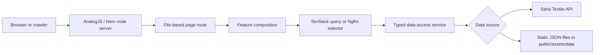

# Storefront orientation

The storefront is the public Saha Textile shop. It is an Angular 22 application hosted by AnalogJS and rendered on the server by Nitro. Routes are file-based, under `apps/storefront/src/app/pages`.

## Recommended reading sequence

1. [Application atlas](./application-atlas): see what exists and which parts are complete.
2. [Routing and rendering](./routing-and-rendering): how a URL becomes a rendered page.
3. [State and data ownership](./state-and-data): choose between TanStack Query, SignalStore, classic NgRx and local signals.
4. [Contributor recipes](./contributor-recipes): step-by-step checklists.

## Mental model

The page layer stays thin. A route identifies the customer journey and composes a feature. The feature owns presentation and interaction. Query and store layers own asynchronous or shared state. Services own transport.

## Capabilities

| Capability      | How it works                                                                                                                                                                     |
| --------------- | -------------------------------------------------------------------------------------------------------------------------------------------------------------------------------- |
| Routing         | About 40 page files, including dynamic slug and catch-all routes                                                                                                                 |
| Rendering       | Dynamic server rendering through Nitro. Nothing is prerendered                                                                                                                   |
| Locale URLs     | Every page is served under `/en/` or `/bn/`. The router base carries the locale                                                                                                  |
| Catalogue       | Home, category pages, cards, product pages and redirects read `/catalog/*`                                                                                                       |
| Search          | The menu-bar search and the Search page share one suggestion box; see [Search](./search.md)                                                                                      |
| First paint     | The header menu renders on the server; product pages show a skeleton while loading                                                                                               |
| Purchase popup  | `/catalog/recent-purchases` shows real sales from the last day, and stays hidden without any                                                                                     |
| Product media   | Cards and the gallery use `ResolvedImage` with `srcset`, and banners use `<picture>`                                                                                             |
| Product gallery | The main photo slider moves on by itself, but holds while the pointer is over a photo (the hover zoom) and while the full-screen gallery, opened by a click or a tap, is showing |
| Cart            | Held and priced by the API at `/cart/current`; classic NgRx mirrors it in the browser                                                                                            |
| Saved lists     | Wishlist hearts saved to the account (a session cookie for guests), and a compare page                                                                                           |
| Content         | Blog, launch and sale countdowns with the event popup, and Contact Us with store cards and a message form                                                                        |
| Authentication  | Verified signup, email or phone sign-in, social sign-in, recovery and guarded account routes                                                                                     |
| Account         | Profile, addresses, sign-in methods, sessions and contact changes use the API                                                                                                    |
| Stock alerts    | **Notify me** on a sold-out variant, with replay after sign-in                                                                                                                   |
| Brand           | Logos, icons, the browser bar colour, footer profiles and app badges come from `/storefront/brand`; a badge shows only when its link is saved                                    |
| Sharing         | The product page's share button uses the phone's share sheet where there is one, else a popover; its apps come from `/catalog/share-settings`                                    |
| Short address   | `/p/<product code>` looks up the slug through `/catalog/code/:code` and answers with a 301 to the product page, for Instagram captions                                           |
| Newsletter      | The popup opens on half-page scroll, after 30 seconds or on desktop exit intent, and never on cart, checkout, account or sign-in pages                                           |
| SEO             | Canonical and `hreflang` tags, `/sitemap.xml`, `/robots.txt`, redirects and `410` answers                                                                                        |
| Home banners    | The hero and the promo row read `/storefront/banners`; see [Home page banners](#home-page-banners)                                                                               |
| Header menu     | Fixed menu entries plus the live category tree; see [Header menu](#header-menu)                                                                                                  |
| Cookie consent  | A first-visit box and a Cookie settings popup; see [Cookie box](#cookie-box)                                                                                                     |

## Installable app

A production build is an installable app on Android, desktop Chrome and Edge, and iPhone and iPad through Add to Home Screen.

- **Manifest.** `/manifest.webmanifest` is built by `src/server/middleware/web-manifest.ts` from the Brand Kit, so a shop's name and icons change without a rebuild. It finds the API through `src/server/api-url.ts`, which reads `SAHA_TEXTILE_PUBLIC_CONFIG`, because Nitro handlers never run Angular's start-up and the shared `environment` keeps its localhost default there. Each language has its own `start_url`, and `id` stays the same, so a browser sees one app. Built-in icons in `public/assets/images/app-icon-*.png` cover a shop with no seal yet.
- **Service worker.** `src/service-worker/sw.ts` builds to `/sw.js` in production only. It has no `fetch` listener, so no request passes through it and nothing is cached.
- **Updates.** `core/pwa/app-update.ts` registers the worker after the page loads and checks for a new build hourly. When one is live, the next in-app link becomes a normal page load. A long-open page that asks for a file the new build removed reloads the same way.
- **Get the App.** The top bar and the footer's Customer Service list share `shared/ui/modal/install-help-modal/install-app.ts`. A browser that has offered to install gets its own prompt, and any other browser gets the how-to popup, with steps for iPhone and iPad, Safari on a Mac, or anything else. The offer's default is left alone, so Android Chrome still shows its install bar. Nothing appears until a shopper clicks, and nothing is stored. Both links carry `hide-when-installed`, a CSS rule on `display-mode: standalone`, so they never flash inside the installed app.
- **Offline work.** New offline features go in `sw.ts` as their own routes. They must never cache API responses, auth, account, cart or checkout data, signed URLs or `/config.json`. Once the worker serves files, revisit taking over at once with `skipWaiting`, because a page could then mix files from two builds.

## Home page banners

`features/home/home.ts` reads the live home banners once through `injectBannersQuery(() => 'home')` (`GET /storefront/banners`). The response holds the admin's hero layout and every live banner, each tagged with a `position` and a `slot`.

| Layout              | Rendered by                                     | Slots                                       |
| ------------------- | ----------------------------------------------- | ------------------------------------------- |
| `hero_full`         | The page's own Owl carousel, one slide per slot | `main`, `slide_2`, `slide_3`, in that order |
| `hero_main_side`    | `app-theme-home-banner`, theme `berlin`         | `main`, `side`                              |
| `hero_main_stack`   | `app-theme-home-banner`, theme `paris`          | `main`, `side_top`, `side_bottom`           |
| `hero_center_sides` | `app-theme-home-banner`, theme `tokyo`          | `main`, `left`, `right`                     |

- Banners for other layouts can be live at the same time. Only the slots of the chosen layout are read (`HERO_LAYOUT_TILES`), so switching the layout in admin needs no clean-up.
- With no live hero banner the section is left out and the page starts at its first product row. The promo row (`promo_wide`, slots `item_1` and `item_2`) follows the same rule.
- `app-image-link` renders each banner as a `<picture>` with desktop, tablet and phone sources. The first slide carries the loading priority, so the hero is in the server's HTML and nothing shifts after hydration.
- Slots and image rules are defined in `packages/contracts/src/content-block.ts` and edited on the admin **Home banners** screen; see [banner rules](../admin/forms-tables-and-crud.md#banner-rules).

## Header menu

`shared/ui/menu/menu.ts` builds the menu as one signal, so the server renders the same links the browser shows.

- **Fixed entries** come from `shared/data/menu.ts`: Home, Product, Mega Menu, Blog, Videos and Pages, with their child pages.
- **Categories.** Once `injectCategoriesQuery()` resolves, the top-level branches of the live category tree are added after Home, each placed once under its canonical parent. From 1200 px wide the tree is the full three-level flyout. Below that, the offcanvas menu shows two levels plus a **View all** link, because the theme's offcanvas cannot nest deeper.
- **Product links.** Entries whose path starts with `product/` are rewritten in turn to real product slugs from the home rails query (`injectHomeRailsQuery()`, shared with the home page), so they never point at a missing product. Until that query answers they keep their written paths. The Mega Menu picture opens the first of those products, or `/collections` when there is none.
- **Blog post link.** The blog details entry opens the newest live post.

To add a menu entry, add it to `shared/data/menu.ts` with a translation key in both locale files. Do not hard-code a product or post slug: it goes stale when the catalogue changes.

## Cookie box

`shared/ui/cookie` holds the first-visit box and the Cookie settings popup. `core/consent/consent.store.ts` keeps the choice in the `st_consent` cookie, and optional features check `ConsentStore.allows(category)` before they run. The box is never rendered on the server, so a returning visitor sees no flash.

The layout in `scss/components/_cookie_bar.scss` keeps every button label whole at any screen size, language and browser text size:

- Both templates set `--cookie-label-chars` to the length of the longest button label (`longestLabel()`). Buttons are at least that wide, and they stack at equal width when the box is too narrow to hold them side by side. A new language or a longer label needs no stylesheet change.
- Sizes are in `rem`, so the box grows with the browser's text size. The box is at most 23.125rem wide and scrolls inside itself when it would be taller than the screen. On phones it sits above the bottom navigation bar.
- On screens under 30rem tall, such as phones on their side, the whole Cookie settings popup scrolls.

When you change a label or a size, check the box and the popup from 320 px to 4K wide, in both orientations, in every locale and at 200% browser text size. A label may wrap onto a second line but must never be cut off.

## Directory ownership

| Directory                | Owns                                                | Should not own                   |
| ------------------------ | --------------------------------------------------- | -------------------------------- |
| `pages/`                 | URL entry points, route metadata, composition       | Business logic or transport code |
| `features/`              | Customer journeys and feature presentation          | Raw HTTP construction            |
| `data-access/queries/`   | Server-state keys, caching and invalidation         | Reusable visual components       |
| `data-access/services/`  | HTTP calls and response typing                      | Cross-page UI state              |
| `core/catalog/`          | Mapping API catalogue responses to view models      | Page presentation                |
| `core/state/`            | Application-wide client state and effects           | Copies of remote data            |
| `layout/`                | Header, footer and page shells                      | Catalogue or checkout rules      |
| `shared/ui/`             | Reusable presentational components                  | Feature-specific orchestration   |
| `shared/util/`           | Pure helpers                                        | Angular component state          |
| `src/server/middleware/` | Locale redirects, old addresses, sitemap and robots | Page rendering                   |

## Before making a storefront change

- Identify the URL or feature that owns the behaviour.
- Check whether the data is server-owned, browser-owned or component-local.
- Check whether the service reads the API or a JSON file.
- Keep server rendering safe: browser globals need a platform guard.
- Validate external data at the boundary.
- Add tests and update the portal in the same change.

## Limitations

- Checkout is closed: the page says so, and nothing places an order or takes a payment.
- Order history, refunds, wallet, points and notifications read JSON files.
- The newsletter form has no subscribe endpoint.
- Offline catalogue, offline cart and image caching are planned. The service worker has no `fetch` listener until then.

:::warning A finished-looking screen may not be connected
A polished screen can be JSON-backed or have no write path. Check the [state and data page](./state-and-data#data-sources) before you depend on it.
:::
