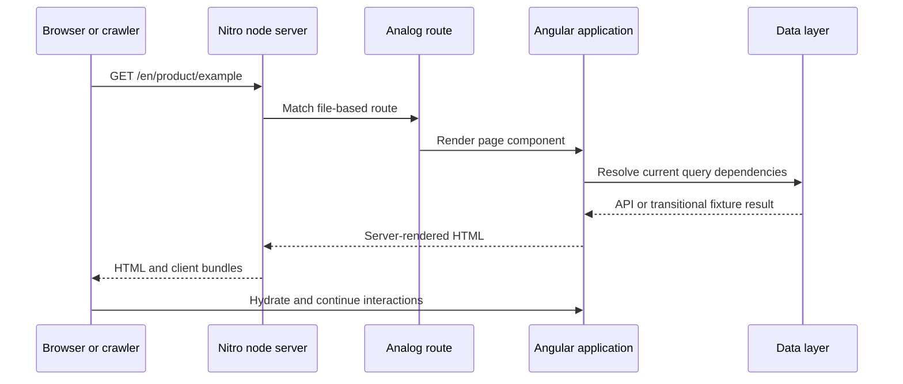

# Storefront routing and rendering

The storefront does not maintain a central Angular `Routes` array. AnalogJS discovers page entry points from filenames below `src/app/pages`, and `provideFileRouter()` installs those generated routes.

## From filename to URL

| File shape                          | URL shape                     | Example                |
| ----------------------------------- | ----------------------------- | ---------------------- |
| `index.page.ts`                     | `/<locale>/`                  | Home                   |
| `cart.page.ts`                      | `/<locale>/cart`              | Cart                   |
| `auth/register.page.ts`             | `/<locale>/auth/register`     | Resumable registration |
| `account/addresses.page.ts`         | `/<locale>/account/addresses` | Saved addresses        |
| `blog/[slug].page.ts`               | `/<locale>/blog/:slug`        | Blog detail            |
| `product/[slug].page.ts`            | `/<locale>/product/:slug`     | Product detail         |
| `collections/[...category].page.ts` | `/<locale>/collections/**`    | Nested category route  |
| `[...not-found].page.ts`            | Catch-all                     | Unknown URL, HTTP 404  |

Brackets create dynamic parameters. Three dots create a catch-all parameter. The `.page.ts` suffix marks a routable page. File paths never contain the locale; it is the router's base (see [Locale URLs](#locale-urls)).

## A page should be an adapter, not a feature dump

A healthy page entry does four small jobs:

1. Imports the feature component.
2. Declares route metadata or guards when needed.
3. Supplies route-derived inputs when appropriate.
4. Exports the feature as the default route component.

```ts title="Conceptual route entry"
import { ScrollPositionGuard } from '@core/guards/scroll-position.guard';
import { Collections } from '@features/shop/collection/collection';

export const routeMeta = { canActivate: [ScrollPositionGuard] };
export default Collections;
```

Keep querying, filtering, mutation, and presentation orchestration inside the appropriate feature/data layer.

The registration route carries both guards. `guestOnlyGuard` keeps a signed-in customer on `/account/dashboard`. Its `canDeactivate` guard distinguishes in-app abandonment from a browser reload. Leaving discards server-held pending signup state without blocking navigation; reload does not run the guard and the page resumes through `GET /auth/storefront/signup`. Login, one-time-code, and forgot-password use the same guest-only activation guard.

## Locale URLs

The locale URL law is locked (owner log § Locale URLs, 2026-10-31) and implemented. Every page is served under its language — `/en/…`, `/fr/…` — private routes included.

**The locale is the router's base, not a route segment.** `provideLocaleRouting()` (`core/i18n/locale-routing.ts`) sets Angular's `APP_BASE_HREF` to `/<locale>`, read once from the requested URL (`ACTIVE_LOCALE`). Page files, `routerLink`s, menu data and `navigateByUrl` calls therefore stay locale-free (`/cart`, `/product/<slug>`), and `Location` adds and strips the prefix. The document's `<base href="/">` is unchanged, so relative asset URLs still resolve from the site root. Never write `/en/` into a link — the base adds it.

**Server rendering is in the page's language.** The same initializer loads that locale's dictionary before the first render and sets `<html lang>`. A dictionary that fails to load does not fail the render; the page falls back to Transloco's missing-key handling.

**Redirects run before rendering** (`src/server/middleware/locale.ts`, rules in `localeRedirectFor()` in `core/i18n/locale.ts`, shared with the app):

| Request                                                                | Answer                                                                                           |
| ---------------------------------------------------------------------- | ------------------------------------------------------------------------------------------------ |
| `/`                                                                    | `302` to the `st_locale` choice, else `/en/`; `Cache-Control: private, no-store`, `Vary: Cookie` |
| `/en`, `/fr`                                                           | `301` to `/en/`, `/fr/` (one home address)                                                       |
| Any unprefixed page, e.g. `/cart`                                      | `301` to `/en/cart`, query kept                                                                  |
| `/de/…` (unsupported language)                                         | Treated as unprefixed: `301` to `/en/de/…`                                                       |
| Assets, `/api/*`, `/_analog/*`, dev internals, files with an extension | Untouched                                                                                        |

There is no redirect on browser language or IP. Legacy WooCommerce paths that survive unchanged are covered by the unprefixed rule; renamed ones wait for the `seoRedirects` map.

**The switcher is a set of real links** (`layout/header/widgets/language`): each option links to the same page under the other prefix, so choosing a language is a full navigation the server renders, and clicking records the choice in the `st_locale` cookie — the only thing `/` consults.

**Head tags** (`LocaleSeo`, `core/i18n/locale-seo.ts`): every public page gets a canonical in its own language plus reciprocal `hreflang` for each locale and `x-default` → `/`, refreshed on every navigation. Private paths (`/account`, `/auth`, `/cart`, `/checkout`, `/wishlist`, `/compare`, `/search`) get `noindex,follow` and no alternates. A page that knows its canonical better calls `setCanonicalPath()` — the collection page does, so an extra-placement category points everything at its home path. Not-found pages (the catch-all and `/404`, where an unknown product slug also lands) export `routeMeta = notFoundRouteMeta`: they get the same `noindex` treatment, and the server answers them with HTTP `404` instead of a `200` page claiming itself as canonical.

Development gotcha: Analog loads `src/server/middleware/*.ts` **without compiling TypeScript** in dev, so a type annotation or `import type` there crashes the server. Keep middleware to syntax that is valid JavaScript.

## Rendering mode



Current configuration:

- SSR is enabled.
- Static-site generation is disabled.
- No routes are prerendered.
- Nitro targets a Node server.
- Link crawling during prerender is disabled.

## Browser-only safety

Code executed during SSR cannot assume `window`, `document`, browser storage, media APIs, or DOM-dependent libraries exist.

Use an explicit guard at the narrowest possible boundary:

```ts
if (isPlatformBrowser(this.platformId)) {
	// Browser-only library or DOM behavior.
}
```

Prefer rendering a stable server-safe structure and enhancing it in the browser. Avoid returning entirely different markup unless the feature genuinely cannot render on the server.

## Current SSR caveat

The storefront server interceptor returns an empty placeholder response for intercepted HTTP requests during server rendering. That is a transitional seam, not a final data-loading architecture. Until it is replaced, verify both:

- direct SSR navigation; and
- client-side navigation after hydration.

## Adding a route safely

1. Choose the correct URL and filename.
2. Reuse or create a feature component outside `pages/`.
3. Add guards through `routeMeta` only when the route needs them.
4. Read dynamic parameters through the established Angular/Analog route API.
5. Test direct navigation, client navigation, refresh, unknown parameters, and mobile layout.
6. Update this portal when the route introduces a new ownership or data boundary.
