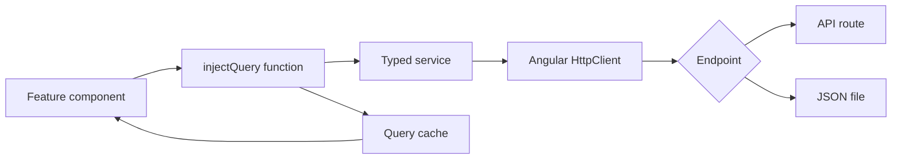
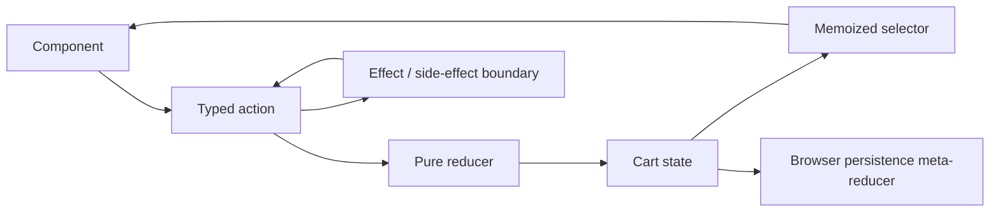

# Storefront state and data ownership

The storefront uses more than one state tool. To choose, ask who owns the value, how it changes and how long it lives.

## Decision table

| State shape                      | Default owner                  | Examples                                              |
| -------------------------------- | ------------------------------ | ----------------------------------------------------- |
| Server-owned records and lists   | TanStack Angular Query         | Products, categories, countries, orders, reviews      |
| Small application state          | NgRx SignalStore               | Authentication, account, settings, site configuration |
| Heavily mutated browser workflow | Classic NgRx store and effects | Cart, wishlist, compare                               |
| One-component interaction        | Local signal or form state     | Expanded panel, selected tab, form field              |
| HTTP construction                | Typed service                  | Product, order, page and notification services        |

## Server-state path

Query functions own keys, enablement, cache duration, selection and invalidation. Services own URLs and response types. Components consume query state and do not rebuild cache keys.

Each server render gets its own query client, so one visitor's data cannot reach another. Public requests pass through Angular's HTTP transfer cache, so the browser reuses the server's response. `isPublicRequest` in `core/query/query-client.ts` defines which ones.

The server also writes finished public queries into the page, and the browser hydrates them. An allow-list of query roots (`isPublicQuery`) decides what is shipped, so a new personal query stays out by default. Queries are fresh for 30 seconds, and a `4xx` answer is not retried. A server render stays open while any query is fetching, so crawlers receive the data.

## Data sources

| Source                       | Services                                                                                                                                                                                                                                                      |
| ---------------------------- | ------------------------------------------------------------------------------------------------------------------------------------------------------------------------------------------------------------------------------------------------------------- |
| API                          | `product`, `questions-answers`, `account`, `account-address`, `contact-change`, FAQ in `page`, banners in `banner.queries`, stock alerts, review submission and photo upload, sign-in through `core/auth`                                                     |
| JSON in `public/assets/data` | `attribute`, `blog`, `cart`, `category`, `compare`, `country`, `coupon`, `currency`, `notification`, `order`, `order-status`, `page`, `payment-details`, `point`, `refund`, `review`, `setting`, `site-config`, `state`, `store`, `tag`, `wallet`, `wishlist` |

Always trace the exact query and service method before you edit a screen.

`core/catalog/from-api.ts` maps API catalogue responses to the view models that product cards and pages use.

## Classic NgRx path

The cart needs explicit events and derived state because customers can add, remove, increment, decrement, replace, persist and optimistically update items from many places.

This is a client cart. Ids and totals can originate in the browser, and authoritative price and stock checks belong to the backend.

## SignalStore path

SignalStore suits a compact state object with colocated methods. Examples include auth, account, loader, settings and site configuration.

Use it when:

- The browser owns the state.
- Several components need reactive reads.
- Methods form a small, coherent API.
- Classic event and effect ceremony would add no clarity.

## Runtime configuration

`core/config/runtime-config.ts` loads `/config.json` at startup and fills a mutable `runtimeConfig` singleton, plus the `environment` object that services read for `apiUrl`. Only non-secret values live there. In deployments the edge Nginx serves the real file. The server side reads `SAHA_TEXTILE_PUBLIC_CONFIG`.

## Session and HTTP behaviour

- The auth interceptor sends `withCredentials: true`, and sends the CSRF token as `x-csrf-token` on unsafe methods. The token comes from the API's reply and is held in memory.
- Session state comes from `GET /auth/storefront/me`, resolved by an app initializer before routing. It is never stored in the browser.
- A pending signup stays on the server. The registration route reads its safe projection after a reload, and discards it when the visitor leaves within the app.
- `@saha-textile/http-transport` provides single-flight refresh, cross-tab locks, CSRF recovery, request ids and error mapping.
- Repository lint guards reject bearer tokens, browser token storage and cross-audience calls.

## Text and translations

Transloco owns interface text such as actions and status messages, with paired English and French keys. Catalogue option, add-on, attribute, taxonomy and measurement labels are data: render them as the API supplies them, and do not create translation keys for them.

Repeated templates track stable entity ids. Presentation-only lists with no unique identity use their position.

## Errors: screen-owned refusals versus toasts

`GlobalErrorHandlerInterceptor` shows a toast for unexpected failures, but not for a domain refusal. A domain refusal is an API error whose issues all have `path: ['request']` and a stable `code`, such as `otp_invalid`, `signup_identifier_taken` or `last_credential`. `isDomainRefusal` from `@saha-textile/http-transport` recognises it. The screen that made the request shows the code as a translated sentence beside the control. Field validation issues and transport failures keep their toast.

## Cache ownership rules

- Query keys are internal contracts. Keep them stable and structured.
- Invalidate the narrowest affected query after a write.
- Do not copy query results into SignalStore just to make them global.
- Do not cache personalized or sensitive data indefinitely.
- Do not persist authoritative prices without server revalidation.

## When the API replaces a JSON source

1. Define or reuse the zod contract in `packages/contracts`.
2. Update the typed service method.
3. Keep the query key stable unless the resource identity changes.
4. Map contract output to a view model only when presentation needs it.
5. Add error, empty, retry and loading coverage.
6. Remove the old JSON path.
